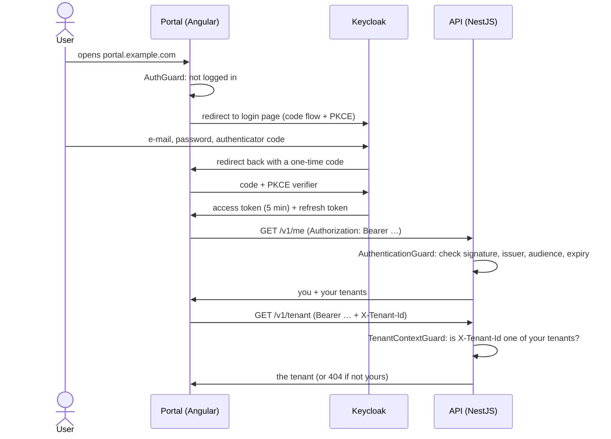

# Module 1: login with Keycloak

This module answers one question on every request: **who is calling, and which tenant are they working in?** Keycloak proves who someone is. The API checks that proof and picks the tenant from the person's own memberships, never from the URL. What a person may do (roles and permissions) is module 2.

> **Since module 2**, tenants and memberships come from the Wattwisely database instead of the token's `organization` claim, so steps f and g below were replaced. See [2-roles-permissions.md](2-roles-permissions.md).

Stories covered: ACC-01 (staff login with two-factor), ACC-04 (switch between tenants), and the base of SEC-01 (Keycloak records every login, failed login and logout).

## The flow at a glance

## Read the code in this order

### 1. Portal starts and sends you to Keycloak

| Step | File                                   | What it does                                                                                                                          |
| ---- | -------------------------------------- | ------------------------------------------------------------------------------------------------------------------------------------- |
| 1    | `apps/portal/src/main.ts`              | Reads `/config.json`, then starts Angular                                                                                             |
| 2    | `core/config/runtime-config.loader.ts` | Downloads `/config.json` (API and Keycloak addresses). The Docker image writes this file at start-up, so one image runs on any server |
| 3    | `app.config.ts`                        | Registers the router, HTTP client, the interceptor and `AuthService.initialize()` to run before the first page                        |
| 4    | `core/auth/auth.service.ts`            | The only class that talks to Keycloak: configure, finish a login, log in, log out, give the token                                     |
| 5    | `core/auth/auth-config.factory.ts`     | The OpenID Connect settings: code flow with PKCE, scopes, where to return after login and logout                                      |
| 6    | `app.routes.ts`                        | Every page sits under `AuthGuard`; workspace pages also need `WorkspaceGuard`                                                         |
| 7    | `core/auth/auth.guard.ts`              | Not logged in? Send the browser to Keycloak, remembering the page you wanted                                                          |

All portal paths above are under `apps/portal/src/app/`.

### 2. Keycloak checks you

Keycloak is configured by one file, `deploy/keycloak/realm/wattwisely-realm.json`, imported the first time Keycloak starts:

| Setting                                          | Value                         | Why                                                                                         |
| ------------------------------------------------ | ----------------------------- | ------------------------------------------------------------------------------------------- |
| `organizationsEnabled`                           | true                          | Each tenant is a Keycloak organization. Tenants can later bring their own SSO               |
| `CONFIGURE_TOTP` as default action               | on                            | Two-factor login is required (ACC-01). New users set up an authenticator app at first login |
| `bruteForceProtected`, `failureFactor`           | 5 failures in 15 min          | Locks the account for 15 minutes (ACC-01 edge case)                                         |
| `ssoSessionIdleTimeout`, `ssoSessionMaxLifespan` | 30 min, 12 h                  | Session limits from ACC-01                                                                  |
| `accessTokenLifespan`                            | 5 min                         | A stolen token stops working quickly; the portal renews it with the refresh token           |
| `eventsEnabled`                                  | on                            | Logins, failed logins and logouts are recorded for the audit log                            |
| Client `wattwisely-portal`                       | public, PKCE S256             | The browser app holds no secret                                                             |
| Mapper "wattwisely-api audience"                 | `aud: wattwisely-api`         | The API only accepts tokens meant for it                                                    |
| Mapper "tenant memberships"                      | `organization` claim with ids | Lists the user's tenants inside the token                                                   |
| Client `wattwisely-api`                          | bearer-only                   | The API's identity; nobody logs in with it                                                  |

The portal asks for the scope `organization:*`, which puts **all** the user's tenants in the token. Plain `organization` would make Keycloak ask the user to pick one tenant at login.

### 3. Back in the portal: load the user and pick a tenant

| Step | File                                    | What it does                                                                                                                 |
| ---- | --------------------------------------- | ---------------------------------------------------------------------------------------------------------------------------- |
| 8    | `core/tenant/workspace.guard.ts`        | Loads the user once, then: no tenant → "No workspace" page; several and none chosen → tenant picker; otherwise open the page |
| 9    | `core/tenant/user-loader.service.ts`    | Calls `GET /v1/me` the first time it is needed                                                                               |
| 10   | `core/api/me-api.service.ts`            | The HTTP call itself                                                                                                         |
| 11   | `core/auth/api-auth.interceptor.ts`     | Adds `Authorization: Bearer …` and `X-Tenant-Id` to calls to our API, and only to our API                                    |
| 12   | `core/tenant/tenant-context.service.ts` | Holds the user and the chosen tenant. Opens the last tenant used, or the only one (ACC-01)                                   |
| 13   | `layout/tenant-switcher.component.ts`   | Switching reloads the page so nothing from the old tenant stays on screen (ACC-04)                                           |

### 4. The API checks every request

Two global guards run before every controller, in this order. Both are registered in `apps/api/src/common/auth/auth.module.ts`.

**Guard 1: who is calling?** `common/auth/authentication.guard.ts`

| Step | File                                        | What it does                                                                                                                                               |
| ---- | ------------------------------------------- | ---------------------------------------------------------------------------------------------------------------------------------------------------------- |
| a    | `common/auth/route-access.reader.ts`        | Skips the check on routes marked `@RouteAccess.public()` (health checks)                                                                                   |
| b    | `common/auth/bearer-token.extractor.ts`     | Reads the token from the `Authorization` header, or answers 401 `token_missing`                                                                            |
| c    | `common/auth/keycloak-token.verifier.ts`    | Checks the signature with Keycloak's public keys, plus issuer, audience and expiry. Answers 401 `token_invalid` otherwise. No call to Keycloak per request |
| d    | `common/auth/keycloak-key-set.provider.ts`  | Downloads and caches Keycloak's public keys                                                                                                                |
| e    | `common/auth/authenticated-user.factory.ts` | Turns the token into an `AuthenticatedUser`                                                                                                                |
| f    | `common/auth/organization-claim.parser.ts`  | Reads the tenants out of the `organization` claim                                                                                                          |

**Guard 2: which tenant?** `common/tenant/tenant-context.guard.ts`

| Step | File                                          | What it does                                                                                                                                                                               |
| ---- | --------------------------------------------- | ------------------------------------------------------------------------------------------------------------------------------------------------------------------------------------------ |
| g    | `common/tenant/tenant-membership.resolver.ts` | With `X-Tenant-Id`: must be one of your tenants, otherwise 404 `tenant_not_found`, so strangers cannot even learn a tenant exists. Without it: allowed only if you have exactly one tenant |

Routes are **private and tenant-scoped by default**. A route has to opt out explicitly with `@RouteAccess.public()` or `@RouteAccess.withoutTenant()` (see `common/auth/route-access.decorator.ts`). Forgetting a decorator can only make a route stricter, never open it up.

**Then the controller.** It receives the result through `@CurrentAuth()` and follows the usual line: controller → service → DTO.

| Endpoint                            | Files              | Needs a tenant                        |
| ----------------------------------- | ------------------ | ------------------------------------- |
| `GET /health/live`, `/health/ready` | `modules/health/`  | No login at all                       |
| `GET /v1/me`                        | `modules/me/`      | No: works before a tenant is chosen   |
| `GET /v1/tenant`                    | `modules/tenancy/` | Yes: the first tenant-scoped endpoint |

**Errors.** Anything thrown ends in `common/problem/problem-details.filter.ts`, which answers with RFC 9457 `application/problem+json`: `type`, `title`, `status`, `detail`, a stable `code` and the `request_id` that also appears in the logs.

### 5. Logging out

`AuthService.logout()` ends the Keycloak session too, then Keycloak sends the browser back to the portal, which shows the login page again.

## Tests

| Test                                               | What it proves                                                                                                                                                       |
| -------------------------------------------------- | -------------------------------------------------------------------------------------------------------------------------------------------------------------------- |
| `apps/api/src/app.module.spec.ts`                  | The real API in memory, with a fake Keycloak: no token → 401, forged token → 401, `/v1/me` lists tenants, `X-Tenant-Id` switches tenant, someone else's tenant → 404 |
| `common/auth/keycloak-token.verifier.spec.ts`      | Wrong audience, wrong issuer and expired tokens are refused                                                                                                          |
| `common/tenant/tenant-membership.resolver.spec.ts` | Every tenant rule from ACC-04                                                                                                                                        |
| `common/auth/organization-claim.parser.spec.ts`    | Every shape Keycloak uses for the `organization` claim                                                                                                               |
| `apps/portal/.../tenant-context.service.spec.ts`   | Last-used tenant, only tenant, picker when unsure                                                                                                                    |
| `apps/portal/.../api-auth.interceptor.spec.ts`     | The token goes to our API and never to other sites                                                                                                                   |

The whole flow was also checked in a real browser against the Docker stack: login with password and authenticator code, tenant picker, switching tenants, logout, and the "No workspace" page.

## Not in this module

| What                                                                 | Where              |
| -------------------------------------------------------------------- | ------------------ |
| Roles, permissions, site scoping (`chargers:command` etc.)           | Module 2           |
| `tenants` and `user_accounts` tables, row-level security in Postgres | Module 2           |
| Inviting team members, removing access within 60 s                   | Module 2           |
| Audit log table and screen                                           | Module 2 and later |
| Driver login and guest QR tokens                                     | Driver modules     |
