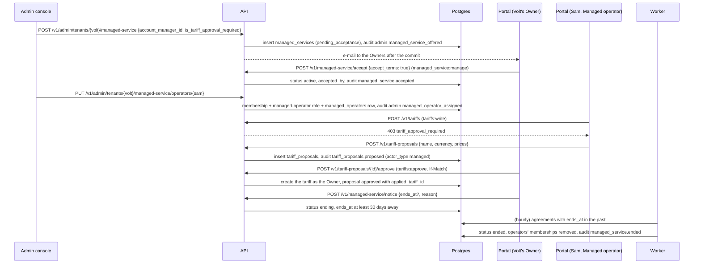

# Module 10: managed tenants

Module 9 let Wattwisely staff run the platform from the admin console. Some operators do not want to run their own charging at all: they want Wattwisely to watch the chargers, set the prices and handle refunds for them. This module adds that **managed service tier** (stories MGT-01 to MGT-05). Staff offer an agreement from the console; the tenant's **Owner accepts it** in the portal; staff then work inside the tenant as **Managed operators**, a reserved role that only the console assigns. Everything they do is labelled **"Wattwisely"** in the tenant's audit log. Their tariff changes become **proposals** the Owner approves or rejects. A **monthly service report** sums up what the chargers did and what Wattwisely changed, and either side can **end the service with 30 days' notice**, after which the worker takes the operators out. Managed payments and the platform's ledger are milestone 2 and not part of this module.

Stories covered: support offers "Volt Hotels" the managed service with Sam as account manager, and its Owner gets an e-mail; nothing changes until the Owner reads the offer under Settings, Managed service, and accepts it; staff then put Sam in as Managed operator, and Sam appears in Volt's team as "Wattwisely" with no menu to change or remove him; Sam proposes a new tariff, the Owner is e-mailed, approves it, and the tariff is created as the Owner's own change, while a rejected proposal keeps the Owner's comment; when the agreement says tariff changes need no approval, Sam changes prices directly and the Owners are told by e-mail; Volt's audit log can show only what Wattwisely did; the Owner reads last month's report with sessions, energy, revenue, refunds, restarts and faults per charger, and the tariff changes; the Owner gives notice, the service shows "Ending" with its date, and the day after, Sam's access is gone; a staff member who leaves Wattwisely loses every managed tenant at once.

## What changed since module 9

| Before (module 9)                                                         | Now (module 10)                                                                                                                                                                                                                       |
| ------------------------------------------------------------------------- | ------------------------------------------------------------------------------------------------------------------------------------------------------------------------------------------------------------------------------------- |
| Every tenant ran its own charging                                         | `managed_services`: one agreement per tenant at a time, `pending_acceptance` → `active` → `ending` → `ended`, or `withdrawn` before acceptance. The tier is not a column: a tenant is managed while an agreement is active or ending  |
| Staff could only act inside a tenant through the console (`platform`)     | `managed_operators` and the system role `managed-operator` (migration 0016): staff become real members of the tenant, with a role the tenant cannot give, change or take away (403 `role_reserved`, 403 `managed_operator_protected`) |
| `actor_type` had `user`, `api_key`, `support`, `system`, `platform`       | Also `managed`: `AuditRecorder` writes it when the caller holds the Managed operator role, and `GET /v1/audit-log?actor_type=managed` shows only Wattwisely's actions                                                                 |
| A tariff change with `tariffs:write` applied at once                      | `tariff_proposals` and `tariffs:approve` (Owner only): a Managed operator's change is refused with 403 `tariff_approval_required` and goes through `POST /v1/tariff-proposals` instead, unless the agreement says otherwise           |
| `GET /v1/me/permissions` carried roles, permissions, plan, locked modules | It also carries `managed_service` (status, `is_operator`, `is_tariff_approval_required`, account manager, end date) or null, so the portal can show the badge, the offer banner and the proposal flow without another call            |
| Removing a staff member ended their console access                        | It also removes them from every tenant they operate, in the same transaction                                                                                                                                                          |
| The worker priced sessions and released holds                             | It also ends agreements whose notice ran out (`ManagedServiceEndJob`, hourly by default)                                                                                                                                              |
| The console's tenant page had Plan & billing, Owners, Modules             | It also has a Managed service card (offer, change the terms, withdraw, give notice, add and remove operators) and a service report page                                                                                               |
| The portal's Settings had Branding and Plan                               | Also Managed service (`/settings/managed-service`), a "Managed by Wattwisely" badge in the top bar, Tariffs, Proposed changes, and "Wattwisely" marks in the team and the audit log                                                   |

## The flow at a glance



## Design decisions for M1

| Decision                                                                                                                                                                                                                                                                                                                                                                                                       |
| -------------------------------------------------------------------------------------------------------------------------------------------------------------------------------------------------------------------------------------------------------------------------------------------------------------------------------------------------------------------------------------------------------------- |
| **Managed operators are members, not a back door.** Platform access (module 9) bypasses the tenant's roles; a managed tenant should see exactly who works in it and with which permissions. So a Managed operator is an ordinary membership with a reserved system role, and every existing guard, row-level security policy and audit entry applies unchanged                                                 |
| **The role is reserved, both ways.** The tenant cannot assign `managed-operator`, nor change or remove a member who holds it; the console cannot give an operator any other role. Only `PUT`/`DELETE …/managed-service/operators/{staffId}`, the end of the service and the removal of the staff member touch it                                                                                               |
| **The Owner decides, in the portal.** An agreement is only an offer until an Owner accepts it with `accept_terms: true`; only an Owner (`managed_service:manage`) gives the tenant's notice. Notice needs the tenant to keep an Owner of its own (409 `own_owner_required`), so a tenant never ends up run by nobody                                                                                           |
| **Thirty days' notice, from either side.** `ManagedNoticePolicy` puts the end exactly 30 days out when no date is given and refuses an earlier one (422 `notice_too_short`). During notice the status is `ending` and everything keeps working; the worker ends the agreement when the date passes. Withdrawing is only for an offer nobody accepted                                                           |
| **Tariff approval is a property of the agreement.** `is_tariff_approval_required` (default true) decides whether a Managed operator's tariff creations and new prices are refused in favour of a proposal. Renames and archiving stay direct. Approving applies the change in the Owner's name with the existing tariff writer, so the price history and the audit log read as if the Owner had typed it       |
| **Owners hear about changes they did not make.** Offers, notice, new proposals and direct tariff changes by a Managed operator are e-mailed to the tenant's active Owners with the tenant's branding (module 8). Mail is sent after the commit, so a rolled-back change never sends one                                                                                                                        |
| **The report uses what the platform already records.** Sessions, energy and revenue come from completed sessions; restarts from BootNotifications; faults from StatusNotifications; refunds from module 6; tariff changes and Wattwisely's action count from the audit log. Uptime needs the connection history, which the gateway does not keep yet; the report says so in `limitations` rather than guessing |
| **The tier is derived, not stored.** `TenantAccess` reads whether an agreement is active or ending with the rest of the tenant's access (one `EXISTS`), so there is no second source of truth to keep in step                                                                                                                                                                                                  |

## Read the code in this order

### 1. The database: `packages/db`

| Step | File                                                                     | What to look at                                                                                                                                        |
| ---- | ------------------------------------------------------------------------ | ------------------------------------------------------------------------------------------------------------------------------------------------------ |
| 1    | `src/schema/managed-services.table.ts`, `enums.ts`                       | The agreement with its status, account manager, approval rule, the offer, acceptance and notice stamps; `managed_service_status`; `managed` actor type |
| 2    | `src/schema/managed-operators.table.ts`                                  | Who works in the tenant, through which membership; a person once per tenant until removed                                                              |
| 3    | `src/schema/tariff-proposals.table.ts`                                   | A proposed tariff or new prices, the Owner's decision and comment, the tariff it produced                                                              |
| 4    | `src/schema/platform-staff.table.ts`                                     | The new policy that lets a tenant see the name of its own account manager                                                                              |
| 5    | `migrations/0015_managed_tenants.sql`, `0016_managed_tenants_grants.sql` | Tables and policies; grants; the `managed-operator` system role and its permissions; `managed_service:manage` and `tariffs:approve` for Owners         |
| 6    | `src/client/database-session.ts`, `src/testing/test-managed.ts`          | `forSystem()` and `forSystemInTenant()` for the worker; `TestManaged` for tests                                                                        |

### 2. The API: `apps/api/src`

| Step | File                                                                                                                   | What to look at                                                                                                              |
| ---- | ---------------------------------------------------------------------------------------------------------------------- | ---------------------------------------------------------------------------------------------------------------------------- |
| 7    | `common/permissions/managed-permissions.ts`, `common/managed/managed-operator-role.ts`, `common/platform/*-catalog.ts` | The two tenant permissions, the reserved role, `tenants:manage_service` for admin and support                                |
| 8    | `common/tenant/tenant-access.repository.ts`, `tenant-summary.ts`, `tenant-access.ts`, `common/audit/audit.recorder.ts` | `serviceTier` from the live agreement; `isManagedOperator`; `actor_type: managed`                                            |
| 9    | `modules/managed/managed-service.writer.ts`, `managed-service.describer.ts`, `managed-notice.policy.ts`                | Offer, accept, notice, withdraw, update with `If-Match`; one description for the tenant and staff (notes only for staff)     |
| 10   | `modules/managed/tenant/*`                                                                                             | `GET /v1/managed-service`, `accept`, `notice`, `report` for the tenant                                                       |
| 11   | `modules/managed/admin/*`                                                                                              | The console's endpoints; `ManagedOperatorAssigner` creates or reuses the membership and swaps its roles for the reserved one |
| 12   | `modules/managed/mail/*`                                                                                               | The four e-mails to Owners, built in the transaction and sent after it                                                       |
| 13   | `modules/managed/report/*`                                                                                             | The month (`2026-05`, last month by default, never the future) and the queries behind the report                             |
| 14   | `modules/tariffs/tariff-approval.rule.ts`, `tariff.writer.ts`, `tariff-changes.service.ts`                             | Where a Managed operator's direct change is refused or announced                                                             |
| 15   | `modules/tariffs/proposals/*`                                                                                          | Proposals: create, list, approve and reject (Owner, `If-Match`), withdraw                                                    |
| 16   | `modules/team/role-assignment.policy.ts`, `member-access.service.ts`, `modules/admin/staff/staff.writer.ts`            | The reserved role kept out of the team page; staff removal cascading to every tenant                                         |
| 17   | `modules/me/me.service.ts`                                                                                             | `managed_service` on `/v1/me/permissions`                                                                                    |

### 3. The worker: `apps/worker/src/managed`

| Step | File                                                     | What to look at                                                                                                                                        |
| ---- | -------------------------------------------------------- | ------------------------------------------------------------------------------------------------------------------------------------------------------ |
| 18   | `managed-service-end.job.ts`, `managed-service.ender.ts` | Every `MANAGED_SERVICE_END_INTERVAL_MS` (an hour): end due agreements one tenant at a time, take the operators out, log it as "Wattwisely (automatic)" |

### 4. The admin console: `apps/admin/src/app`

| Step | File                                                                                                                        | What to look at                                                                  |
| ---- | --------------------------------------------------------------------------------------------------------------------------- | -------------------------------------------------------------------------------- |
| 19   | `core/api/managed-service-api.service.ts`, `core/api/models/managed-service.ts`                                             | The endpoints and models                                                         |
| 20   | `features/tenants/tenant-managed-service.component.*`, `managed-service.store.ts`                                           | The card: status, account manager, operators, and the actions each status allows |
| 21   | `features/tenants/managed-service-dialog.component.ts`, `assign-operator-dialog.component.ts`, `service-report.component.*` | The terms, choosing a colleague as operator, the monthly report                  |

### 5. The portal: `apps/portal/src/app`

| Step | File                                                                                                                | What to look at                                                                                              |
| ---- | ------------------------------------------------------------------------------------------------------------------- | ------------------------------------------------------------------------------------------------------------ |
| 22   | `core/permissions/permissions.service.ts`                                                                           | `managedService`, `isManaged`, `isManagedOperator`, `mustProposeTariffs`, and `reload()` after accepting     |
| 23   | `layout/shell.component.*`                                                                                          | The badge, the offer banner for Owners, the Managed service link                                             |
| 24   | `features/settings/managed-service.component.*`, `managed-notice-dialog.component.ts`, `service-report.component.*` | Accept the offer, give notice with a date, read the report month by month                                    |
| 25   | `features/tariffs/tariff-editor.store.ts`, `features/tariffs/proposals/*`                                           | Saving becomes "Propose to the Owner"; the list of proposals; one proposal with approve, reject and withdraw |
| 26   | `features/team/team.component.html`, `features/audit-log/audit-log.component.*`                                     | "Wattwisely" for operators and their entries; "Wattwisely only" filter                                       |

### 6. Deployment: `deploy`

| Step | File                       | What to look at                                                                                                        |
| ---- | -------------------------- | ---------------------------------------------------------------------------------------------------------------------- |
| 27   | `scripts/seed-demo.sh`     | Volt Hotels is managed: accepted by Mia, Sam Support as account manager and Managed operator, tariff approval required |
| 28   | `apps/worker/.env.example` | `MANAGED_SERVICE_END_INTERVAL_MS`; the default works in Docker Compose without a change                                |

### 7. Endpoints

| Endpoint                                                            | Permission               | Notes                                                                                                                                                                    |
| ------------------------------------------------------------------- | ------------------------ | ------------------------------------------------------------------------------------------------------------------------------------------------------------------------ |
| `GET /v1/managed-service`                                           | `settings:read`          | The latest agreement and the operators working now; 404 `managed_service_not_found` for a self-serve tenant                                                              |
| `POST /v1/managed-service/accept`                                   | `managed_service:manage` | `{accept_terms: true}`; 400 `terms_not_accepted`; 409 `managed_service_status_conflict` unless offered                                                                   |
| `POST /v1/managed-service/notice`                                   | `managed_service:manage` | `{ends_at?, reason?}`; 422 `notice_too_short`; 409 `own_owner_required`; only while active                                                                               |
| `GET /v1/managed-service/report?month=YYYY-MM`                      | `settings:read`          | Last month by default; 400 for a future month                                                                                                                            |
| `GET /v1/admin/tenants/{id}/managed-service`                        | `tenants:read`           | With staff notes                                                                                                                                                         |
| `POST /v1/admin/tenants/{id}/managed-service`                       | `tenants:manage_service` | `account_manager_id`, `is_tariff_approval_required`, `agreement_reference`, `notes`; 409 `managed_service_exists`; 422 `staff_not_found`                                 |
| `PATCH /v1/admin/tenants/{id}/managed-service`                      | `tenants:manage_service` | The same fields, each optional; `If-Match`                                                                                                                               |
| `POST /v1/admin/tenants/{id}/managed-service/withdraw`              | `tenants:manage_service` | `If-Match`; only before acceptance                                                                                                                                       |
| `POST /v1/admin/tenants/{id}/managed-service/notice`                | `tenants:manage_service` | `{ends_at?, reason?}`; `If-Match`; the same 30-day rule                                                                                                                  |
| `GET /v1/admin/tenants/{id}/managed-service/report?month=`          | `tenants:read`           | The tenant's report                                                                                                                                                      |
| `GET /v1/admin/tenants/{id}/managed-service/operators`              | `tenants:read`           | The operators working now                                                                                                                                                |
| `PUT /v1/admin/tenants/{id}/managed-service/operators/{staffId}`    | `tenants:manage_service` | `{site_ids?}` limits the operator to those sites; only while active; 409 `already_operator`; 409 `already_member` for a colleague who is already in the team another way |
| `DELETE /v1/admin/tenants/{id}/managed-service/operators/{staffId}` | `tenants:manage_service` | 404 `operator_not_found`                                                                                                                                                 |
| `GET /v1/tariff-proposals?status=`, `GET /v1/tariff-proposals/{id}` | `tariffs:read`           | Newest first, at most 100                                                                                                                                                |
| `POST /v1/tariff-proposals`                                         | `tariffs:write`          | `tariff_id` for new prices, or `name` and `currency` for a new tariff; `prices` as a tariff version takes them; `note`; 409 `not_managed` when the tenant is not managed |
| `POST /v1/tariff-proposals/{id}/approve`, `/reject`                 | `tariffs:approve`        | `{comment}` (required to reject); `If-Match`; 409 `tariff_proposal_decided`                                                                                              |
| `POST /v1/tariff-proposals/{id}/withdraw`                           | `tariffs:write`          | `If-Match`                                                                                                                                                               |
| `GET /v1/me/permissions`                                            | any member               | `managed_service` or null                                                                                                                                                |
| `GET /v1/audit-log?actor_type=managed`                              | `audit:read`             | Only Wattwisely's actions                                                                                                                                                |

## Running it

```sh
cd deploy
./scripts/up.sh --build         # migrations 0015 and 0016 run on start
./scripts/seed-demo.sh          # Volt Hotels becomes a managed tenant with Sam Support as its operator
```

Open <http://portal.localhost> as `support@wattwisely.test` and switch to Volt Hotels: the top bar says "Managed by Wattwisely". Create a tariff: the button reads "Propose to the Owner". Log in as `multi@demo.test` (Volt's Owner), open Tariffs, Proposed changes, and approve it; the audit log's "Wattwisely only" filter shows Sam's proposal. In <http://admin.localhost> as `admin@wattwisely.test`, open Acme Charging and offer it the managed service; `owner@acme.test` sees the offer banner and accepts under Settings, Managed service.

## Tests

| Test                                                                                                         | What it proves                                                                                                                                                                                                        |
| ------------------------------------------------------------------------------------------------------------ | --------------------------------------------------------------------------------------------------------------------------------------------------------------------------------------------------------------------- |
| `apps/api/src/modules/managed/managed-service.flow.spec.ts`, `managed-service-refusals.flow.spec.ts`         | The offer waits for the Owner, who is e-mailed; acceptance; an operator assigned and shown as Wattwisely; the audit label and filter; the reserved role out of the tenant's hands; notice and staff removal; refusals |
| `apps/api/src/modules/tariffs/proposals/tariff-proposals.flow.spec.ts`                                       | A direct change refused and proposed instead; approval creates the tariff or the version in the Owner's name; rejection keeps the comment; without approval the Owners are told                                       |
| `apps/api/src/modules/managed/managed-notice.policy.spec.ts`, `report/report-month.spec.ts`                  | The 30-day rule; the report month                                                                                                                                                                                     |
| `apps/worker/src/managed/managed-jobs.flow.spec.ts`                                                          | Only due agreements end, with their operators removed and an audit entry                                                                                                                                              |
| `apps/api/src/common/permissions/module-catalog.spec.ts`, `permission.guard.spec.ts`                         | The two new permissions belong to a module; the guard with the new tenant summary                                                                                                                                     |
| `apps/portal/src/app/core/permissions/permissions.service.spec.ts`, `features/settings/report-month.spec.ts` | The portal knows when Wattwisely runs the tenant and whose tariff changes need approval; report months                                                                                                                |

## Not in this module

| What                                                                          | Where                                                                                    |
| ----------------------------------------------------------------------------- | ---------------------------------------------------------------------------------------- |
| Managed payments: drivers paying into Wattwisely's Stripe account, the ledger | Milestone 2                                                                              |
| Billing the managed service fee                                               | The invoicing module, with the plan fees                                                 |
| Charger uptime in the report                                                  | Once the gateway keeps a connection history                                              |
| Choosing sites for a Managed operator in the console                          | The API takes `site_ids` on the assignment; the console assigns the whole tenant for now |
| A signed contract document                                                    | `agreement_reference` points to it; storing the PDF is out of scope                      |
