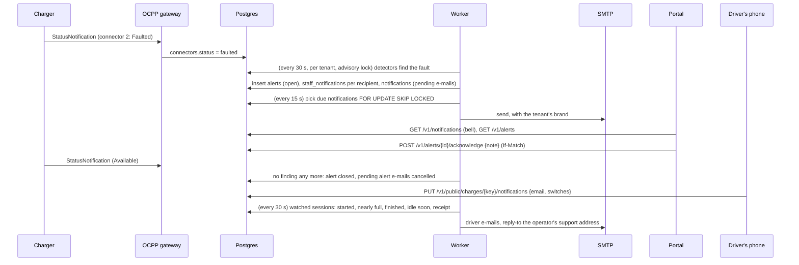

# Module 11: notifications and reports

Until module 10 the platform only spoke when someone looked: a charger that dropped off the network stayed red on its page until a person happened to open it, and a driver had to keep the charge page open to see that charging had finished. This module makes the platform **tell people things**. The worker watches the chargers and opens **alerts** (stories NTF-03 and NTF-04); each tenant decides **who hears about which alert, at which sites, by e-mail or in the portal**; every team member has a **bell** in the portal's top bar and their own **quiet hours**. Drivers can leave an e-mail address on the charge page and get **updates and the receipt** without an account (NTF-01). On the reporting side there is a **usage report** per site or charger with sessions, energy, revenue, utilisation and uptime (RPT-01), **background exports** for files too large to download at once (SES-04), and on plans with Advanced reports, **scheduled reports** e-mailed every Monday or on the 1st.

Stories covered: plug B of the ABB charger at Riverside reports Faulted, and within a minute the Owner and Operations get an e-mail and a line in the bell, while the Technician sees it in the portal only; the Technician acknowledges it with "on site at 14:00", and everyone sees who is on it; the plug comes back, and the alert closes by itself; a charger that keeps dropping in and out within 15 minutes counts its returns on one alert instead of sending a new e-mail each time; Theo sets quiet hours from 22:00 to 07:00, so an offline charger at 23:00 waits for the morning and is dropped if it came back in the night, but a faulted plug is still sent at once; the Owner routes "Repeated start failures" at Depot North to one person only; a driver types an e-mail address while charging, gets "charging started", "nearly full" at 80%, "finished", a warning five minutes before the idle fee, and the receipt; a refused address is flagged on the charge page; the Owner reads last month's usage per site and downloads it as CSV; a session export of 30,000 rows becomes a background file that is e-mailed when ready and kept for seven days; Acme Charging gets its weekly usage report every Monday in the finance team's inbox.

## What changed since module 10

| Before (module 10)                                                | Now (module 11)                                                                                                                                                                                                                                                            |
| ----------------------------------------------------------------- | -------------------------------------------------------------------------------------------------------------------------------------------------------------------------------------------------------------------------------------------------------------------------- |
| A broken charger showed only on its own page                      | `alerts` (migration 0017): `charger_offline`, `connector_faulted`, `session_stuck`, `start_failures`, `reset_no_return`, each `open` → `acknowledged` → `closed`. The worker opens, touches, reopens and closes them; people only acknowledge                              |
| E-mails were sent by the API, inside the request that caused them | `notifications`, an **outbox**: the worker writes a row in the same transaction as the alert or the session change, and `NotificationSendJob` sends it with retries. The API still sends its own few (invitations, managed service) as before                              |
| Nobody chose who heard about what                                 | `alert_rules`: per alert type, a role or one member, at one site or every site, by e-mail and/or in the portal. A type with no rules goes to the default roles. `GET`/`PUT /v1/alert-rules` (settings:read / settings:write)                                               |
| The portal had no notifications                                   | `staff_notifications`: the bell's lines, per member. `GET /v1/notifications`, `POST /v1/notifications/{id}/read`, `POST /v1/notifications/read-all`, for every member                                                                                                      |
| —                                                                 | `member_notification_settings`: quiet hours and their time zone, per member and tenant. `GET`/`PUT /v1/notification-settings`                                                                                                                                              |
| Drivers saw progress only with the page open                      | `session_subscriptions`: one address per charge, with four switches. `GET`/`PUT`/`DELETE /v1/public/charges/{key}/notifications`, proved by the charge key like the rest of the driver's page                                                                              |
| The session CSV was built in the API and capped at 10,000 rows    | `packages/reports` builds every CSV (sessions, usage, audit log). Too many sessions for a direct download still answers 422 `export_too_large`, and the portal now asks for a background export instead                                                                    |
| No reports                                                        | `GET /v1/reports/usage`, `/v1/reports/usage/export`, `/v1/reports/overview` (reports:read); `report_exports` with `POST`/`GET /v1/reports/exports` and `GET …/{id}/download`; `report_schedules` with `GET`/`POST`/`PUT`/`DELETE /v1/reports/schedules` (reports:schedule) |
| The worker priced sessions, settled payments, ended agreements    | Also `AlertScanJob`, `SessionNotifyJob`, `NotificationSendJob`, `ReportExportJob` and `ReportScheduleJob`, and it needs the SMTP settings and the API and portal addresses                                                                                                 |
| The portal's home page showed who you are                         | It also shows tiles for chargers online, open alerts, charging now and the last 24 hours, with reports:read. New pages: Alerts, Reports, Settings > Alert routing; a bell and Quiet hours in the top bar; an export button on the audit log                                |
| The driver's charge page showed the charge                        | It also has an E-mail updates card while the charge is under way                                                                                                                                                                                                           |

## The flow at a glance

## Alerts

| Alert               | Opens when                                                                                                       | Closes when                        |
| ------------------- | ---------------------------------------------------------------------------------------------------------------- | ---------------------------------- |
| `charger_offline`   | A charger that has connected before was last seen more than 60 seconds ago and holds no live gateway connection  | It is connected again              |
| `connector_faulted` | A connector reports Faulted                                                                                      | It reports anything else           |
| `session_stuck`     | A running session has had no meter value for 6 hours, or has been open for 48 hours (SES-05)                     | The session ends or moves again    |
| `start_failures`    | Three or more failed starts on one charger within an hour: refused remote starts and sessions that never started | The last hour has fewer than three |
| `reset_no_return`   | A reset was accepted more than 5 minutes ago and the charger has not booted since (CMD-02)                       | It boots, or a day has passed      |

The detectors are small classes behind one `AlertDetector` interface (`apps/worker/src/alerts/detectors/`); `AlertTracker` compares what they find with the live alerts of the tenant. A finding with no alert opens one; a finding with an alert touches it (`last_seen_at`); an alert with no finding closes. An alert that closed less than **15 minutes** ago is reopened silently, with `occurrences` counting the returns, so a flapping charger sends one e-mail and not twenty. Each tenant is scanned under a Postgres advisory lock, so two worker replicas never open the same alert twice.

**Who hears about it.** `AlertRecipients` reads the tenant's rules for the alert's type; with none, the defaults apply: Owner, Operations and Managed operator by e-mail and in the portal, Technician in the portal only. Either way a person is only told about a site where they hold `alerts:read`, so a technician scoped to Riverside never hears about Depot North. Acknowledging needs `alerts:acknowledge` at the alert's site.

**Quiet hours.** An alert e-mail for someone in their quiet hours is written with `send_after` at the end of them. When it comes due, `NotificationSender` checks the alert again: if it closed in the meantime the e-mail is cancelled. `connector_faulted` ignores quiet hours, as a faulted plug strands drivers. The bell is never held back.

## E-mail delivery

Every e-mail the worker sends goes through the `notifications` outbox, written in the same transaction as the change it is about, with a **dedupe key** (`alert:<id>:<membership>`, `session:<id>:<kind>`, `export:<id>`, `export:<id>:<address>`) and `ON CONFLICT DO NOTHING`, so a job that runs twice cannot send twice. `NotificationSendJob` takes up to 100 due rows with `FOR UPDATE SKIP LOCKED` and sends each through `SmtpMailSender` (the same class the API uses, from `packages/mail`), in the tenant's brand (module 8). A failure is tried again up to 5 times, waiting 60 seconds × 2^attempts; an SMTP 5xx answer is permanent at once. A permanent failure on a driver's address marks the subscription `is_undeliverable`, and the charge page asks for another address.

## Driver e-mails

| E-mail            | Sent when                                                                               | Can be switched off |
| ----------------- | --------------------------------------------------------------------------------------- | ------------------- |
| Charging started  | The session reaches charging                                                            | Yes                 |
| Nearly full       | The car reports a state of charge of 80% or more (only cars that report it)             | Yes                 |
| Charging finished | The session leaves charging for idle, stopping or completed                             | Yes                 |
| Idle fee soon     | 5 minutes before the tariff's idle grace period ends, while the car is still plugged in | Yes                 |
| Receipt           | The session is completed and its payment is settled (or there was nothing to pay)       | No                  |

The address is kept only with that charge. The e-mails carry no link back to the charge page, because the charge key's secret half is never stored; the driver's open page is the way back. Replies go to the operator's support address.

## Reports and exports

`packages/reports` holds the queries and CSV writers the API and the worker share: `SessionCsv` (moved from the API), `UsageReportBuilder` and `UsageCsv`, `AuditLogCsv`, and `ReportCalendar` for schedule dates. Every CSV cell that starts with `=`, `+`, `-`, `@`, a tab or a carriage return is prefixed with an apostrophe, so a spreadsheet never runs it as a formula.

**Usage** (`GET /v1/reports/usage?from&to&group_by=site|charger&site_id`): per site or per charger, the sessions that started in the period, their energy and revenue (per currency), **utilisation** (connector time with a session, as a share of all connector time in the period) and **uptime** (charger time not covered by a `charger_offline` alert), with a totals row. Periods are at most 366 days. The caller's site scope applies.

**Background exports** (`POST /v1/reports/exports {kind, filters}`): sessions (sessions:export), usage (reports:read) or audit log (audit:read). The caller's site scope is frozen into the request, so the file holds what they could see when they asked. A member may have three waiting at once. `ReportExportJob` builds up to five at a time, up to 100,000 rows (`is_truncated` beyond that), stores the CSV gzipped in Postgres and keeps it for **seven days**; then it is emptied and marked `expired`. When it is ready the member gets a line in the bell and an e-mail linking to `/reports?export=<id>`. Only the member who asked can download it.

**Scheduled reports** (advanced_reports: Growth and Enterprise): a usage report, weekly (Monday 00:00 in the schedule's time zone, for the week before) or monthly (the 1st, for the month before), to up to 20 addresses that need no portal account. `ReportScheduleJob` queues an export for the period and moves `next_run_at` on; the e-mail carries the CSV as a gzipped attachment. Creating or changing a schedule needs `reports:schedule` and `reports:read` for the whole tenant.

## Design decisions for M1

| Decision                                                                                                                                                                                                                                                                                                      |
| ------------------------------------------------------------------------------------------------------------------------------------------------------------------------------------------------------------------------------------------------------------------------------------------------------------- |
| **Alerts are derived, not reported.** Nothing in the gateway or the API raises an alert. The worker looks at the state they already store (connections, connector statuses, sessions, commands) and keeps `alerts` in line with it. New alert types are a new detector class, with no change to the OCPP path |
| **People acknowledge; only the platform closes.** An acknowledged alert stays until its problem clears, so nobody can make a real fault disappear by clicking it away                                                                                                                                         |
| **An outbox, not sends in the request.** Mail goes out after the commit and survives a crash or an SMTP outage, retries are one place, and quiet hours are just a later `send_after`                                                                                                                          |
| **Routing replaces the defaults per type.** A tenant that writes a rule for one type keeps the defaults for the others, and `PUT /v1/alert-rules` replaces the whole list in one transaction, as the settings page saves it                                                                                   |
| **Exports live in Postgres for now.** The files are small once gzipped and kept seven days; object storage comes with the hardening module                                                                                                                                                                    |
| **Browser push is left out.** The bell polls every minute. Web push, SMS and per-member e-mail switches are later work                                                                                                                                                                                        |

## Try it

With the local stack and the demo data (`./scripts/seed-demo.sh`), log in as `owner@acme.test`. Within a minute the worker opens alerts for plug B of the ABB charger at Riverside, which the demo marks Faulted, and for the two demo chargers that reported in once but are not connected now; they show on the Alerts page, in the bell and in Mailpit (<http://localhost:8025>). Connect the simulator as `WW-7KQ4M2XR9T` and its offline alert closes. Reports shows the usage of the demo session; Acme Charging also has a weekly usage report scheduled to `owner@acme.test`. On the driver's charge page, give an address under E-mail updates and the receipt arrives in Mailpit when the charge is priced.

## Settings

| Variable (worker)               | Default | What                                                                                         |
| ------------------------------- | ------- | -------------------------------------------------------------------------------------------- |
| `SMTP_HOST`, `SMTP_PORT`, …     | —, 587  | The same SMTP server as the API (`SMTP_FROM`, `SMTP_USER`, `SMTP_PASSWORD`, `SMTP_STARTTLS`) |
| `API_URL`                       | —       | Where tenant logos in e-mails are linked from                                                |
| `PORTAL_URL`                    | —       | Where alert and export e-mails link to                                                       |
| `ALERT_SCAN_INTERVAL_MS`        | 30000   | How often the detectors run                                                                  |
| `SESSION_NOTIFY_INTERVAL_MS`    | 30000   | How often watched sessions are checked for driver e-mails                                    |
| `NOTIFICATION_SEND_INTERVAL_MS` | 15000   | How often the outbox is sent                                                                 |
| `REPORT_EXPORT_INTERVAL_MS`     | 15000   | How often queued exports are built and old ones expired                                      |
| `REPORT_SCHEDULE_INTERVAL_MS`   | 300000  | How often due schedules are queued                                                           |

`deploy/docker-compose.yml` passes the SMTP settings and both addresses to the worker; the intervals use their defaults.
