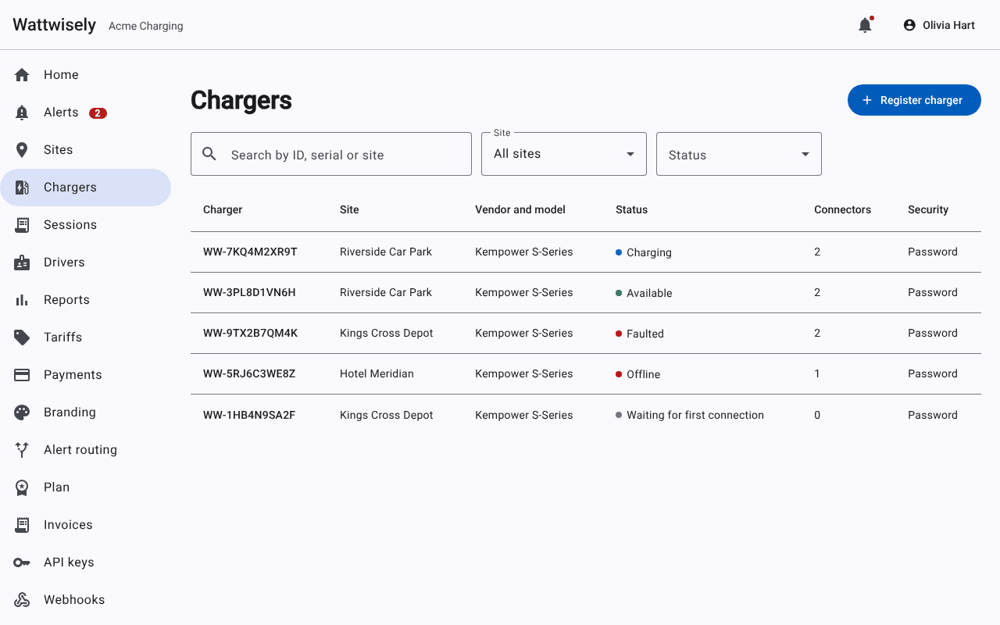
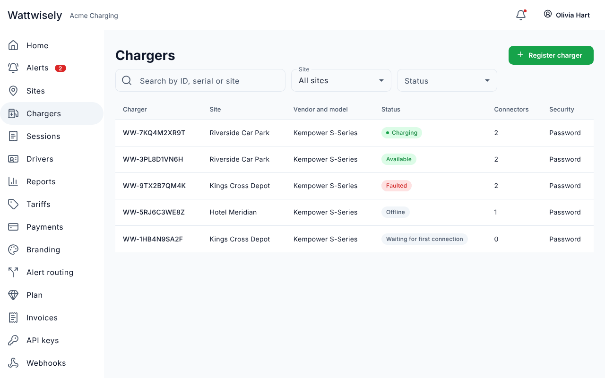
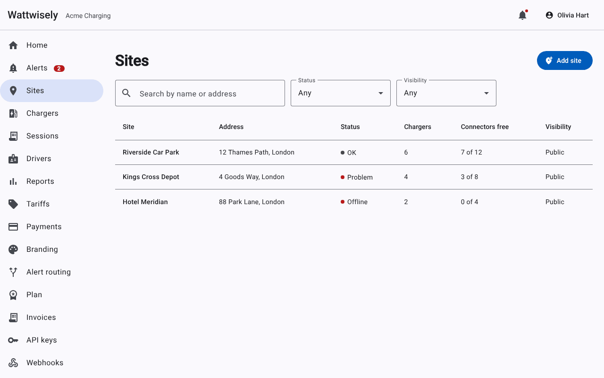
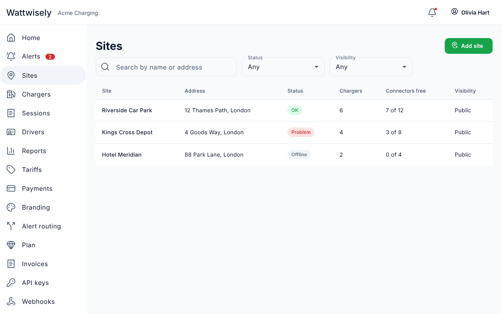
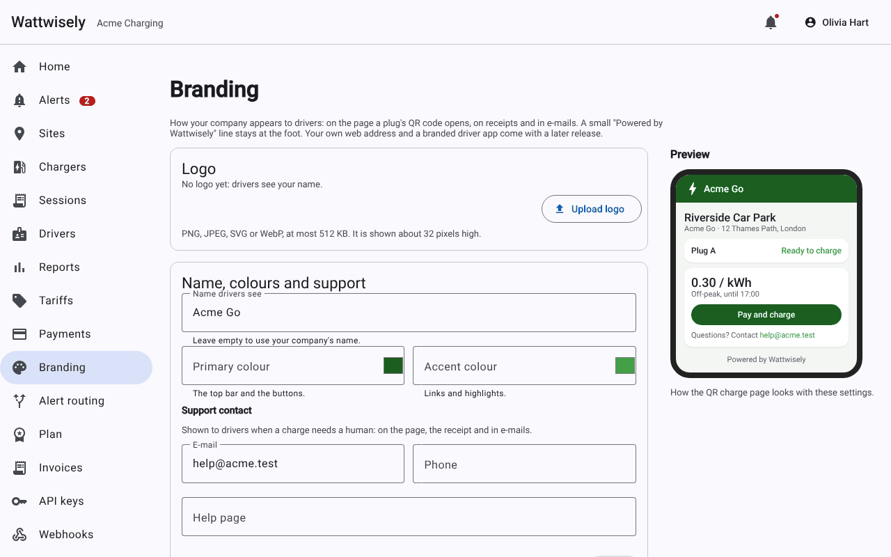
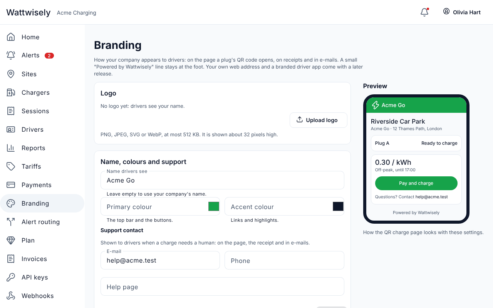
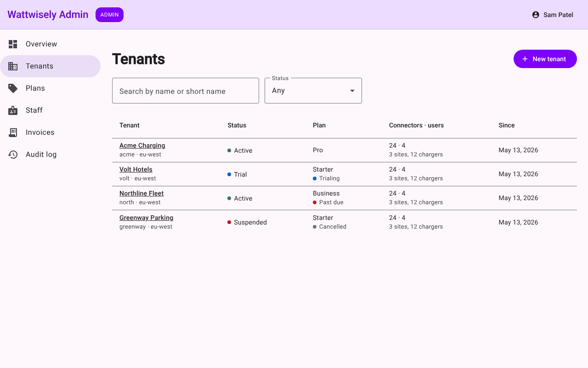
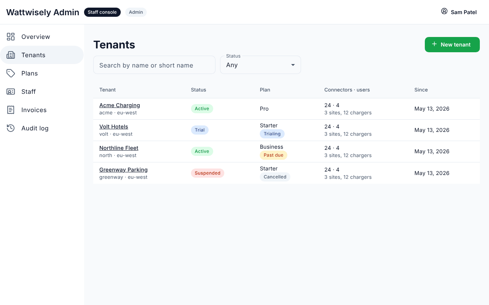
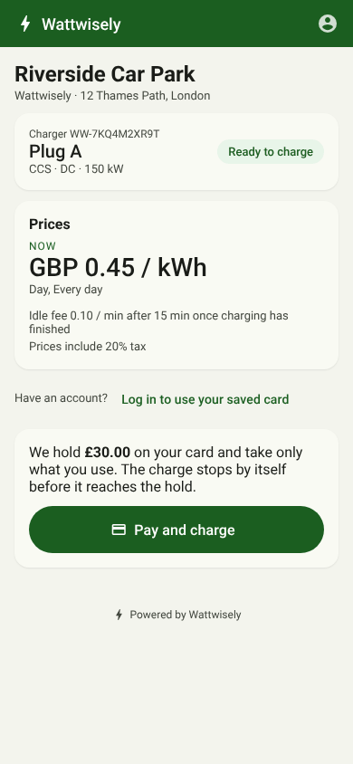
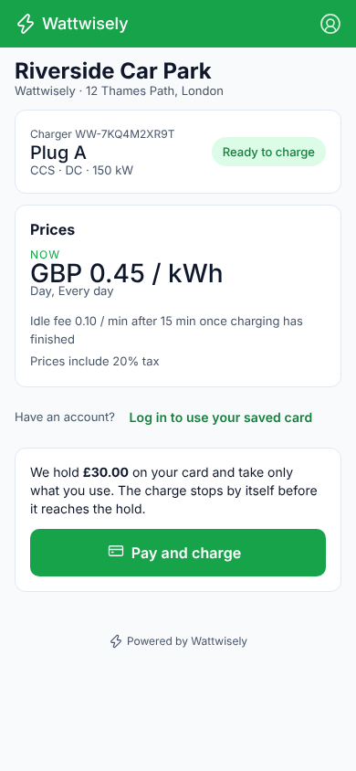

# Module 20: design system and theme.json

The portal, the admin console and the driver app now wear one look. **Every color lives in one file, `packages/theme/theme.json`**, matched to the driver app's design in Figma. Angular Material is themed from it, the type is Inter, the icons are Lucide, and cards, fields, tables, chips, dialogs, menus and tabs take the shapes of the approved screens.

The pages keep their layout, URLs, permissions and `data-testid` attributes: this module changes how things look, not what they do. Modules 22 to 26 redesign the screens on top of it, and module 21 gives Keycloak's login pages and e-mails the same colors.

Stories covered: Olivia opens the portal and sees the green, white and slate of the Wattwisely app instead of Material's default blue; Wattwisely staff open the admin console, which used to be violet, and a "Staff console" chip tells them where they are; Dana scans a plug and the page is green until the operator's brand loads; a designer changes the brand green in `theme.json`, runs one command, and the apps, the e-mails, Stripe's card form and the QR stickers all follow.

## What changed

| Before                                                                                                              | Now                                                                                                                                                                                                                                                                                                                                                                                     |
| ------------------------------------------------------------------------------------------------------------------- | --------------------------------------------------------------------------------------------------------------------------------------------------------------------------------------------------------------------------------------------------------------------------------------------------------------------------------------------------------------------------------------- |
| Each app had its own Material palette: azure for the portal, violet for the admin console, green for the driver app | One theme. `packages/theme/theme.json` names 19 colors (the palette), the Material roles that use them and the colors of each status chip                                                                                                                                                                                                                                               |
| 37 hex values were written into components, print pages, Stripe's options and e-mails                               | Stylesheets read CSS variables from `tokens.css`; code that cannot read CSS (e-mails, Stripe, the QR sheet, default brands, API examples) reads `PlatformColours`. Both are generated from theme.json. The only hex left in the apps are the two placeholders on the branding page and the driver app's `theme-color` meta tag, which BrandService rewrites whenever it applies a brand |
| Roboto and the Material Icons font loaded from Google Fonts                                                         | Inter and JetBrains Mono are bundled (`@fontsource-variable/inter`, `@fontsource/jetbrains-mono`). The apps make no request to Google                                                                                                                                                                                                                                                   |
| `<mat-icon>bolt</mat-icon>`: icon names were font ligatures                                                         | `<mat-icon svgIcon="zap" />`: 74 Lucide icons (`lucide-static` 1.55) registered with Material's icon registry at start-up. The 172 icons in the templates moved over by the table below                                                                                                                                                                                                 |
| Material's defaults: pill buttons, raised cards, 56px fields                                                        | `packages/ui`: 10px corners on buttons and fields, outlined 12px cards, 48px outlined fields, table headers on the page background, 16px dialogs, pill chips, a white top bar and side menu                                                                                                                                                                                             |
| A status was a colored dot and a word                                                                               | A soft pill, as in the app: green when all is well, green with a dot while charging, blue while waiting, amber when it needs a look, red when it failed, grey otherwise                                                                                                                                                                                                                 |
| The default brand was `#1b5e20` with `#43a047`, and dark text was `#1b1b1b`                                         | `#16a34a` with `#0f172a` (theme.json's `primary` and `secondary`), with white text on the green. A tenant's own colors keep the contrast rule; dark text is theme.json's ink, `#0f172a`                                                                                                                                                                                                 |
| Branded e-mails used their own greys and Roboto                                                                     | The e-mail layout reads `PlatformColours`: slate background, white card, line color, Inter first in the font list, 10px buttons                                                                                                                                                                                                                                                         |

## Before and after

The same pages with the same data, on `main` before this module and after it (the API was stubbed for the pictures).

| Before                                                        | After                                                       |
| ------------------------------------------------------------- | ----------------------------------------------------------- |
|       |       |
|             |             |
|       |       |
|    |    |
|  |  |

## How the pieces fit

```text
packages/theme/theme.json                 palette, roles, status chips
   │  npx nx run theme:generate
   ├─▶ packages/theme/src/tokens.css       --ww-<color>, --mat-sys-<role>, --ww-link, --ww-status-<status>-<part>
   │      └─▶ packages/ui/src/styles/wattwisely.scss   + mat.theme, component overrides, base classes, chips
   │             └─▶ apps/{portal,admin,driver}/src/styles.scss   @use 'wattwisely';
   └─▶ packages/theme/src/platform-colours.ts   PlatformColours.BRAND, .INK, .PRIMARY, .ON_PRIMARY, ...
          └─▶ e-mails, Stripe's card form, the QR sheet, default brands (mail, portal, driver), API examples
```

`mat.theme` writes every `--mat-sys-*` token Material needs from a green palette, on `html`. `tokens.css` sets the ones theme.json names on `:root`, which beats `html`, so theme.json always wins and Material still has a value for the few tokens theme.json leaves out. The driver app's `BrandService` sets the operator's colors as inline variables on `<html>`, which beat both.

## How to change a color

1. Edit a hex value in the `palette` of `packages/theme/theme.json`. Every role and status that names it follows. A role or a status can also take a hex value of its own.
2. Run `npx nx run theme:generate`. It rewrites `tokens.css` and `platform-colours.ts`, and since module 21 the Keycloak theme's `tokens.css`, `mark.svg` and `theme-colours.ftl`.
3. Commit theme.json with the files it wrote. If you forget step 2, `theme-files.spec.ts` fails in `nx run-many -t test` and names the stale file.

The `*Text` colors (`brandDark`, `warningText`, `dangerText`, `infoText`) are the darker shade of each hue, for small text on the soft backgrounds (WCAG AA). Light mode only.

## Using it in an app

| What                   | How                                                                                                                                                                                                                                                             |
| ---------------------- | --------------------------------------------------------------------------------------------------------------------------------------------------------------------------------------------------------------------------------------------------------------- |
| The look               | `styles.scss` starts with `@use 'wattwisely';`. The app's `project.json` puts `packages/ui/src/styles` on the Sass load path and the font files in `styles`                                                                                                     |
| Providers              | `...UiProviders.all()` in `app.config.ts`: outlined cards and fields by default, and the icon registration                                                                                                                                                      |
| An icon                | `<mat-icon svgIcon="zap" />`, by its [Lucide](https://lucide.dev/icons) name. A new icon is one import and one line in `packages/ui/src/lib/icons/app-icons.ts`; `icon-usage.spec.ts` fails on a name that is not there, and on any ligature left in a template |
| A status chip          | `<span class="ww-chip ok">`, with `live`, `info`, `warn`, `danger`, `dark`, or no tone for grey. `ww-status-chip` in the portal and admin console picks the tone from the status                                                                                |
| A note                 | `<p class="notice">` is blue; add `ok`, `warn`, `danger` or `neutral`                                                                                                                                                                                           |
| Other classes          | `.error`, `.hint`, `.sub` and `.mono` are global                                                                                                                                                                                                                |
| A color in a component | `var(--mat-sys-primary)` for Material's roles, `var(--ww-brand-soft)` and the other `--ww-*` names for the palette, `var(--ww-status-faulted-background)` for a status. Never a hex value                                                                       |
| Corners and code       | `var(--ww-radius-sm)` 6px, `--ww-radius-md` 10px, `--ww-radius-lg` 12px, `--ww-radius-xl` 16px; `var(--ww-mono)` for IDs and codes                                                                                                                              |

## Icon map

| Material                 | Lucide              | Material               | Lucide             | Material            | Lucide              |
| ------------------------ | ------------------- | ---------------------- | ------------------ | ------------------- | ------------------- |
| `account_circle`         | `circle-user-round` | `add`                  | `plus`             | `add_card`          | `credit-card`       |
| `add_location_alt`       | `map-pin-plus`      | `admin_panel_settings` | `shield`           | `alt_route`         | `split`             |
| `arrow_back`             | `arrow-left`        | `badge`                | `id-card`          | `bar_chart`         | `chart-column`      |
| `bedtime`                | `moon`              | `block`                | `ban`              | `bolt`              | `zap`               |
| `business`               | `building-2`        | `chat`                 | `message-circle`   | `check`             | `check`             |
| `check_circle`           | `circle-check`      | `chevron_right`        | `chevron-right`    | `close`             | `x`                 |
| `content_copy`           | `copy`              | `credit_card`          | `credit-card`      | `dashboard`         | `layout-dashboard`  |
| `delete`                 | `trash-2`           | `delete_forever`       | `trash`            | `download`          | `download`          |
| `edit`                   | `pencil`            | `error_outline`        | `circle-alert`     | `ev_station`        | `ev-charger`        |
| `event_busy`             | `calendar-x`        | `expand_more`          | `chevron-down`     | `flag`              | `flag`              |
| `forward_to_inbox`       | `forward`           | `group`                | `users`            | `groups`            | `users-round`       |
| `history`                | `history`           | `home`                 | `house`            | `info`              | `info`              |
| `key`                    | `key-round`         | `link`                 | `link`             | `link_off`          | `unlink`            |
| `location_on`            | `map-pin`           | `lock`                 | `lock`             | `logout`            | `log-out`           |
| `mail`                   | `mail`              | `mark_email_unread`    | `mail-warning`     | `more_vert`         | `ellipsis-vertical` |
| `notification_important` | `bell-ring`         | `notifications`        | `bell`             | `paid`              | `hand-coins`        |
| `palette`                | `palette`           | `pause_circle`         | `circle-pause`     | `payments`          | `banknote`          |
| `person_add`             | `user-plus`         | `person_remove`        | `user-minus`       | `play_circle`       | `circle-play`       |
| `print`                  | `printer`           | `qr_code_2`            | `qr-code`          | `qr_code_scanner`   | `scan-qr-code`      |
| `receipt_long`           | `receipt-text`      | `refresh`              | `refresh-cw`       | `rule`              | `list-checks`       |
| `schedule`               | `clock`             | `schedule_send`        | `calendar-clock`   | `search`            | `search`            |
| `sell`                   | `tag`               | `send`                 | `send`             | `stop_circle`       | `circle-stop`       |
| `support_agent`          | `headset`           | `swap_horiz`           | `arrow-left-right` | `toggle_off`        | `toggle-left`       |
| `toggle_on`              | `toggle-right`      | `undo`                 | `undo-2`           | `upload`            | `upload`            |
| `verified_user`          | `shield-check`      | `webhook`              | `webhook`          | `workspace_premium` | `gem`               |

## Design decisions

| Decision                                                                                                                                                                                                                                                                                                                                                                                        |
| ----------------------------------------------------------------------------------------------------------------------------------------------------------------------------------------------------------------------------------------------------------------------------------------------------------------------------------------------------------------------------------------------- |
| **theme.json holds colors and the font family, nothing else.** Corner radii and the monospace font are design constants in `packages/ui/src/styles/_base.scss`. One file a designer can edit without reading Sass                                                                                                                                                                               |
| **Generated files are committed, and a test checks them.** The apps, the API and the e-mails import plain files with no build step of their own, and a stale file fails CI by name                                                                                                                                                                                                              |
| **`@wattwisely/theme` exports only `PlatformColours`.** The generator uses `node:fs`; the apps are browser builds, so the index never exports it                                                                                                                                                                                                                                                |
| **White text on the platform green, by decision rather than by rule.** The contrast rule alone would put dark text on `#16a34a`. The mobile app puts white on it, so the default brand says so explicitly (`ON_PRIMARY`). White on `#16a34a` is 3.3 to 1: fine for buttons and the top bar, too light for small body text, which uses `brandDark`. A tenant's own color keeps the contrast rule |
| **Lucide, registered once, not an icon font.** The mobile app's design uses Lucide. SVGs scale with the text, take `currentColor`, and only the 74 icons the apps use are bundled (about 28 kB of markup before compression)                                                                                                                                                                    |
| **Bundled fonts.** No request to Google from the apps (privacy, CSP, offline development). The browser loads only the subsets a page needs (`unicode-range`)                                                                                                                                                                                                                                    |
| **Status tones follow theme.json and the approved screens.** That moved a few: an offline charger, an unavailable plug and a completed session are grey; an occupied or paused plug is amber; a blocked card is red. The words did not change                                                                                                                                                   |
| **Fields stay Material's outlined fields with a floating label, at 48px.** The screens put the label above a 40px field; that arrives with each screen in modules 22 to 26, where the forms are rebuilt anyway                                                                                                                                                                                  |
| **Same colors in the admin console.** Staff told the two apps apart by the violet. The "Staff console" chip in the top bar does that now, so the admin console can share the theme                                                                                                                                                                                                              |

## Read the code in this order

| Step | Where                                                                                                                                   | What to look at                                                                                      |
| ---- | --------------------------------------------------------------------------------------------------------------------------------------- | ---------------------------------------------------------------------------------------------------- |
| 1    | `packages/theme/theme.json`                                                                                                             | The palette, the roles, the status chips                                                             |
| 2    | `packages/theme/src/lib`                                                                                                                | `ThemeTokens` (names), `TokensCss`, `PlatformColoursSource`, `ThemeFiles` (write and stale)          |
| 3    | `packages/ui/src/styles`                                                                                                                | `wattwisely.scss` and its parts: `_material.scss` (theme and overrides), `_base.scss`, `_chips.scss` |
| 4    | `packages/ui/src/lib`                                                                                                                   | `AppIcons`, `IconRegistrar`, `UiProviders`, and `icon-usage.spec.ts`                                 |
| 5    | `apps/*/project.json`, `apps/*/src/styles.scss`, `apps/*/src/app/app.config.ts`                                                         | How an app takes the look                                                                            |
| 6    | `apps/portal/src/app/shared/status-labels.ts` (`TONES`), both `status-chip.component.ts`                                                | Which status gets which tone                                                                         |
| 7    | `packages/mail/src/brand`, `apps/portal/src/app/features/settings/branding-form.ts`, `apps/driver/src/app/core/branding/brand-theme.ts` | The default brand and the text on it                                                                 |
