# Module 21: Keycloak login and e-mail theme

Signing in now looks like the rest of Wattwisely. Keycloak's pages (sign in, create an account, forgot password, check your e-mail, choose a new password, two-step sign-in, errors) show the logo mark and the name above a white card, in Inter and the colors of `packages/theme/theme.json`, with the wording of the approved screens. The e-mails Keycloak sends (confirm your e-mail, reset your password, update your account) use the platform's e-mail layout from module 8.

The theme is `deploy/keycloak/themes/wattwisely`: a login theme built on Keycloak's own `keycloak.v2` pages, and an e-mail theme built on Keycloak's `base`. No build step, no plugin jar: Keycloak reads the folder as it is.

Stories covered: Olivia opens the portal and the sign-in page is green and white like the portal behind it, not Keycloak's dark grey; Dana taps "Log in" on her phone and sees "Use your saved card and see your charges at every operator"; Maya forgets her password and the e-mail that arrives has a green "Choose a new password" button; a designer changes the brand green in `theme.json`, runs one command, and Keycloak's pages and e-mails follow.

## What changed

| Before                                                                                               | Now                                                                                                                                                                                                                      |
| ---------------------------------------------------------------------------------------------------- | ------------------------------------------------------------------------------------------------------------------------------------------------------------------------------------------------------------------------ |
| Keycloak's own look: a dark background picture, "WATTWISELY" in capitals, a blue bar on top          | The page background of the apps, the logo mark (a white zap on the brand green) and the name, a white card with 16px corners. On a phone the page is the card                                                            |
| Red Hat fonts, blue buttons, PatternFly fields with an underline                                     | Inter, bundled with the theme. 48px fields and buttons with 10px corners, labels above, primary buttons in the brand green, the eye button inside the password field                                                     |
| Alerts with a colored top border                                                                     | Notices on the soft colors of theme.json, as the apps' `.notice`: red for errors, amber for warnings, green for success, blue for information                                                                            |
| Keycloak's English: "Sign in to your account", "Forgot Your Password?", "Mobile Authenticator Setup" | The approved screens' wording: "Sign in", "Reset your password", "Check your e-mail", "Choose a new password", "Set up two-step sign-in", "Enter your code". The driver app says "Log in", with a line about saved cards |
| E-mails in Times New Roman with a "Link to reset credentials"                                        | The platform's e-mail layout: a bar in the brand green, a white card, a heading, a green button, and how long the link works                                                                                             |
| `loginTheme` and `emailTheme` unset in the realm                                                     | The realm file names `wattwisely` for both, and Compose mounts the folder into the Keycloak container. A realm that already exists is switched by hand: see [deploy/README.md](../../deploy/README.md), "Good to know"   |

## Before and after

Keycloak 26.8.1 with the realm imported from `wattwisely-realm.json`, before this module (Keycloak's default `keycloak.v2` and `base` themes) and after it.

| Before                                                                | After                                                               |
| --------------------------------------------------------------------- | ------------------------------------------------------------------- |
| 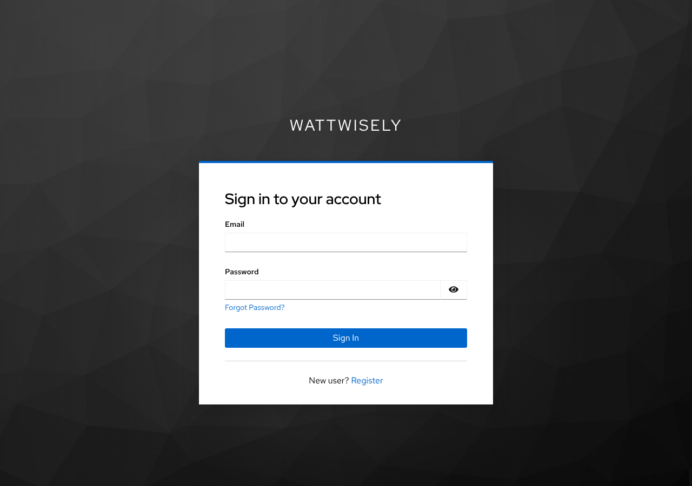                | 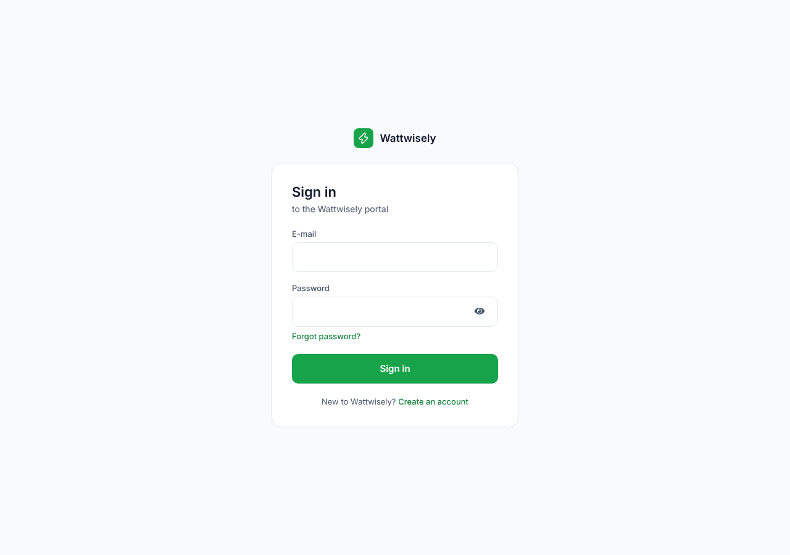                |
| 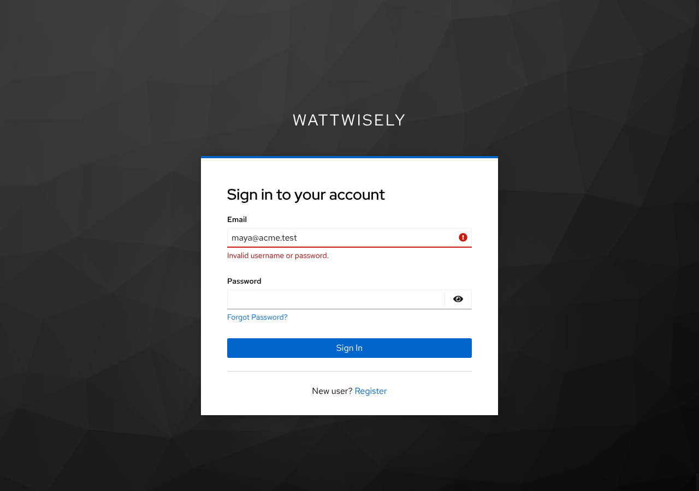          | 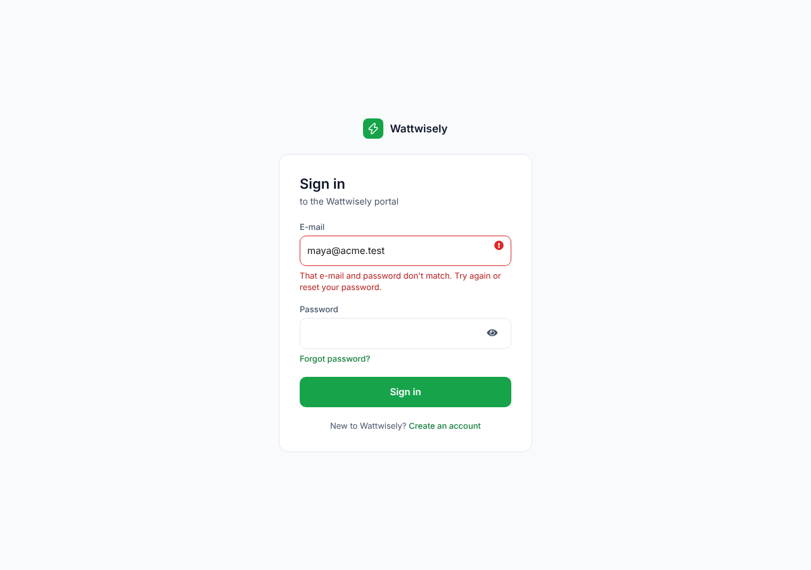          |
| 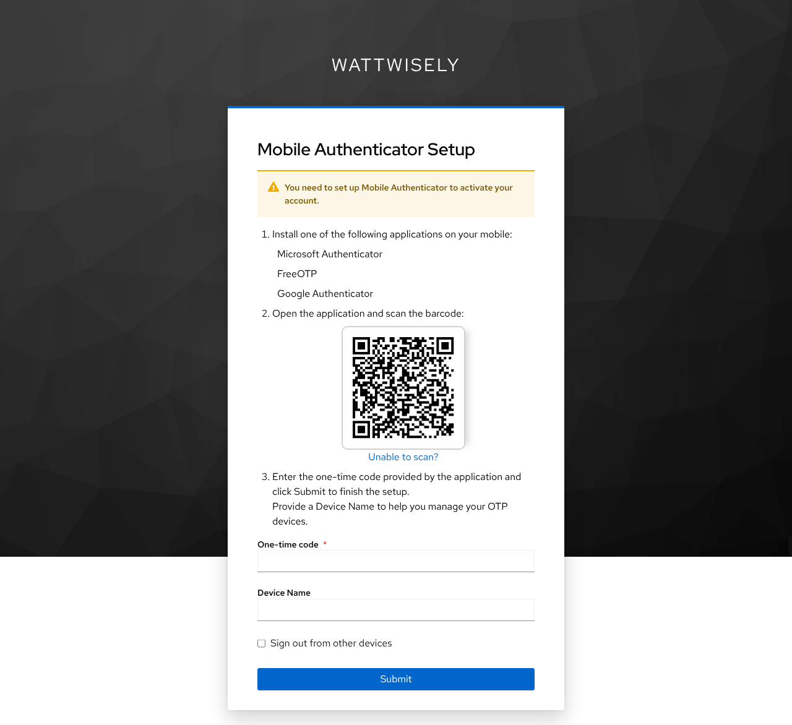       | 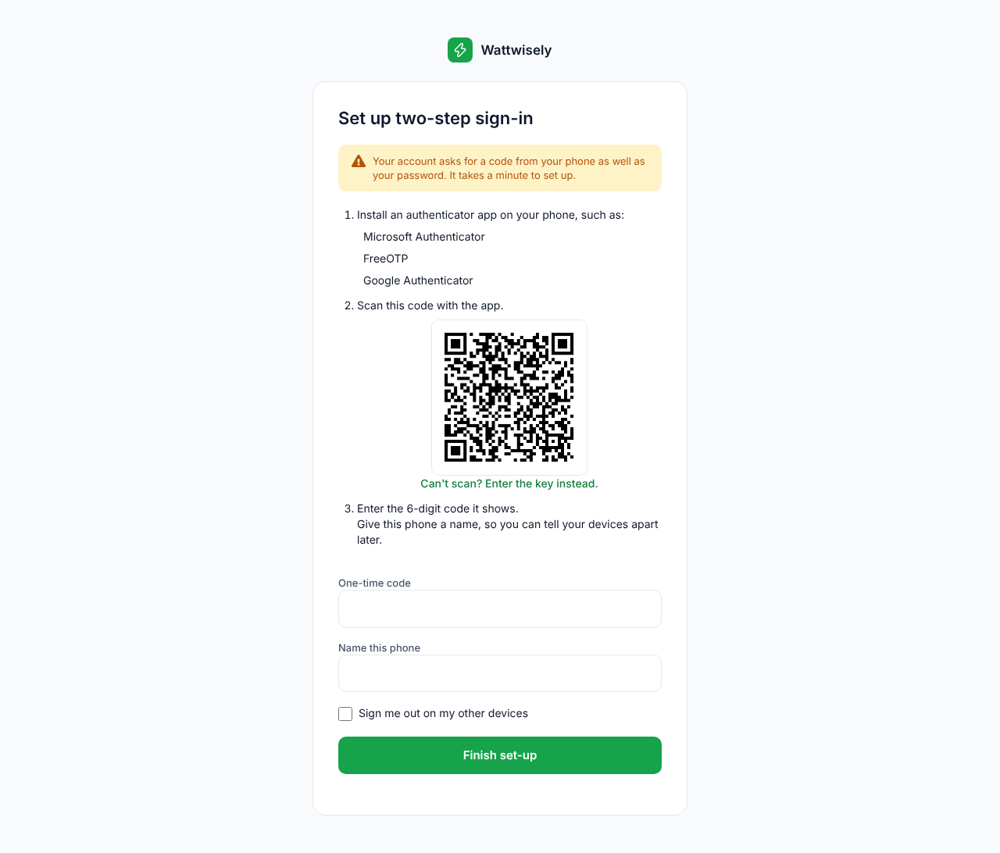       |
| 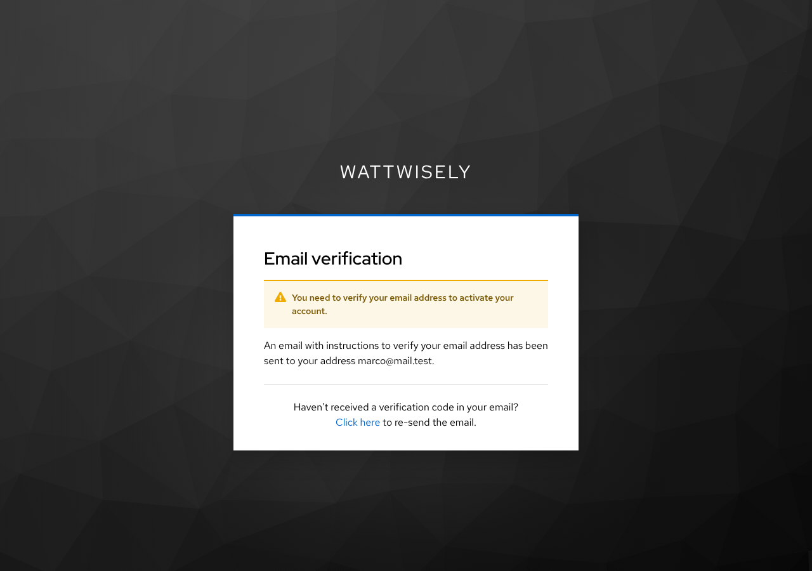   | 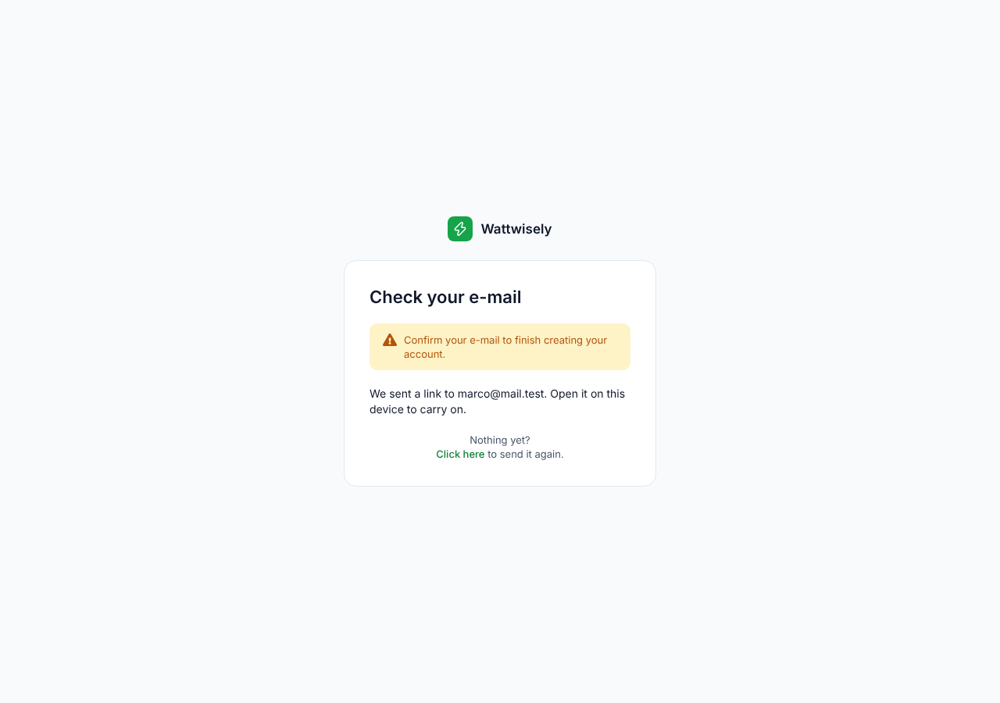   |
| 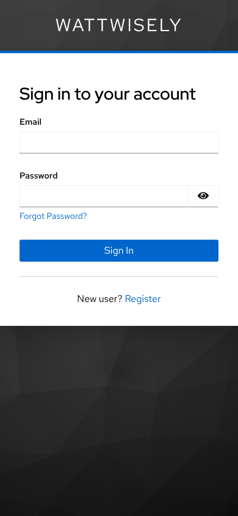    | 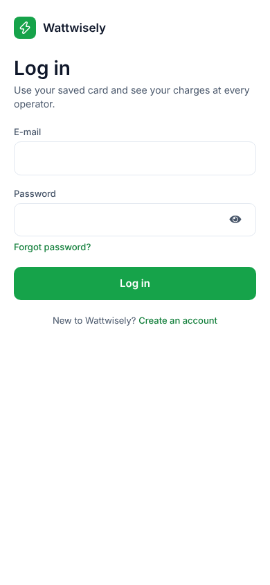    |
| 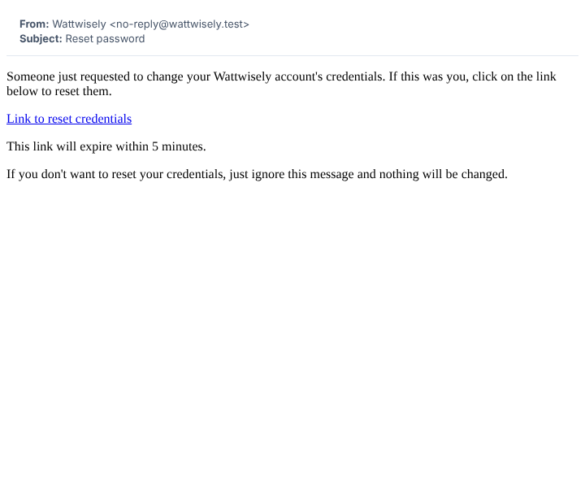 | 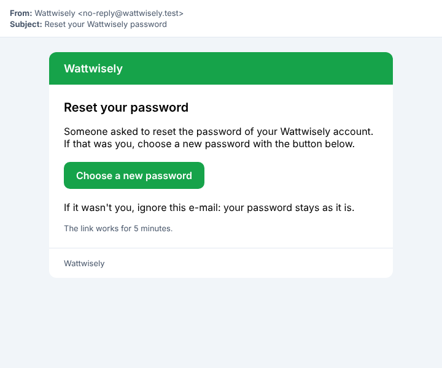 |

## How the pieces fit

```text
packages/theme/theme.json
   │  npx nx run theme:generate
   ├─▶ deploy/keycloak/themes/wattwisely/login/resources/css/tokens.css     the apps' tokens.css, the same file
   ├─▶ deploy/keycloak/themes/wattwisely/login/resources/img/mark.svg       the logo mark, also the tab icon
   └─▶ deploy/keycloak/themes/wattwisely/email/html/theme-colours.ftl       the hex values, for the e-mails

deploy/keycloak/themes/wattwisely/
   login/                     parent=keycloak.v2
      theme.properties        styles: keycloak.v2's styles.css, fonts.css, tokens.css, wattwisely.css, forms.css
      resources/css/          wattwisely.css (the page and the card), forms.css (fields, buttons, notices)
      resources/fonts/        Inter (latin, latin-ext), with its licence
      messages/messages_en.properties   the wording
      template.ftl, buttons.ftl         keycloak.v2's, with the changes marked "Wattwisely"
      footer.ftl, ww.ftl                the line under the card; wording by page
   email/                     parent=base
      html/template.ftl       the platform's e-mail layout, and macros for a heading, a paragraph, a button, a footnote
      html/*.ftl              reset password, confirm e-mail, confirm a new e-mail, update your account
      messages/messages_en.properties
```

Keycloak finds a page, a stylesheet or a message in this theme first and in its parent otherwise, so the theme holds only what differs. The CSS sets PatternFly v5's variables to the `--ww-*` and `--mat-sys-*` tokens and restyles the few parts PatternFly draws with borders of its own (fields, buttons, alerts). It names no color.

## The pages and their wording

Every message lives in `login/messages/messages_en.properties`. A key that is not there keeps Keycloak's English. Two things to know when editing it: Keycloak runs every message through Java's `MessageFormat`, so an apostrophe is written twice (`don''t`); and a page can have wording of its own.

`ww.ftl` looks a key up for the page first, then for the page and the app: `doSubmit` on the reset-password page tries `doSubmit.login-reset-password.<client>`, then `doSubmit.login-reset-password`, then `doSubmit`. A page is its template's name without `.ftl`; the app is the Keycloak client, such as `wattwisely-driver`. `template.ftl` uses it for a page's title and subtitle (`wwTitle`, `wwSubtitle`), `buttons.ftl` for button labels, `footer.ftl` for the line under the card (`wwFooterHtml`, which may hold links).

| Page (template)         | Title                   | Wording of its own                                                                                                                                                      |
| ----------------------- | ----------------------- | ----------------------------------------------------------------------------------------------------------------------------------------------------------------------- |
| `login`                 | Sign in                 | Subtitle by app: "to the Wattwisely portal", "to the Wattwisely admin console". The driver app: "Log in", "Use your saved card and see your charges at every operator." |
| `register`              | Create your account     | Subtitle "Keep your cards, receipts and charging history in one place…"; under the card in the portal, "Work at a charging company? Your team's Owner invites you…"     |
| `login-reset-password`  | Reset your password     | Button "Send reset link"                                                                                                                                                |
| `login-update-password` | Choose a new password   | Button "Save password"                                                                                                                                                  |
| `login-verify-email`    | Check your e-mail       | "We sent a link to … Open it on this device to carry on."                                                                                                               |
| `login-config-totp`     | Set up two-step sign-in | Button "Finish set-up"                                                                                                                                                  |
| `login-otp`             | Enter your code         | Subtitle "Open your authenticator app and type the 6-digit code for Wattwisely."; button "Verify"                                                                       |
| `error`                 | Something went wrong    | Keycloak's own message, and "Back to the app"                                                                                                                           |

The e-mails' wording is in `email/messages/messages_en.properties`: a subject, a heading, a line, a button label and an "ignore this" line for each, and a plain-text version (`*Body`) for mail apps that show no HTML.

## How to change a color, a word or the footer

| To change               | Do                                                                                                                                                                                                                                              |
| ----------------------- | ----------------------------------------------------------------------------------------------------------------------------------------------------------------------------------------------------------------------------------------------- |
| A color                 | Edit `theme.json` and run `npx nx run theme:generate`, as in [module 20](20-design-system.md#how-to-change-a-color). It also rewrites the theme's `tokens.css`, `mark.svg` and `theme-colours.ftl`; `theme-files.spec.ts` fails if one is stale |
| A word                  | Edit `messages_en.properties`, in `login/` or `email/`                                                                                                                                                                                          |
| The line under the card | Set `wwFooterHtml` in `login/messages/messages_en.properties`, for example to links to the privacy notice and the terms. It is empty: the platform has no public pages for them yet                                                             |

Keycloak caches themes on a server, so restart it after a change: `docker restart wattwisely-keycloak-1`. For working on the theme, Keycloak's dev mode with `--spi-theme--cache-themes=false --spi-theme--cache-templates=false` shows a change on the next page load.

## Upgrading Keycloak

`login/template.ftl` and `login/buttons.ftl` are copies of `keycloak.v2`'s from Keycloak 26.8.1, with each change marked `Wattwisely`: the tab icon, the mark before the name, the title and subtitle by page, the footer under the card, and button labels by page. After an upgrade, take the new version's two files from `lib/lib/main/org.keycloak.keycloak-themes-<version>.jar` (`theme/keycloak.v2/login/`) and make the same marked changes. Everything else follows `keycloak.v2` by itself.

## Design decisions

| Decision                                                                                                                                                                                                                                                                                                                                                                                                      |
| ------------------------------------------------------------------------------------------------------------------------------------------------------------------------------------------------------------------------------------------------------------------------------------------------------------------------------------------------------------------------------------------------------------- |
| **Keycloak's own pages, restyled, rather than pages of our own.** The theme extends `keycloak.v2` and copies two of its templates. Keycloak's forms, flows, error messages and accessibility work stay Keycloak's, and an upgrade touches two files. A React login (Keycloakify) would match the screens more closely but needs a build and a jar for every Keycloak upgrade                                  |
| **The same tokens as the apps.** The theme's `tokens.css` is the apps' file, generated from theme.json. A color changed there reaches the apps, the e-mails and Keycloak with one command                                                                                                                                                                                                                     |
| **Keycloak's flow, not the canvas's, where they differ.** The realm confirms e-mail, so Keycloak 26.8 asks for the password on its own page after the sign-up form rather than on it. A wrong password is shown under the e-mail field, not as a notice above the form. The one-time code is one field, not six boxes. Notices keep the type Keycloak gives them, so "Choose a password to carry on" is amber |
| **Wording by page and by app, in messages.** The driver app says "Log in" and talks about saved cards; the portal and the admin console say "Sign in". Titles, subtitles and buttons that Keycloak shares between pages ("Submit", "Sign In") get a page's own word through `ww.ftl`, so no page template is copied for a word                                                                                |
| **No asterisks.** Every field on these forms is required, and the screens mark none. The asterisk was hidden from screen readers already                                                                                                                                                                                                                                                                      |
| **Light only.** As the apps. `keycloak.v2` follows the system's dark mode; the theme sets `darkMode=false`                                                                                                                                                                                                                                                                                                    |
| **Inter bundled, no Google request.** 133 kB of WOFF2 for Latin and extended Latin, loaded only when a page uses those characters                                                                                                                                                                                                                                                                             |
| **Keycloak's e-mails in the platform's brand, not a tenant's.** A Keycloak account works at every operator, so its e-mails come from Wattwisely. The layout is module 8's `BrandedMailLayout` with the platform's colors                                                                                                                                                                                      |
| **The footer is empty.** The screens show "Privacy · Terms · help@…", but the platform has no public privacy notice, terms or help address yet. One line in the messages adds them                                                                                                                                                                                                                            |

## How it was checked

Keycloak 26.8.1 ran from its release archive in dev mode, with the realm imported from `wattwisely-realm.json`, the theme folder linked in, and a small SMTP catcher for the e-mails. A Playwright script walked every flow: signing in to the portal, the admin console and the driver app; a wrong password; forgot password, the e-mail and the reset link; two-step set-up (with the code worked out from the key) and the code page with a wrong code; creating an account, choosing its password and the confirmation e-mail; an error page; and the "update your account" e-mail sent from the admin API. Each page was taken at 1280 and 390 pixels wide, once with Keycloak's default themes and once with this one.

## Read the code in this order

| Step | Where                                                                                          | What to look at                                                                                     |
| ---- | ---------------------------------------------------------------------------------------------- | --------------------------------------------------------------------------------------------------- |
| 1    | `deploy/keycloak/themes/wattwisely/login/theme.properties`                                     | The parent theme and the stylesheets, in order                                                      |
| 2    | `login/resources/css/wattwisely.css`, `forms.css`                                              | PatternFly's variables set to the tokens; the card, the fields, the buttons, the notices, the phone |
| 3    | `login/messages/messages_en.properties`, `login/ww.ftl`                                        | The wording, and how a page finds its own                                                           |
| 4    | `login/template.ftl`, `login/buttons.ftl`, `login/footer.ftl`                                  | The changes marked `Wattwisely`                                                                     |
| 5    | `email/html/template.ftl`, `email/html/password-reset.ftl`                                     | The e-mail layout and one e-mail built with it                                                      |
| 6    | `packages/theme/src/lib/theme-files.ts`, `mark-svg.ts`, `mail-colours-ftl.ts`                  | The three files generated for Keycloak                                                              |
| 7    | `deploy/docker-compose.yml`, `deploy/keycloak/realm/wattwisely-realm.json`, `deploy/README.md` | The mount, the realm's theme settings, the steps for a realm that already exists                    |
