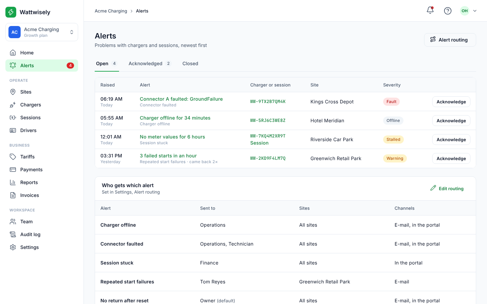
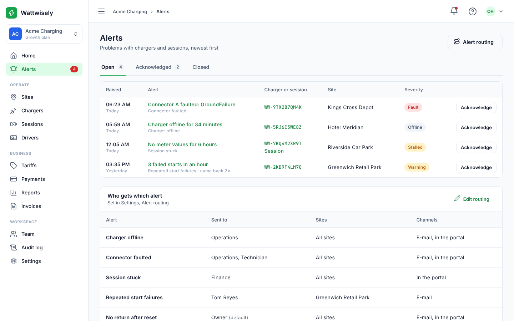
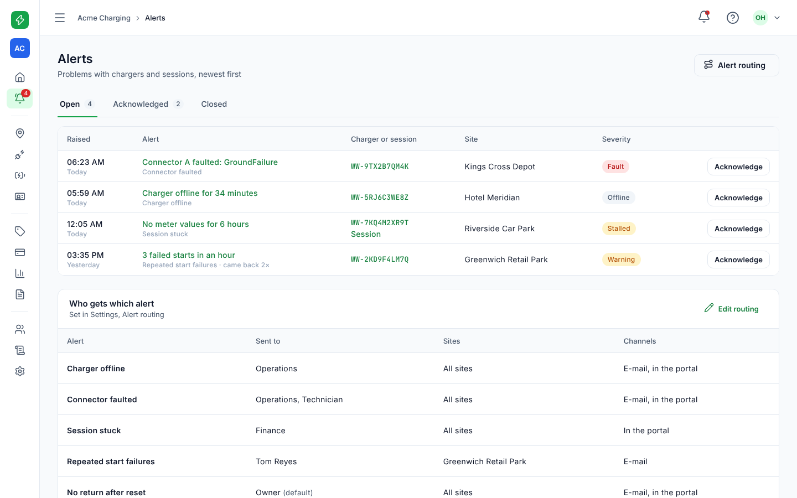
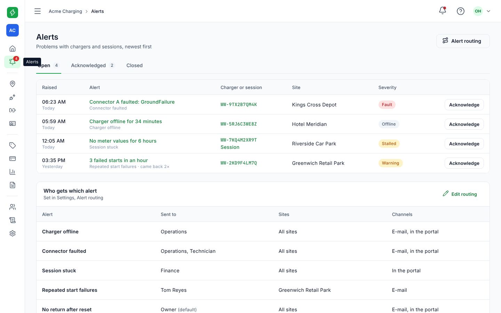
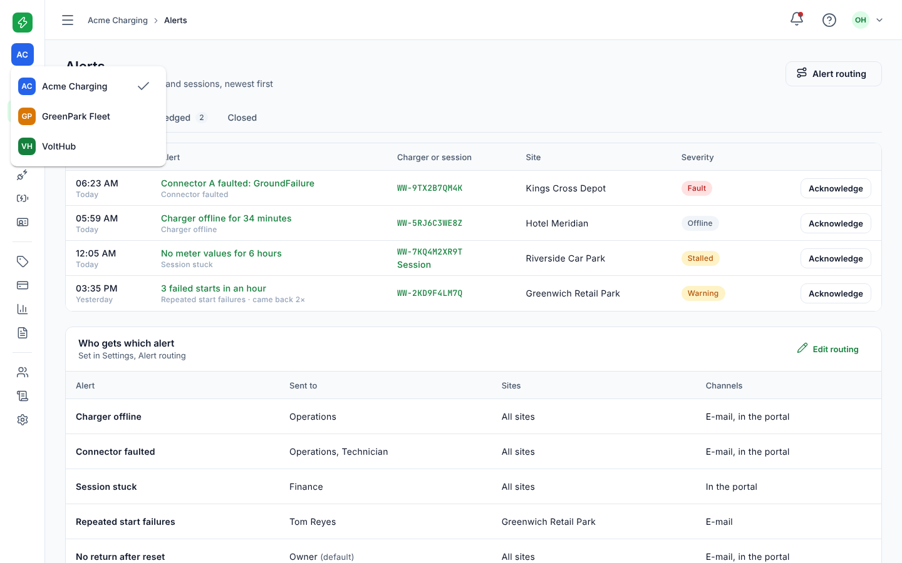
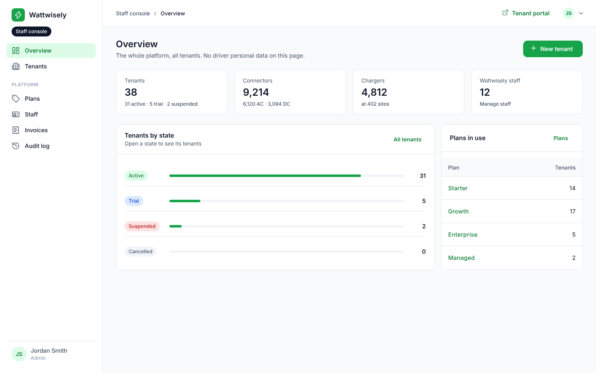
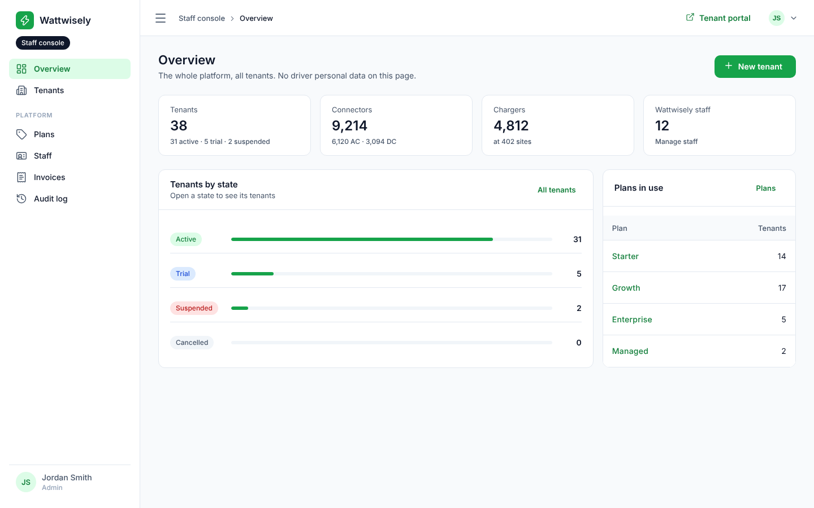
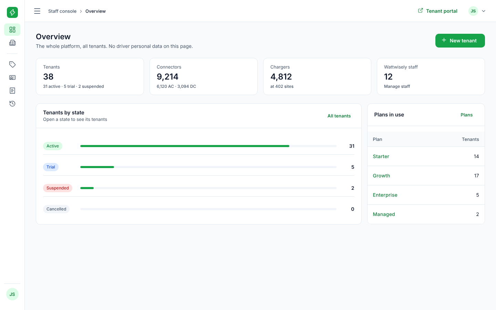
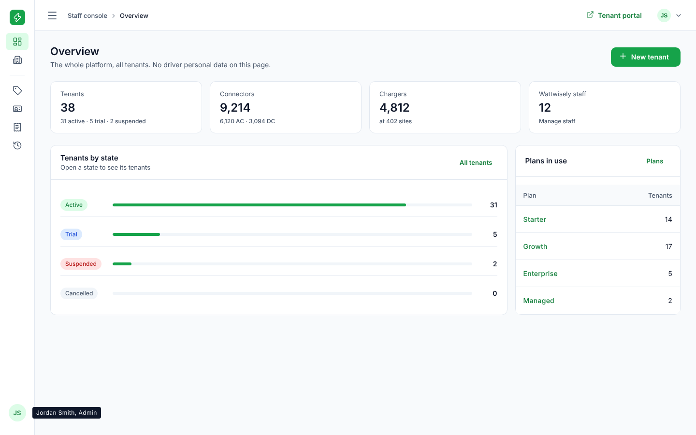
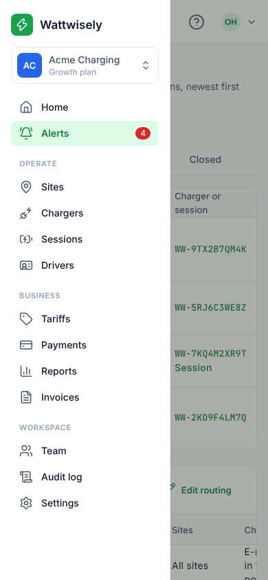

# Module 27: collapsible side menu

The side menu of the portal and of the staff console can now collapse. **On a wide screen the menu button in the top bar collapses it to a strip of icons**, 72px wide instead of 248px, and the page takes the room. **Each icon shows its page's name on hover**, and the workspace switcher and the staff member at the foot show theirs too. **The same button expands it again, and the browser remembers the choice**, so the next visit opens the menu as it was left. **Phones and narrow windows keep the menu that slides in over the page**, always full width: there the button opens it, as before.

URLs, permissions and `data-testid` attributes stay as they were; the new button is `menu-toggle`. Nothing in the API changed.

Stories covered: Olivia, an Operations manager at Acme Charging, works on a laptop and wants the alerts table wider, so she collapses the menu; she finds Sessions by its icon and its name on hover; the count of open alerts still shows on the Alerts icon; she switches to GreenPark Fleet from the initials at the top; the next morning the menu is still collapsed. Jordan, on the staff console, does the same.

## What changed

| Before                                          | Now                                                                                                                                                        |
| ----------------------------------------------- | ---------------------------------------------------------------------------------------------------------------------------------------------------------- |
| The side menu was always 248px on a wide screen | A menu button at the left of the top bar collapses it to 72px of icons and expands it again; the menu's width and the page's margin ease together in 400ms |
| —                                               | Collapsed: the logo's mark alone, the workspace's initials, a line between the groups where their headings were, each page's icon with its name on hover   |
| —                                               | Collapsed: the open alerts' count as a small badge on the Alerts icon                                                                                      |
| —                                               | Collapsed, in the console: no Staff console chip, and the staff member's initials at the foot with their name and role on hover                            |
| —                                               | The choice is remembered in the browser (`wattwisely.side-menu` in local storage); where the browser keeps nothing, it lasts until the page reloads        |
| Below 960px the menu slid in over the page      | The same, always at full width, whatever was chosen on a wide screen                                                                                       |

## Before and after

At 1440 wide with the API stubbed; the phone at 390.

| Page                                          | Before                                             | After                                                                   |
| --------------------------------------------- | -------------------------------------------------- | ----------------------------------------------------------------------- |
| Portal                                        |       |                              |
| Portal, collapsed                             | The menu could not collapse                        |                |
| Portal, collapsed, a page's name              | —                                                  |    |
| Portal, collapsed, workspaces                 | —                                                  |  |
| Console                                       |       |                              |
| Console, collapsed                            | The menu could not collapse                        |                |
| Console, collapsed, who you are               | —                                                  |  |
| Phone, menu open (left collapsed on a laptop) |  |                         |

## How the pieces fit

**`SideMenuState`** (`packages/ui/src/lib/side-menu/side-menu-state.ts`) holds the choice as a signal, `isCollapsed`, and `toggle()` flips it and writes it to local storage. Reading and writing are wrapped in `try`, so a browser that blocks storage still collapses the menu for the page's life. Both apps inject the same class.

**The shell** (`apps/portal/src/app/layout/shell.component.*`, and the console's twin) works out `isRail`: collapsed and not narrow. It passes `isRail` to the side menu and the top bar, and sets two classes on the sidenav container: `beside` when the menu sits beside the page, `rail` when it is collapsed. The width is one CSS variable, `--ww-side-width`, 248px or 72px. Material sets the page's margin from the menu's width only when the menu opens or the window resizes, so a change of width alone would leave the page under the menu or a gap beside it; beside the page, the page's margin is the same variable. Once Material turns its transitions on, the menu's width is added to the properties it eases, so the menu and the margin move together with Material's own 400ms timing, and nothing animates on load.

**The top bar** shows "Open the menu" (`menu`) when narrow, as before, and otherwise the toggle (`menu-toggle`) with "Collapse the menu" or "Expand the menu" as its label and tooltip, and `aria-expanded`.

**The side menu** takes `isCollapsed` and sets the `collapsed` class on itself. Collapsed, the page names are hidden from sight but kept for screen readers, each link gets its name as a tooltip on the right, and a heading becomes a line. The tooltips are switched off while the menu is full.

**The workspace switcher** (portal) and **the logo** (`isMarkOnly`, in `packages/ui`) show their short forms. The switcher hides its tooltip when its menu opens, so the two do not overlap.

## Design decisions

- **A strip of icons, not a menu that disappears.** The pages stay one click away, and the active page stays marked. The approved screens have no collapsed menu, so the strip follows Material's navigation rail: the menu icon at the top, icons below, the names on hover.
- **The button is in the top bar, where the phone's menu button already was.** One place for the menu at every width. It is the menu icon rather than a panel icon: Material uses the menu icon for this, and the icon list in `packages/ui` is at the 200-line limit.
- **Remembered per browser, not per account.** It is a preference of the screen in front of you: a laptop may want the room, the office monitor may not. Nothing goes to the API.
- **Phones ignore it.** Narrow, the menu covers the page anyway, so a collapsed strip would save nothing.

## How it was checked

- `SideMenuState` has a spec: it starts full, collapses and expands, remembers the choice, starts collapsed when left so, and still toggles when storage throws.
- In a browser, on both builds of both apps: the menu and the page's left edge measured after collapsing, expanding, reloading and in mid-animation (both at the same place at every step); no horizontal scroll inside the menu; the phone menu still slides in, at full width, with the choice set to collapsed.
- `prettier --check .` and `NX_NO_CLOUD=true npx nx run-many -t lint test build`.

## Read the code in this order

1. `packages/ui/src/lib/side-menu/side-menu-state.ts` and its spec.
2. `apps/portal/src/app/layout/shell.component.ts`, `.html` and `.scss`: `isRail`, the two classes and the width.
3. `apps/portal/src/app/layout/top-bar.component.html`: the toggle beside the phone's button.
4. `apps/portal/src/app/layout/side-menu.component.html` and `.scss`: the collapsed menu; then `tenant-switcher.component.*`.
5. The console's `apps/admin/src/app/layout/`, the same with the staff member at the foot.
