# Module 28: the Wattwisely logo and icons

The platform now wears the Wattwisely logo from the brand files: **a ring open at the top with a W rising through it, beside the name, in teal (`#0E7490`)**. It replaces the green tile with a lightning bolt that stood in for a logo since module 20. **The portal, the staff console, the workspace pages and Keycloak's sign-in pages show the full logo**; **the collapsed side menu, the driver app's bar and its "Powered by" line show the mark alone**. **Every app has the new tab icon**, and the driver app installs on a phone's home screen with the new icon.

URLs, permissions and `data-testid` attributes stay as they were. Nothing in the API changed. The rest of the interface keeps the approved green: only the logo is teal.

Stories covered: Olivia opens the portal and sees the Wattwisely logo at the top of the menu, and its mark when she collapses the menu; she has three tabs open and finds the portal by its icon; Jordan does the same in the console; Marco signs in on Keycloak's page under the same logo, and adds the driver app to his phone's home screen, where it shows the mark on teal.

## What changed

| Where                                       | Before                                            | Now                                                                                                       |
| ------------------------------------------- | ------------------------------------------------- | --------------------------------------------------------------------------------------------------------- |
| Portal and console side menu                | A green tile with a bolt, and "Wattwisely" in ink | The logo: the mark and the name, in teal                                                                  |
| Collapsed side menu                         | The green tile                                    | The mark alone                                                                                            |
| Workspace picker, no workspace, invitation  | The green tile and the name above the card        | The logo above the card                                                                                   |
| Console's "not staff" page                  | The same                                          | The same as above                                                                                         |
| Keycloak's sign-in pages                    | A green tile and the realm's name                 | The logo, as `img/logo.svg`; the tab icon `img/mark.svg` is the new mark                                  |
| Driver app's bar, on Wattwisely's own pages | A dark tile with a bolt                           | A white tile with the mark in teal (an operator's pages keep its logo or initials, as before)             |
| Driver app's "Powered by" line              | A bolt                                            | The mark, in the line's grey                                                                              |
| Tab icons, all three apps                   | Nx's default `favicon.ico`                        | `favicon.svg` (the mark, from `theme.json`), and `favicon.ico` with 16 and 32 pixels from the brand files |
| iPhone home screen                          | —                                                 | `apple-touch-icon.png`, 180 pixels, in all three apps                                                     |
| Driver app installed on a phone             | `icon.svg`, a green tile with a bolt              | `icon-192.png`, `icon-512.png` and `icon-maskable-512.png` (the mark on teal, for Android's round icons)  |
| E-mails                                     | The realm's name in a green band                  | Unchanged: many mail apps block images and none draw SVG, so the name stays as text                       |

## Before and after

At 1440 wide with the API stubbed; the driver app and Keycloak's phone page at 390. Keycloak's pages are from Keycloak 26 running the theme.

| Page                    | Before                                                            | After                                                           |
| ----------------------- | ----------------------------------------------------------------- | --------------------------------------------------------------- |
| Portal                  | 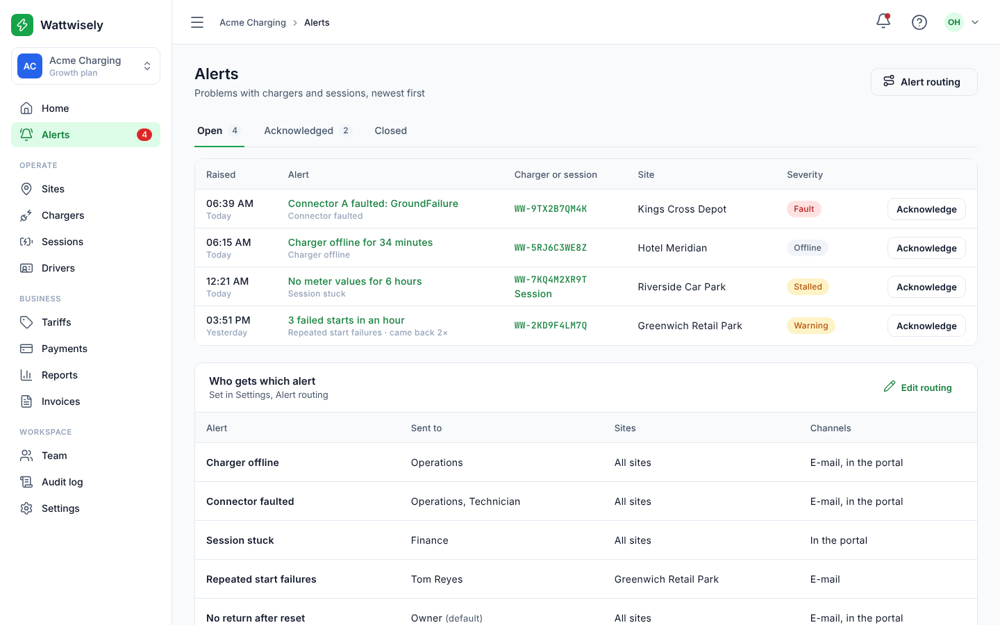                     | 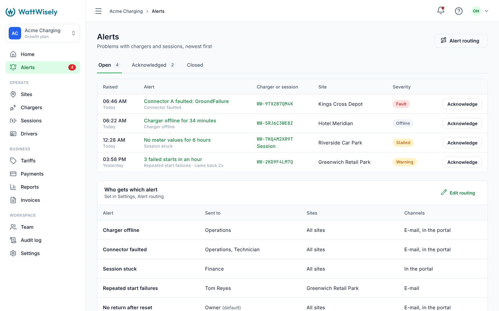                     |
| Portal, menu collapsed  | 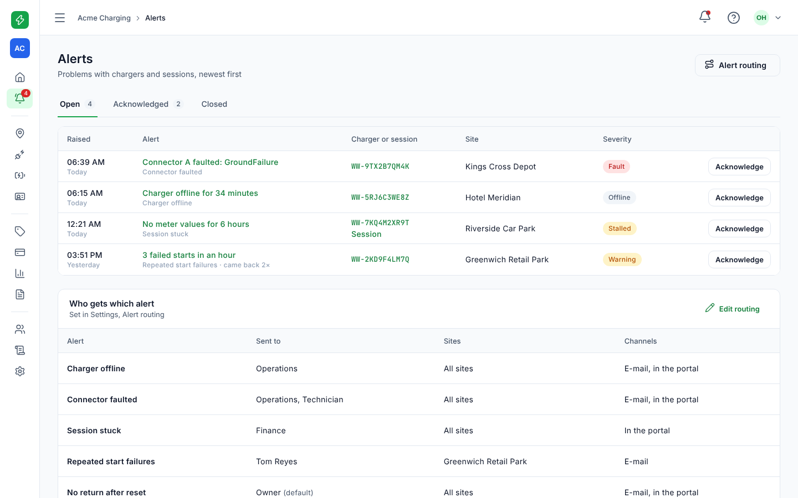        | 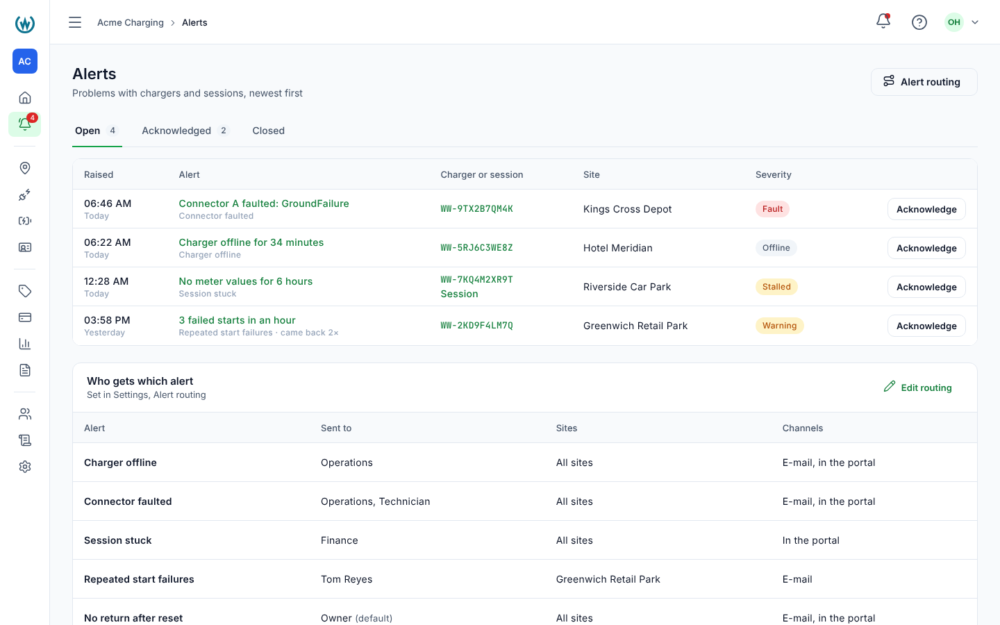        |
| Workspace picker        | 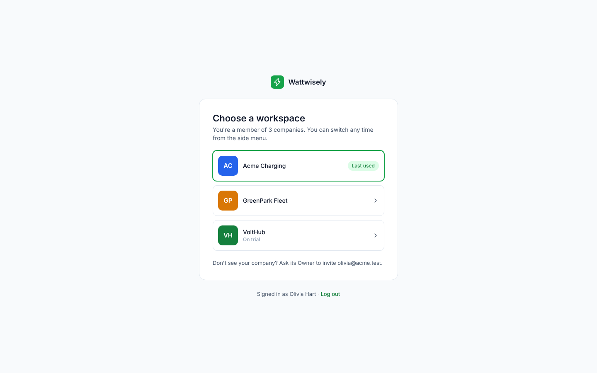       | 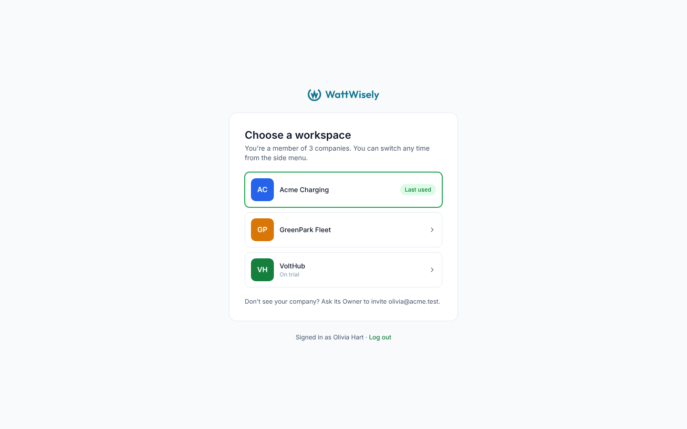       |
| Console                 | 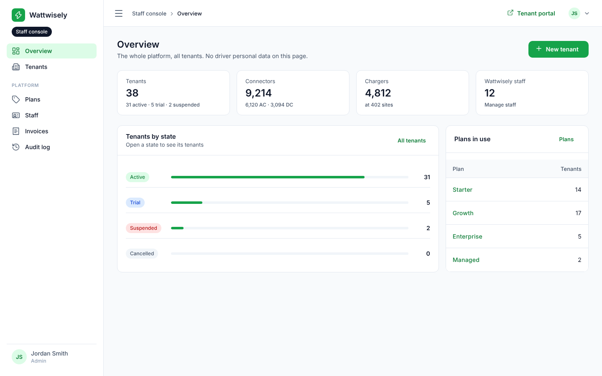                     |                      |
| Console, menu collapsed | 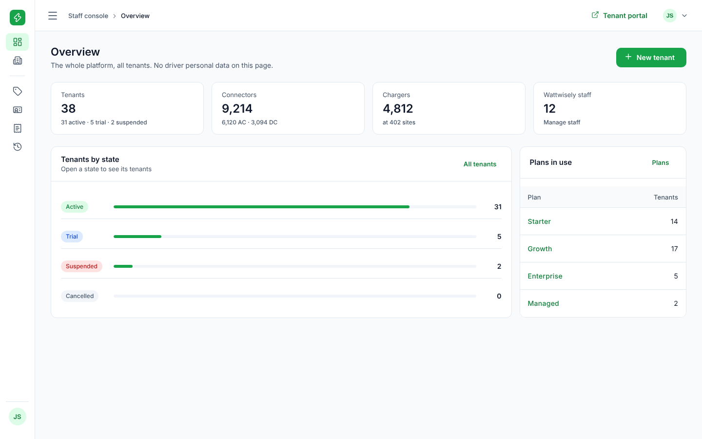 | 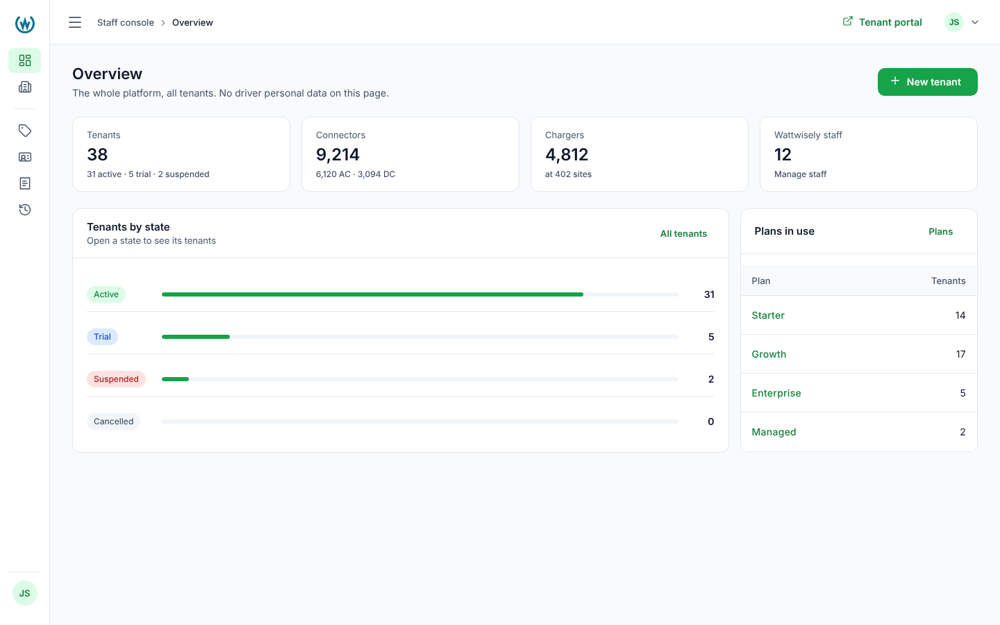 |
| Driver app, home        | 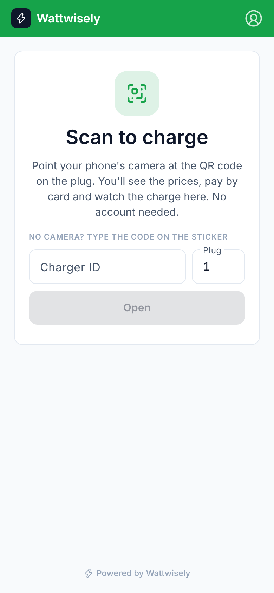                       |                        |
| Sign in (Keycloak)      | 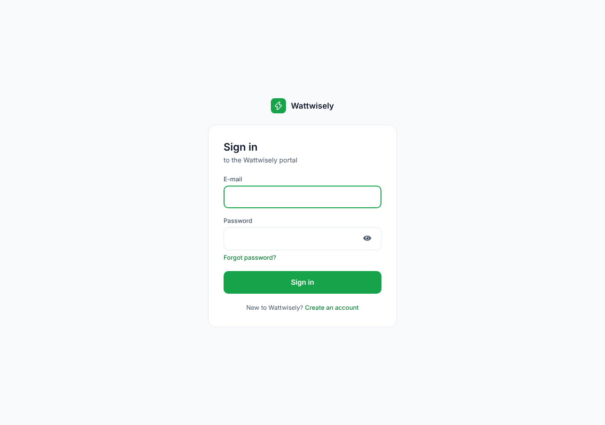                  |                   |
| Sign in, phone          | 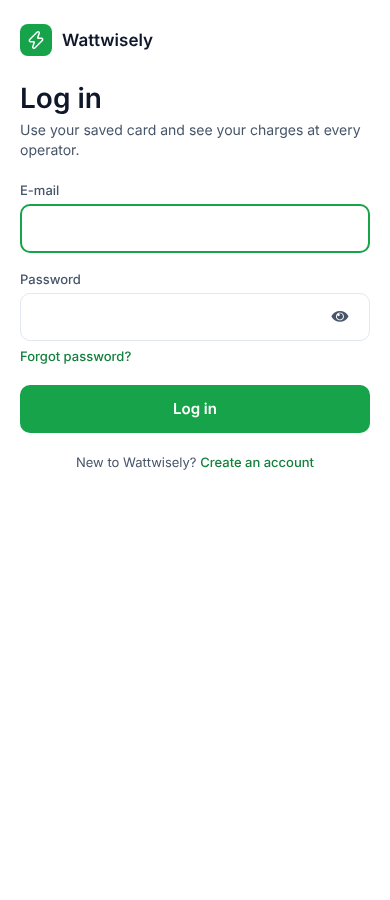      |       |

The tab icons and the driver app's home-screen icon, drawn in a mock browser and a mock home screen:

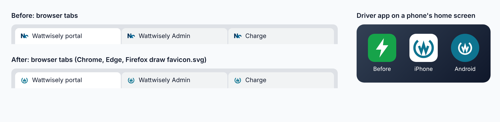

## How the pieces fit

**`theme.json`** has one new color, `logo`: `#0E7490`. `npx nx run theme:generate` turns it into `--ww-logo` in `tokens.css`, `PlatformColours.LOGO`, and the logo's SVG files, so the logo's color, like every other, is changed in one place.

**`BrandMark`** (`packages/theme/src/lib/brand-mark.ts`) holds the logo as path data, copied from the brand files: the ring and the W as 6-unit strokes on a 64-unit square, the name as one filled path, and where the mark sits beside the name on the 300 by 72 lockup. It also holds two crops, `MARK_CROP` and `LOCKUP_CROP`, which cut the drawings to the ring's circle and the end of the name.

**`MarkSvg`** writes the files from `BrandMark` in the `logo` color: `favicon.svg` in each app's `public/`, and Keycloak's `img/mark.svg` and `img/logo.svg`. They keep the brand files' boxes and clear space. `ThemeFiles` lists them, so the theme's spec fails when one no longer matches `theme.json`.

**`LogoComponent`** (`<ww-logo>`, `packages/ui`) draws the logo inline from `BrandMark` in `currentColor`, which is `--ww-logo` unless a parent sets another. `isMarkOnly` draws the mark alone. It uses the crops, so the component's box is the drawing's: its left edge lines up with the menu below it, and its height, 28px, is the ring's. `name` is what a screen reader says, "Wattwisely".

**The raster icons** are the brand files as they were given: `favicon.ico` is the 16 and 32 pixel PNGs in one file, and the PNGs are copied unchanged. Each `index.html` links the ICO (for Safari and older browsers), the SVG (which Chrome, Edge and Firefox prefer) and the touch icon; the driver app's `manifest.webmanifest` lists its three PNGs and the SVG.

## Design decisions

- **The logo is drawn, not linked as an image file.** Inline, it takes its color from the theme's variable, needs no request, and the driver app can draw the mark in teal on a white tile or in grey in its foot line.
- **The apps crop the logo; the files keep their clear space.** A page spaces the logo itself, and a box with built-in margins pushed the logo 9px off the menu's left edge and made the menu's head taller. The files go where nothing else spaces them: a browser tab, Keycloak's header.
- **The rest of the interface stays green.** The approved screens are green, and the logo's teal is close enough to sit beside it. Moving buttons, links and the active menu item to teal is one change to `brand` in `theme.json` if it is wanted.
- **The 16 and 32 pixel PNGs have a white background.** On a grey inactive tab in Safari, which uses the ICO, they show as a small white square. Chrome, Edge and Firefox use the transparent SVG instead. Transparent PNGs from the brand files would fix Safari.
- **E-mails keep the name as text.** A logo in an e-mail would have to be a PNG on a public URL, and mail apps hide remote images until asked. The band in the platform's color carries the brand.

## How it was checked

- The theme's spec checks the generated mark, logo and favicons against `theme.json`.
- In a browser, before and after builds of all three apps with the API stubbed: the menu's head, the collapsed rail, the workspace picker, the driver app's bar and foot line, and the tab and home-screen icons; Keycloak 26 with the theme for the sign-in pages.
- `prettier --check .` and `NX_NO_CLOUD=true npx nx run-many -t lint test build`.

## Read the code in this order

1. `packages/theme/theme.json`: the `logo` color.
2. `packages/theme/src/lib/brand-mark.ts`, then `mark-svg.ts` and `theme-files.ts` with its spec.
3. `packages/ui/src/lib/logo/logo.component.ts`.
4. `apps/driver/src/app/app.component.ts`: the mark in the bar and the foot line.
5. `deploy/keycloak/themes/wattwisely/login/template.ftl` and `resources/css/wattwisely.css`: the logo over the card.
6. Each app's `src/index.html` and `public/`, and the driver app's `manifest.webmanifest`.
