# Module 29: the interface in the logo's teal

The platform's brand color is now the logo's teal. **Buttons, links, the selected menu item, tabs, focus rings, charts and the driver app's bar on Wattwisely's own pages** move from green to teal, so the interface and the logo are one color. **Green stays where it means good news**: a charger that is available or charging, the "Live" chip, a site's pin when all is well, a figure that went up, a saved setting, a free charge, a success notice.

URLs, permissions and `data-testid` attributes stay as they were. Nothing in the API changed. An operator that chose its own colors keeps them.

Stories covered: Olivia opens the portal and every button and link is in the logo's teal, while the chargers that are charging still show green; Jordan sees the same in the console; Marco opens the driver app on Wattwisely's own pages and the bar is teal under the logo; an operator that never set a color gets the teal on its drivers' pages and e-mails, and one that did keeps its own.

## What changed

| Where                                                    | Before                      | Now                                                                                                                                                          |
| -------------------------------------------------------- | --------------------------- | ------------------------------------------------------------------------------------------------------------------------------------------------------------ |
| `brand`, the color of buttons, the top bar, focus, tabs  | `#16A34A` green             | `#0E7490` teal, the logo's color                                                                                                                             |
| `brandDark`, links and text on the soft tint             | `#15803D`                   | `#155E75`                                                                                                                                                    |
| `brandSoft`, the selected menu item, avatars, highlights | `#DCFCE7`                   | `#CFFAFE`                                                                                                                                                    |
| Available and charging chips, the charging dot           | `brandSoft` and `brandDark` | `successSoft` and `successText`: the same greens as before, under their own names                                                                            |
| Good-news details                                        | The brand green             | `success`: success notices, a figure that went up, the map's pins, a saved setting, a free charge, the invitation's check marks, Keycloak's success messages |
| Angular Material's generated palette                     | `mat.$green-palette`        | `mat.$cyan-palette`, the nearest to the teal, for the few tokens theme.json does not set                                                                     |
| The default brand of an operator that set no colors      | Green with white text       | Teal with white text, on the driver's pages, the receipt and the e-mails                                                                                     |
| Keycloak's sign-in pages and e-mails                     | Green buttons and links     | Teal, from the same generated tokens                                                                                                                         |
| The driver app's browser bar on a phone (`theme-color`)  | `#16a34a`                   | `#0e7490`                                                                                                                                                    |

## Before and after

At 1440 wide with the API stubbed; the driver app and Keycloak's phone page at 390. Keycloak's pages are from Keycloak 26 running the theme.

| Page                   | Before                                                       | After                                                      |
| ---------------------- | ------------------------------------------------------------ | ---------------------------------------------------------- |
| Portal, home           | 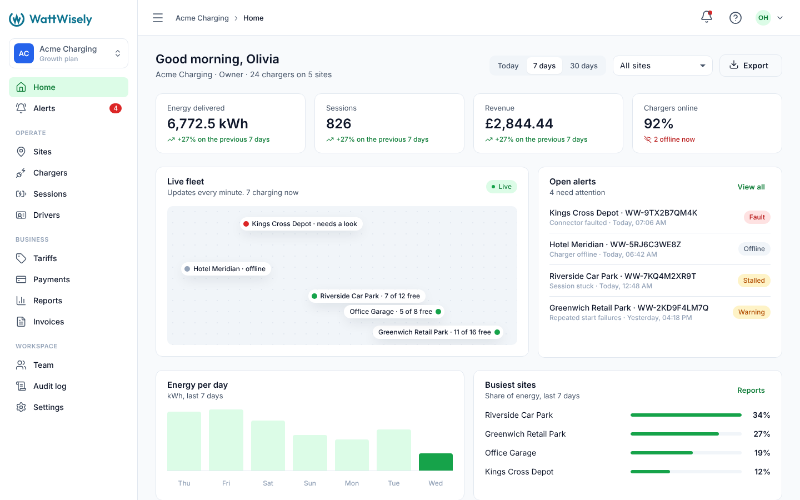             | 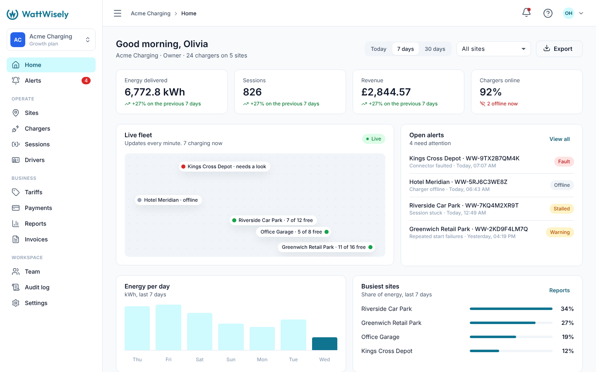             |
| Portal, chargers       | 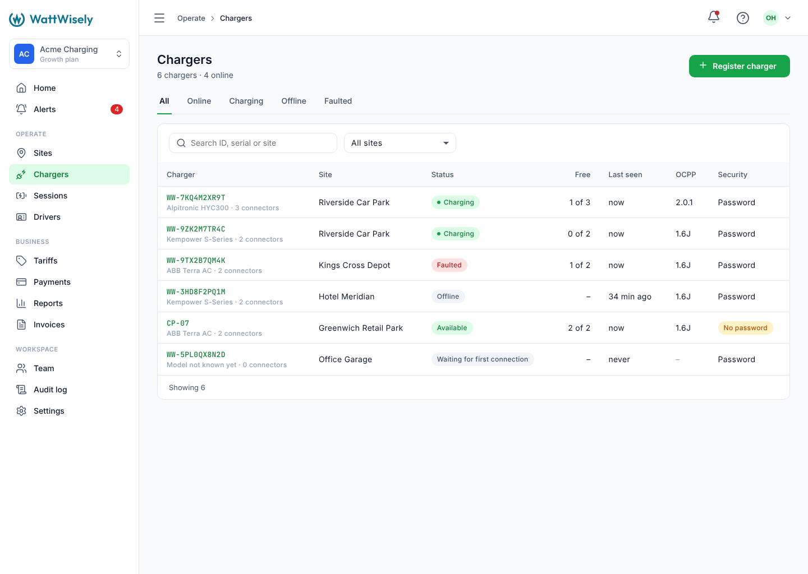            | 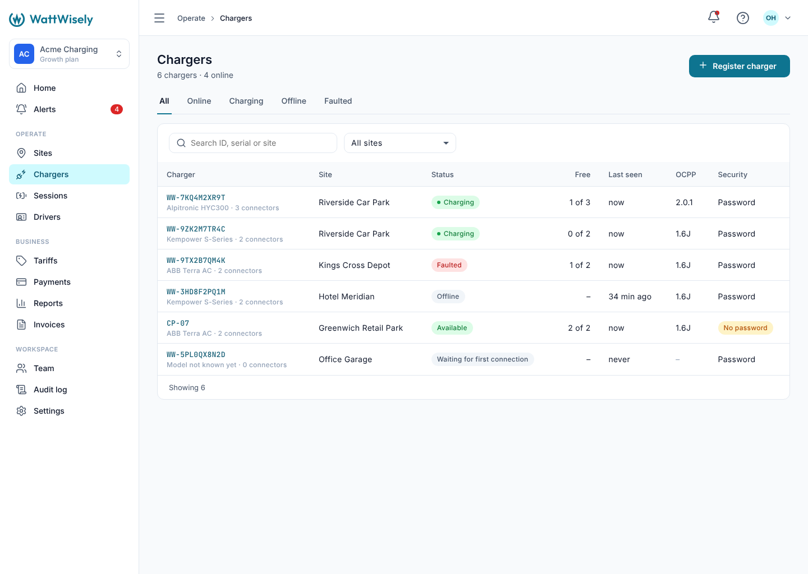            |
| Portal, branding       | 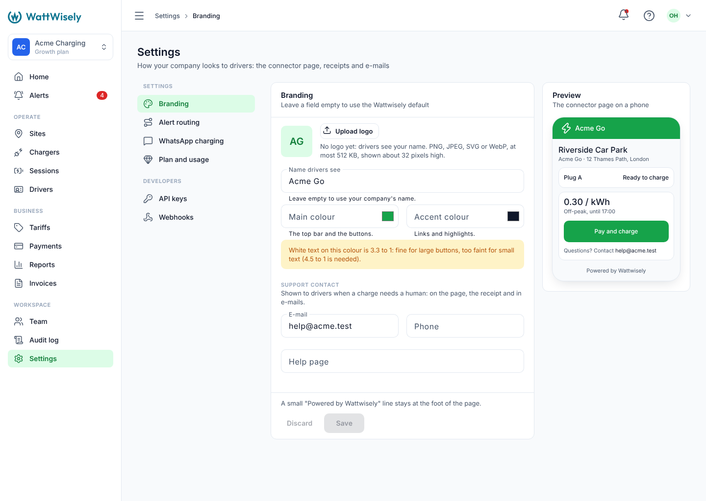            | 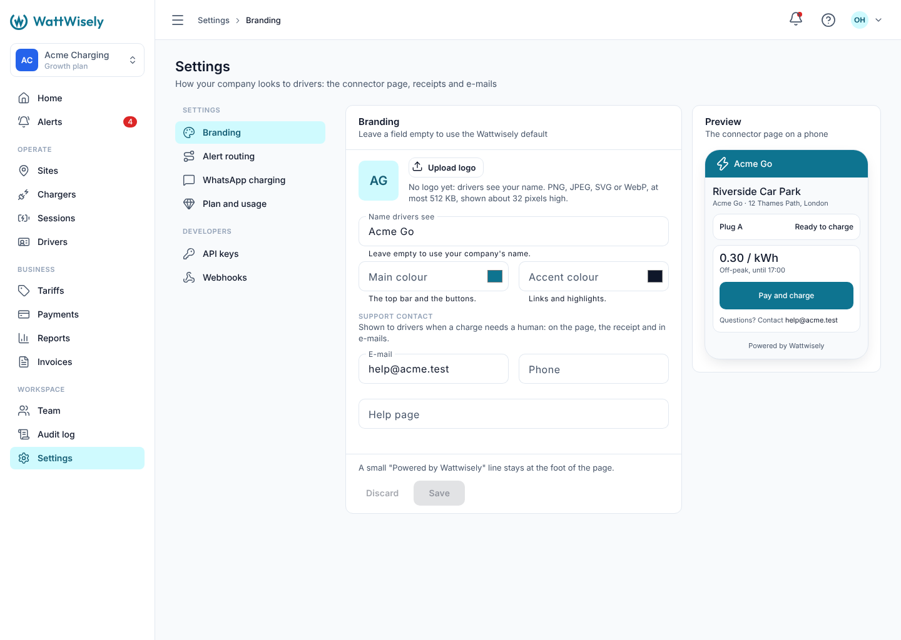            |
| Console                | 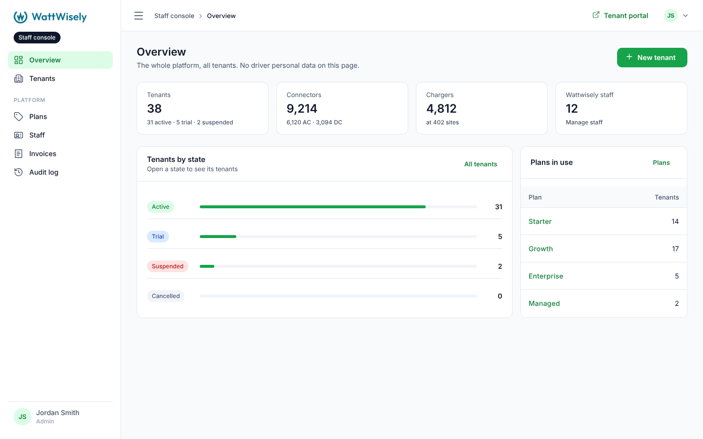                | 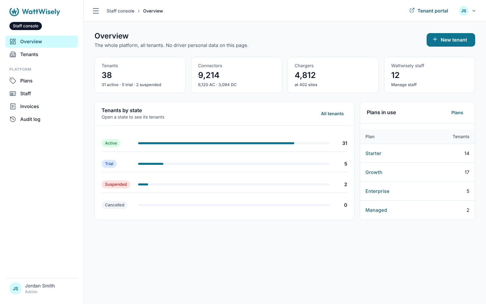                |
| Driver app, home       | 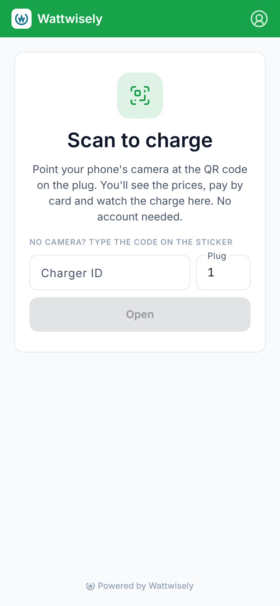      | 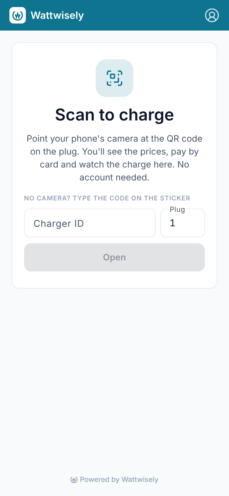      |
| Driver app, invitation | 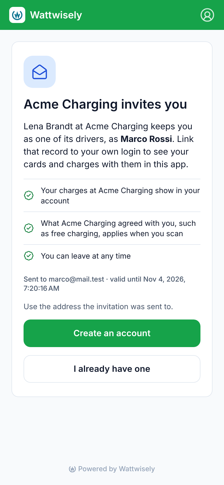 | 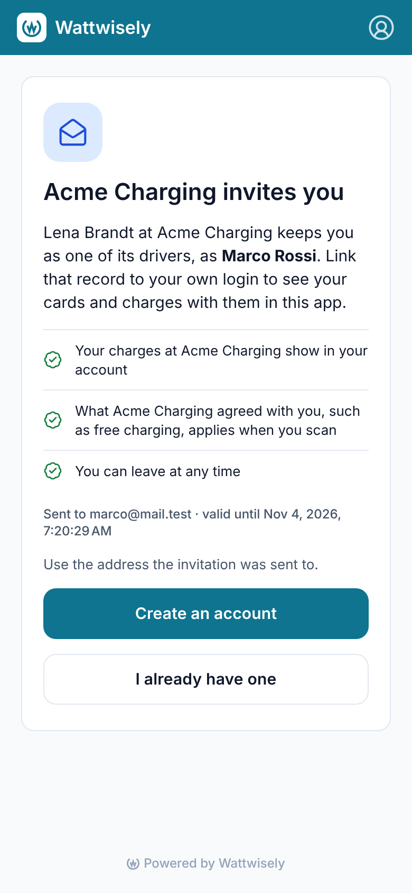 |
| Sign in (Keycloak)     | 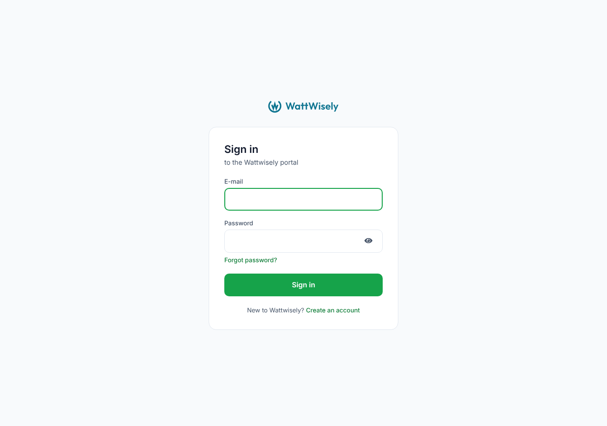             | 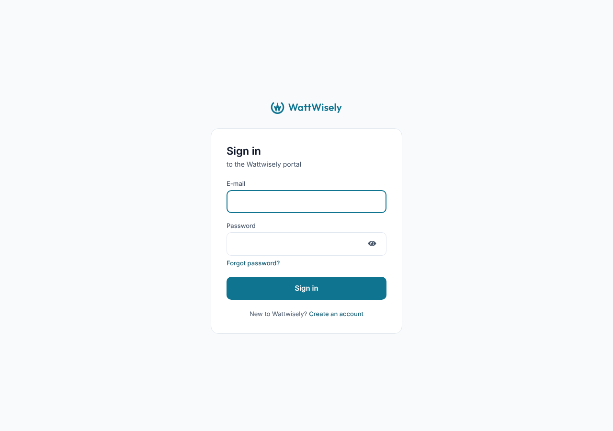             |
| Sign in, phone         | 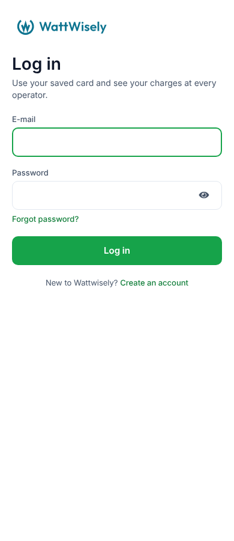 | 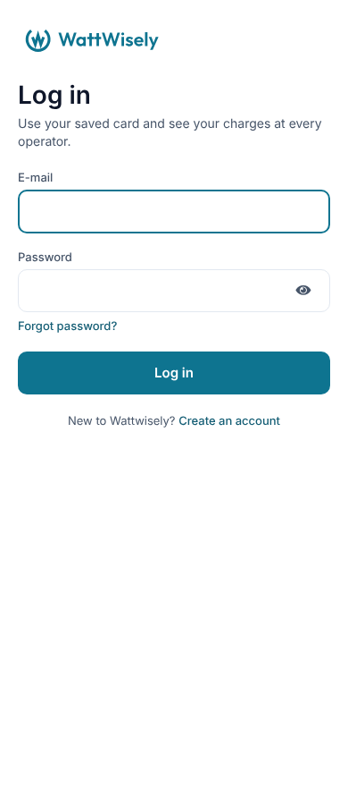 |

## How the pieces fit

**`theme.json`** (version 4) changes the three brand colors and adds three: `success`, `successSoft` and `successText`, the old greens. The `available` and `charging` statuses name the new ones. `npx nx run theme:generate` writes them out as before: `--ww-success`, `--ww-success-soft` and `--ww-success-text` in `tokens.css` (the apps' and Keycloak's), `PlatformColours.SUCCESS` and the rest, and Keycloak's e-mail colors. `PlatformColours.PRIMARY`, the default of an operator with no colors, follows `primary`, so it is teal too.

**The places that meant "good"** read the success variables instead of the brand ones: `.ww-notice.ok` in `packages/ui`, the KPI card's rising figure, the session timeline's dots, the site map's pins, the alert routing page's "Saved", the driver's free charges and the invitation's check marks, and Keycloak's success alerts. Everything else that read the brand, or Material's `primary`, follows it to teal without a change.

**`packages/ui/src/styles/_material.scss`** builds Material's palette from cyan rather than green. theme.json sets the tokens that matter on `:root`; the palette only fills the ones it does not name, so none of them is left green.

**The driver app's `index.html` and `manifest.webmanifest`** carry `#0e7490` as the phone's browser color.

## Design decisions

- **Teal for the brand, green for good news.** A charger that is ready to use, or a charge in progress, reads as green everywhere in EV charging, and the approved screens drew it so. Keeping it apart from the brand keeps that meaning, and the two never compete: teal is for what you can press, green for what is going well.
- **Tailwind's cyan scale, as the rest of the palette is Tailwind's.** The logo's teal is cyan 700, so the brand is cyan 700, links and text are cyan 800, and the tint is cyan 100, as the green was green 600, 700 and 100. White on the teal is 5.4 to 1 (the green was 3.3), so white text on buttons now passes WCAG AA at any size; links are 7.3 to 1 on white and 6.5 on the tint.
- **The logo keeps its own color, `logo`,** equal to `brand` today. A later change to the interface's color does not recolor the logo by accident.
- **An operator's own colors win.** Drivers see an operator's chosen colors on its pages, as before. An operator that never set one now gets the teal. One that typed the old green itself keeps it, with the dark text the contrast rule gives it, since the white-on-green exception was for the platform's own default.

## How it was checked

- The theme spec checks that the default brand is the teal with white text, that the e-mail header is teal, and that the available and charging statuses stay green. The mail and portal specs that named the default color now name the teal.
- In a browser, before and after builds of all three apps with the API stubbed: home, chargers, sites, a session, tariffs, reports, roles, alert routing, branding, the console's overview, and the driver's home, plug page, live charge, invitation and charges; Keycloak 26 with the theme.
- `prettier --check .` and `NX_NO_CLOUD=true npx nx run-many -t lint test build`.

## Read the code in this order

1. `packages/theme/theme.json`: the brand and success colors, and the statuses.
2. `packages/theme/src/tokens.css`, generated, and `packages/theme/src/lib/theme-files.spec.ts`.
3. `packages/ui/src/styles/_material.scss` and `_base.scss`.
4. The success variables in the apps: `git grep -- --ww-success apps packages deploy`.
