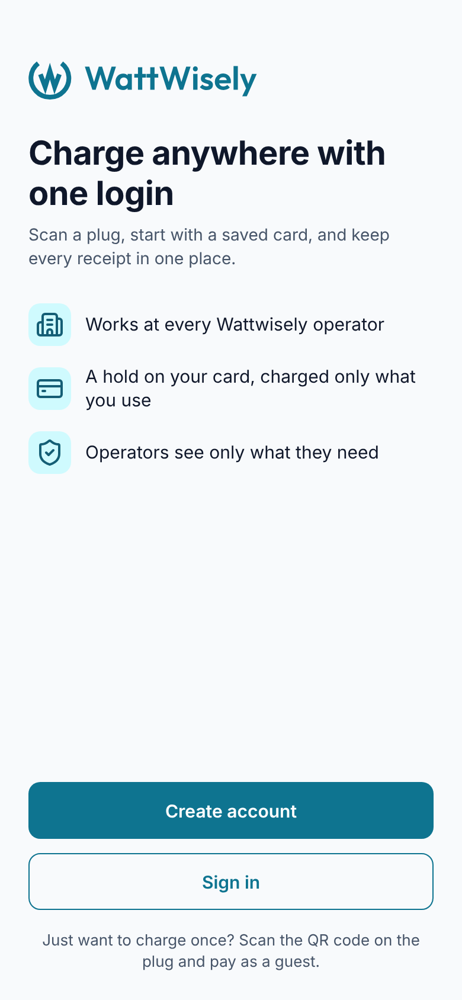
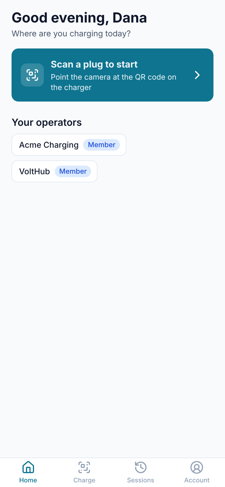
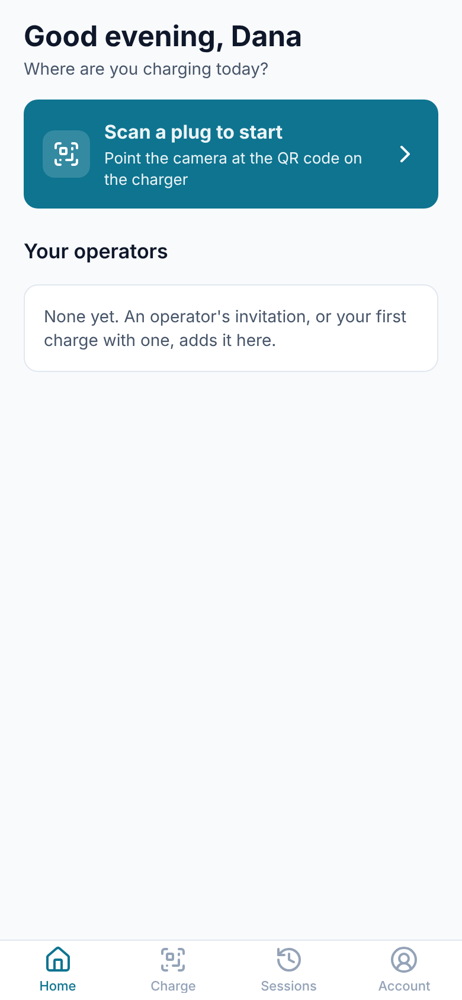
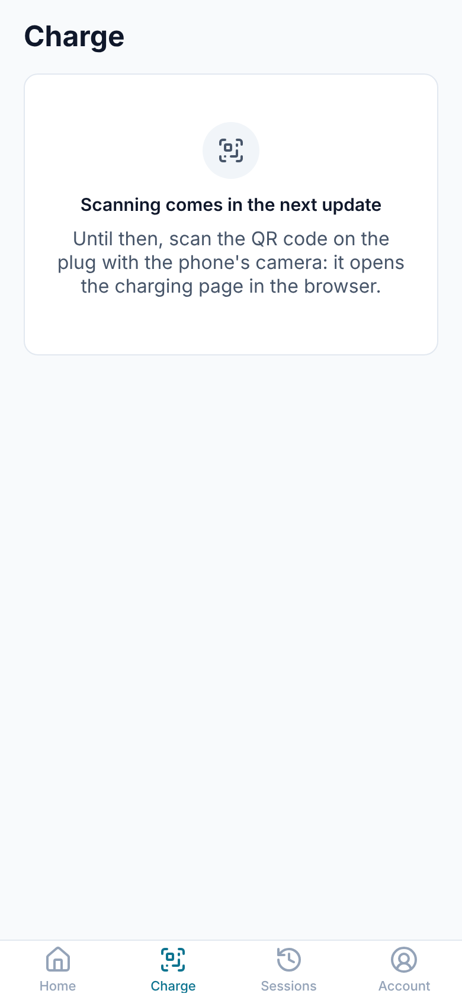
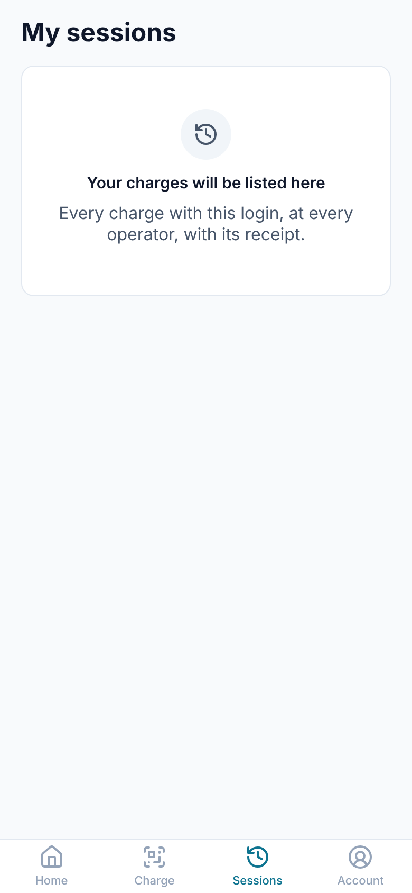
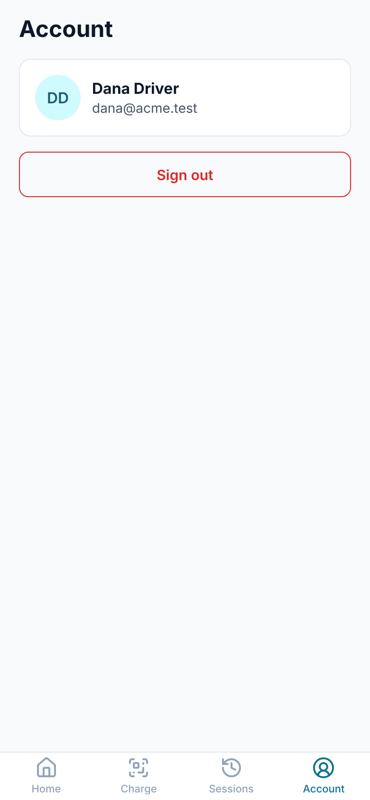

# Module 30: the mobile app's shell

The driver gets an app for Android and iOS, built from one Angular code base with Ionic and Capacitor. **This module builds its frame**: the welcome page, the four tabs of the design (Home, Charge, Sessions, Account), and the sign-in. **The driver signs in once, in the phone's own browser sheet**, with the same Keycloak login as the driver web app; the tokens are kept in the iOS Keychain or the Android Keystore and refreshed when they run out, so the app stays signed in. **Home greets the driver and lists their operators**; Account shows who is signed in and the way out. Charge and Sessions say what comes next; the charging, history and account screens fill them in the modules after this one.

**The driver web app and the mobile app now share their code** for the driver API, its models, the run-time settings, the token interceptor, the charges a phone remembers and the helpers that turn a charge into words, money and steps: it moved from `apps/driver` into `packages/driver-core`, with no change of behaviour.

Stories covered: Dana installs the app, reads what it is for and taps "Sign in"; Keycloak opens over the app, she signs in with `dana@acme.test`, and she lands on Home, greeted by name, with Acme Charging listed as an operator she belongs to; a week later she opens the app and is still signed in; on Account she sees her name and address and signs out, which ends her Keycloak session too.

The plan this module starts is in the project's "Driver mobile app plan" document: one code base, an Android App Bundle for Google Play and an iOS build for the App Store, in modules 30 to 35.

## What changed

| Where                    | Before                                         | Now                                                                                                                                                                                                                           |
| ------------------------ | ---------------------------------------------- | ----------------------------------------------------------------------------------------------------------------------------------------------------------------------------------------------------------------------------- |
| `apps/mobile`            | A name in the README                           | An Angular 22 app with Ionic 9 and Capacitor 8; the Android project (`android/`) and the iOS project (`ios/`) beside it, committed                                                                                            |
| `packages/driver-core`   | Did not exist                                  | The driver API services and models, `RuntimeConfig` and its loader, `DriverApiInterceptor`, `MyChargesStore`, and the charge helpers and pipes, all moved from `apps/driver` with their specs                                 |
| The token interceptor    | Asked the driver web app's `DriverAuthService` | Asks a `DriverSession`; each app says which service that is                                                                                                                                                                   |
| `packages/theme`         | `tokens.css` and the Keycloak theme            | Also `ionic.css`: Ionic's color variables from the same `theme.json`, with the r, g, b triple, text color, shade and tint Ionic wants worked out by `ColourMix`                                                               |
| Keycloak's driver client | The driver web app's addresses                 | Also `com.wattwisely.driver:/*` as a redirect and sign-out address, and the app's web view origins `https://localhost` (Android) and `capacitor://localhost` (iOS)                                                            |
| The API's CORS           | The portals and the driver web app             | Also `https://localhost` and `capacitor://localhost`, where the app's pages run on a phone                                                                                                                                    |
| CI                       | No mobile build                                | `.github/workflows/mobile.yml`: a debug APK on every pull request that touches the app or what it shares, kept 14 days as a download, and an unsigned iOS simulator build on macOS; lint, tests and the web build in `ci.yml` |

## Screens

At 390 wide, as a phone shows them, in a desktop browser with the API stubbed. The brand color is the logo's teal (module 29), where the Figma mobile screens still show green.

| Welcome                           | Home                                | Home, no operator yet                                   |
| --------------------------------- | ----------------------------------- | ------------------------------------------------------- |
|  |          |  |
| **Charge**                        | **Sessions**                        | **Account**                                             |
|    |  |                        |

## How the sign-in works

```
Welcome: "Sign in"
  └─ MobileAuthService.login() ─ angular-oauth2-oidc builds Keycloak's URL with PKCE
       └─ openUri: NativeBrowser.open() ─ Custom Tabs (Android) or Safari (iOS) over the app
            └─ Keycloak, driver browser flow ─ redirects to com.wattwisely.driver:/callback?code=…
                 └─ the phone hands the link to the app: NativeApp.onUrlOpen
                      └─ MobileAuthService.handleUrl() ─ closes the sheet, swaps the code for tokens
                           └─ SecureTokenStore ─ memory now, Keychain or Keystore behind it
Start-up and every return to the foreground
  └─ refreshIfNeeded() ─ a refresh token and no valid access token: refresh; refused by Keycloak: signed out here
```

In a desktop browser (`npx nx serve mobile`, for development) the same service sends the page to Keycloak and back, as the driver web app does.

## Design decisions

| Decision                                                                                                                             | Why                                                                                                                                                                                                                                                                |
| ------------------------------------------------------------------------------------------------------------------------------------ | ------------------------------------------------------------------------------------------------------------------------------------------------------------------------------------------------------------------------------------------------------------------ |
| **Capacitor and Ionic, in this repository.** One Angular code base gives both store apps; the web build runs in the phone's web view | The driver web app is Angular, and half of it is now shared as `packages/driver-core`; the theme, the icons and the API's models stay in one place, and an API change and its screen land in one pull request                                                      |
| **The sign-in opens in the system browser, never inside the app**                                                                    | The password never passes through the app; the phone can fill it in; Google and Apple sign-in, later, refuse embedded web views                                                                                                                                    |
| **A custom scheme, `com.wattwisely.driver:/callback`, for now**                                                                      | It needs no domain. The charging module adds App Links and Universal Links on the charge domain, so QR codes open the app, and the sign-in can move to them                                                                                                        |
| **`offline_access`**                                                                                                                 | Keycloak's browser session ends after 30 minutes idle; an offline refresh token keeps an app signed in for 30 days idle, as drivers expect                                                                                                                         |
| **Tokens in the Keychain or Keystore, read from memory.** `SecureTokenStore` is the library's `OAuthStorage`                         | angular-oauth2-oidc reads its storage synchronously; the plugin is asynchronous. The store loads once at start-up and writes every change through                                                                                                                  |
| **A refresh is dropped only when Keycloak refuses it (400).** Offline, the app keeps its tokens and opens anyway                     | A driver in an underground car park must not be signed out                                                                                                                                                                                                         |
| **Ionic's iOS style on both phones**                                                                                                 | The design is one look for both; Ionic's iOS style is the closer of its two                                                                                                                                                                                        |
| **Ionic's colors are generated** into `packages/theme/src/ionic.css`                                                                 | Colors live in `theme.json` and nowhere else; a palette change reaches the app with `npx nx run theme:generate`                                                                                                                                                    |
| **Icons are the same Lucide set**, through `packages/ui`'s icon registry and `mat-icon`                                              | The tab bar, the welcome page and the portal use one set of icons                                                                                                                                                                                                  |
| **`config.json` is bundled** with the app                                                                                            | An installed app has no server to write it at start-up, as the driver web app's container does. The CI APK points at a test server when the repository variables `MOBILE_API_URL` and `MOBILE_KEYCLOAK_URL` are set; module 31 gives each environment its own file |

## Read the code in this order

1. `packages/driver-core/src/index.ts`: what moved, and `lib/auth/driver-session.ts`, the one new piece.
2. `packages/theme/src/lib/colour-mix.ts` and `ionic-colours-css.ts`, then the generated `ionic.css`.
3. `apps/mobile/capacitor.config.ts`, `project.json` (targets `sync` and `apk`), `src/main.ts`, `src/app/app.config.ts`, `app.routes.ts`, `app.component.ts`, `src/styles.scss`.
4. `src/app/core/native/*`: the phone's browser sheet, its app events, its secure storage.
5. `src/app/core/auth/mobile-auth-config.factory.ts`, `auth-redirects.ts`, `secure-token-store.ts`, `mobile-auth.service.ts`, then the two guards.
6. `src/app/core/account/account.store.ts` and `shared/greeting.ts`.
7. `src/app/features/welcome`, `tabs`, `home`, `account`, `charge`, `sessions`.
8. `android/app/src/main/AndroidManifest.xml` and `ios/App/App/Info.plist`: the URL scheme that brings Keycloak's answer back to the app.
9. `.github/workflows/mobile.yml`, `deploy/keycloak/realm/wattwisely-realm.json` (the driver client), `deploy/docker-compose.yml` (`CORS_ORIGINS`).

## Running it

In a desktop browser, with the Docker stack running: `npx nx serve mobile` opens the app on <http://localhost:4500>. Signing in there needs that address in Keycloak's driver client: set `DRIVER_DEV_URL=http://localhost:4500` in `deploy/.env` on a fresh installation, or add it to the client's redirect URIs and web origins by hand.

On a phone, the app needs a server it can reach: Keycloak's address is written into every token, and a phone cannot reach `*.localhost` on a development machine. Put the server's addresses in `apps/mobile/public/config.json`, then:

```sh
npx nx run mobile:apk            # web build, cap sync, Gradle: apps/mobile/android/app/build/outputs/apk/debug/app-debug.apk
npx nx run mobile:sync           # then open apps/mobile/ios/App/App.xcodeproj in Xcode and run it on a phone or simulator
```

Or download the APK that CI builds for a pull request (the `wattwisely-debug-apk` artifact of the Mobile workflow), with `MOBILE_API_URL` and `MOBILE_KEYCLOAK_URL` set as repository variables. Android Studio with SDK 36 and JDK 21 builds the APK locally; Xcode 16 or later builds for iOS. For a server on plain http, sync with `CAPACITOR_CLEARTEXT=true`.

An existing realm needs the driver client's new addresses by hand: see `deploy/README.md`.

## How it was checked

`prettier --check .` and `nx run-many -t lint test build` pass for every project. The driver web app's build and tests pass unchanged after the move to `packages/driver-core` (its 20 moved tests now run there). New specs: `ColourMix` and the Ionic colors in `theme-files.spec.ts`; in the app, `MobileAuthConfigFactory`, `AuthRedirects`, `SecureTokenStore`, `MobileAuthService` (sign-in from the callback link, refresh at start-up and on return, signed out only on a refused refresh, opening offline, sign-up), `AccountStore`, `Greeting`, and the welcome and home pages. The screens above were taken with Playwright against the production build, the API stubbed and Keycloak unreachable, at 390 wide. `npx cap add android` and `npx cap add ios` generated the native projects; the Gradle and Xcode builds run in the Mobile workflow, as the session that wrote this module had no Android SDK or Mac.

## Not in this module

- Scanning a plug, the plug page, starting and following a charge, App Links and Universal Links: module 32.
- Signing, store uploads (Play internal testing, TestFlight), app icons and splash screen from the logo, a `config.json` per environment: module 31. The app still has Capacitor's default icon.
- My sessions, receipts, payment methods, operators, privacy and account deletion: module 33. Push notifications: module 34. Nearby chargers: module 35.
- Sign in with Google or Apple, and e-mail codes.
