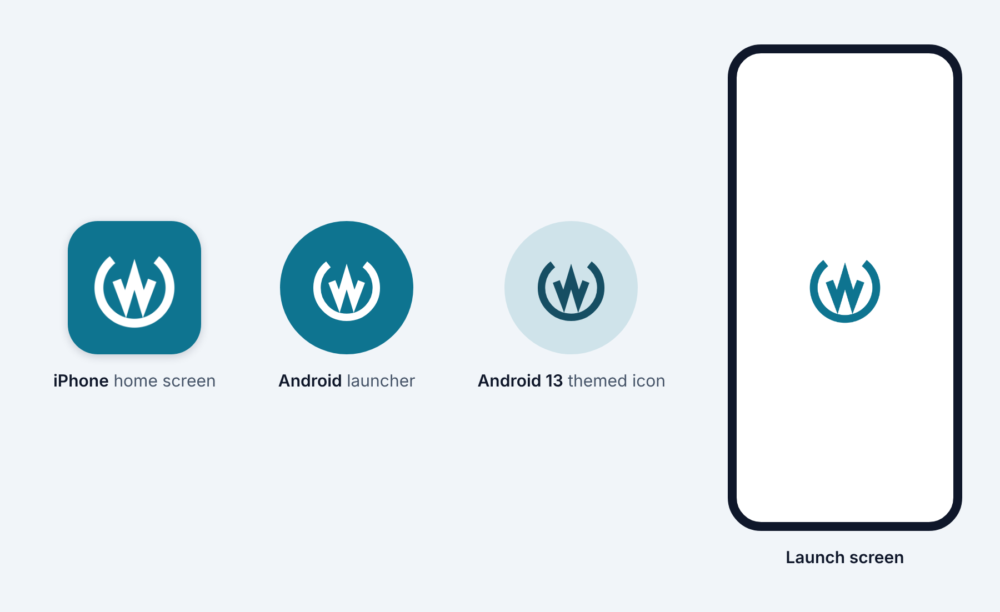

# Module 31: the mobile app's release pipeline

The mobile app gets everything it needs to reach testers' phones from GitHub. **A tag such as `mobile-v0.1.0` builds the app against the production server, signs it, and sends it to Google Play's internal testing track and to TestFlight**. Running the Mobile release workflow by hand does the same for any version, against staging or production. **The app now has its own icon and launch screen**: the white mark on the logo's teal on the home screen, and the teal mark on white while it starts. Both are drawn from the logo's path data, as every other logo is since module 28.

**Nothing reaches a store until the accounts exist.** The workflow needs a Google Play developer account, an Apple Developer Program membership, and their keys as repository secrets. Until they are set, both jobs stop at their first step and name the secrets that are missing. "Before the first release" below lists each account, key and secret, and how to make it.

Stories covered: Marco tags `mobile-v0.1.0`, and the workflow puts the build on Google Play's internal testing track and in TestFlight. Dana, an internal tester, installs it from the Play Store's testing link or the TestFlight app, sees the Wattwisely icon on her home screen, and signs in against the production server. A week later Marco releases 0.2.0. Dana's phone offers the update, and the build number has grown by itself.

## What changed

| Where                                  | Before                                   | Now                                                                                                                                                                                        |
| -------------------------------------- | ---------------------------------------- | ------------------------------------------------------------------------------------------------------------------------------------------------------------------------------------------ |
| The app's icon                         | Capacitor's placeholder                  | The white mark on the logo's teal. Android 8 and later draw it as a vector adaptive icon, with a themed version for Android 13. iOS and Android 7 get PNGs                                 |
| The launch screen                      | Capacitor's placeholder                  | The teal mark on white. Android 12 and later use the system splash, and older phones get a layer list. iOS gets Capacitor's launch image                                                   |
| `packages/theme`                       | Writes the web, Ionic and Keycloak files | Also writes the Android vector drawables and icon colors (`theme:generate`, checked by its spec). The new `theme:icons` target draws the PNGs with `sharp`                                 |
| Android release build                  | Version 1.0, build 1, unsigned           | Takes its version, build number and upload key from the environment. The new `mobile:bundle` target builds the App Bundle                                                                  |
| iOS project                            | —                                        | Declares that the app uses only exempt encryption (`ITSAppUsesNonExemptEncryption`), so TestFlight stops asking about export compliance on every build                                     |
| `apps/mobile/fastlane`, `Gemfile`      | —                                        | The lane `android internal` uploads the bundle to internal testing. The lane `ios beta` imports the certificate, gets the App Store profile, archives the app and uploads it to TestFlight |
| `.github/workflows/mobile-release.yml` | —                                        | A tag `mobile-v*`, or a run by hand, starts three jobs: the version and build number, Android, and iOS                                                                                     |
| `.github/actions/mobile-config`        | Inline in `mobile.yml`                   | Writes `config.json` from the server's addresses. A release fails without them                                                                                                             |
| `.github/workflows/mobile.yml`         | Debug APK and simulator build            | Also builds the release App Bundle, unsigned, so a break in the release build shows on the pull request                                                                                    |

## The icon and launch screen



Every image is drawn from `BrandMark`, the logo's path data, in the color `theme.json` gives `logo`:

| Image                                               | Drawn by                                   | How                                                                                                                              |
| --------------------------------------------------- | ------------------------------------------ | -------------------------------------------------------------------------------------------------------------------------------- |
| Android adaptive icon and its themed version        | `AndroidIconXml`, `theme:generate`         | `drawable/ic_launcher_foreground.xml`, a vector with the ring 54 dp across in the 108 dp box, on `@color/ic_launcher_background` |
| Android 12+ splash, and older phones' launch screen | `AndroidIconXml`, `theme:generate`         | `drawable/splash_mark.xml` on `@color/splash_background`, through `windowSplashScreenAnimatedIcon` or `drawable/splash.xml`      |
| iOS icon                                            | `AppIconSvg`, `AppIconPngs`, `theme:icons` | One 1024-pixel PNG, opaque (the App Store refuses transparency), with the ring at 60% of its width                               |
| iOS launch image                                    | the same                                   | A 2732-pixel square with the mark in the middle, which the launch storyboard crops to the screen                                 |
| Android 7 launcher icons                            | the same                                   | `mipmap-*/ic_launcher.png` and `ic_launcher_round.png`, 48 to 192 pixels                                                         |

After a change to the logo or its color, run `npx nx run theme:generate`, then `npx nx run theme:icons`, and commit what they write.

## How a release runs

```
git tag mobile-v0.2.0 && git push origin mobile-v0.2.0      (or Actions → Mobile release → Run workflow)
  └─ version job: 0.2.0, build number = run number × 10 + attempt, environment mobile-production
       ├─ android (ubuntu): config.json from the environment's variables
       │    └─ nx run mobile:bundle ─ web build, cap sync, Gradle bundleRelease signed with the upload key
       │         └─ the .aab kept 30 days as a download
       │              └─ fastlane android internal ─ Google Play, internal testing track
       └─ ios (macOS): config.json, nx run mobile:sync
            └─ fastlane ios beta ─ temporary keychain, certificate, App Store profile (made the first time)
                 └─ archive with MARKETING_VERSION 0.2.0 and build number ─ TestFlight; the .ipa kept 30 days
```

Both stores refuse a build number they have already seen. The run number grows with every run, and the attempt separates re-runs: run 7 is build 71, and its re-run is build 72.

## Before the first release

These steps are done once, by whoever owns the accounts. A secret goes in **Settings → Secrets and variables → Actions → Secrets**. A variable goes in the **Variables** tab beside it. The server addresses are variables on each environment, under **Settings → Environments**.

### The server

| Name                                    | Kind                                                                   | Value                                                                                                                |
| --------------------------------------- | ---------------------------------------------------------------------- | -------------------------------------------------------------------------------------------------------------------- |
| `MOBILE_API_URL`, `MOBILE_KEYCLOAK_URL` | Variables of the environments `mobile-production` and `mobile-staging` | The server's API and Keycloak addresses over https, such as `https://api.example.com` and `https://auth.example.com` |

The server must accept the app's addresses: the driver client's redirect `com.wattwisely.driver:/*` and the CORS origins `https://localhost` and `capacitor://localhost` (module 30, `deploy/README.md`). A required reviewer on `mobile-production` makes every production release wait for a click.

### Google Play

1. Open a Google Play developer account (a one-off fee). In Play Console, create the app **Wattwisely** with the package name `com.wattwisely.driver`, and keep Play App Signing on.
2. Make the upload key, and keep the file and both passwords somewhere safe. Google can reset a lost upload key, but only on request:
   ```sh
   keytool -genkeypair -v -keystore upload.jks -alias upload -keyalg RSA -keysize 2048 -validity 10000
   base64 -w0 upload.jks      # on macOS: base64 -i upload.jks
   ```
3. In Google Cloud, create a service account with a JSON key. In Play Console → Users and permissions, invite its e-mail address with permission to release to testing tracks for this app.
4. Set the secrets: `ANDROID_KEYSTORE_BASE64` (the output of `base64`), `ANDROID_KEYSTORE_PASSWORD`, `ANDROID_KEY_ALIAS` (`upload`), `ANDROID_KEY_PASSWORD`, and `PLAY_SERVICE_ACCOUNT_JSON` (the whole JSON file).
5. **The first bundle goes up by hand**, because Google Play's API cannot add a bundle to an app that has none. Run the workflow once. Its Android job fails at the upload, but the signed `.aab` is a download on the run. Upload it under Testing → Internal testing in Play Console, and add the testers' e-mail addresses there.
6. Until the app's first release has been reviewed, Google Play accepts only drafts, so the lane sends drafts by default and each one is rolled out with a click in Play Console. After that, set the variable `PLAY_RELEASE_STATUS` to `completed` and builds reach testers by themselves.

### Apple

1. Join the Apple Developer Program (a yearly fee). Under Certificates, Identifiers & Profiles → Identifiers, register the App ID `com.wattwisely.driver`. In App Store Connect → Apps, create the app with that bundle ID.
2. Set the variable `IOS_TEAM_ID` to the team ID from the Membership page.
3. Make an **Apple Distribution** certificate. This works without a Mac:
   ```sh
   openssl req -new -newkey rsa:2048 -nodes -keyout distribution.key -out distribution.csr -subj "/CN=Wattwisely"
   # upload distribution.csr under Certificates → +, Apple Distribution; download distribution.cer
   openssl x509 -inform DER -in distribution.cer -out distribution.pem
   openssl pkcs12 -export -legacy -inkey distribution.key -in distribution.pem -out distribution.p12
   base64 -w0 distribution.p12
   ```
   Set `IOS_CERTIFICATE_P12_BASE64` to the output and `IOS_CERTIFICATE_PASSWORD` to the export password.
4. In App Store Connect → Users and Access → Integrations, generate an App Store Connect API key with the App Manager role. Set `ASC_KEY_ID`, `ASC_ISSUER_ID` and `ASC_KEY_P8_BASE64` (the `.p8` file, in base64). The lane uses the key to make the App Store provisioning profile the first time, and to upload.
5. Add testers under TestFlight. Internal testers, who are App Store Connect users, get each build as soon as Apple has processed it. External testers wait for Apple's beta review of the first build of each version.

## Releasing

```sh
git tag -a mobile-v0.1.0 -m "Mobile 0.1.0" && git push origin mobile-v0.1.0
```

The version is three numbers. A tag always releases against `mobile-production`. For a build against staging, or a build of a branch, use Actions → Mobile release → Run workflow and give the version. A version stays the same across fixes until the next release: the build number tells the builds apart.

## Design decisions

| Decision                                                                           | Why                                                                                                                                                                                                                                                                                                                  |
| ---------------------------------------------------------------------------------- | -------------------------------------------------------------------------------------------------------------------------------------------------------------------------------------------------------------------------------------------------------------------------------------------------------------------- |
| **fastlane for the stores, Gradle for the Android build**                          | fastlane is the usual way to talk to Google Play and App Store Connect, and its `setup_ci`, `import_certificate` and `get_provisioning_profile` handle iOS signing on a fresh runner. Building the bundle through `nx run mobile:bundle` keeps one build command for a contributor, the pull request and the release |
| **The certificate is a secret, and the profile is made by the API key**            | fastlane's `match` would need another repository or a storage bucket to hold the certificates. One certificate, from Apple's portal, is enough for one app and one team                                                                                                                                              |
| **Signing keys and passwords go to the steps that need them, never the whole job** | `npm ci` runs the install scripts of hundreds of packages, which never see the keys                                                                                                                                                                                                                                  |
| **The server's addresses come from GitHub environments**                           | An installed app cannot read its settings from a server, so `config.json` is bundled. One file per environment in the repository would hold production's addresses in code. An environment can also require a reviewer before a production release                                                                   |
| **Build number = run number × 10 + attempt**                                       | It grows with every run without a counter to keep, and a re-run of a failed upload gets a number of its own                                                                                                                                                                                                          |
| **Vector icons on Android, PNGs where they are needed**                            | A vector stays sharp on every screen and follows `theme.json` through `theme:generate` like the other generated files. iOS and Android 7 need PNGs, which `theme:icons` draws from the same paths                                                                                                                    |
| **`sharp` draws the PNGs, not `@capacitor/assets`**                                | `@capacitor/assets` would need the logo as a PNG first, and its latest release pulls in an old `sharp` and Capacitor 5's CLI. `sharp` 0.35 draws the SVG directly from `BrandMark`                                                                                                                                   |
| **Drafts on Google Play until the first review**                                   | Google Play refuses anything else for an app that has never been reviewed. `PLAY_RELEASE_STATUS` switches it off afterwards, with no change to the code                                                                                                                                                              |

## Read the code in this order

1. `packages/theme/src/lib/android-icon-xml.ts`, `app-icon-svg.ts`, `app-icon-pngs.ts`, and the `ThemeFiles` entries.
2. `apps/mobile/android/app/src/main/res`: `mipmap-anydpi-v26/ic_launcher.xml`, `drawable/splash.xml`, `values/styles.xml`.
3. `apps/mobile/android/app/build.gradle`: the version and the upload key. `apps/mobile/project.json`: the `bundle` target.
4. `apps/mobile/Gemfile` and `fastlane/Fastfile`.
5. `.github/actions/mobile-config/action.yml`, `.github/workflows/mobile-release.yml`, then the new step in `mobile.yml`.

## How it was checked

- `prettier --check .` and `nx run-many -t lint test build` pass for every project.
- The theme's specs check the Android drawables and colors against `theme.json`. They also check that the iOS icon is 1024 pixels with no transparency, and that the round icon keeps its transparent corners.
- The images were drawn and looked at; the picture above shows them.
- `ruby -c` and `fastlane lanes` read the Fastfile. Every option the lanes pass was checked against fastlane 2.241.2's actions.
- `actionlint` passes for both workflows.
- **Not run yet:** the signed Gradle build and both uploads, which need the accounts above. The pull request's Mobile workflow builds the release App Bundle, unsigned, so the release build itself is checked there.

## Not in this module

- Store listings: screenshots, descriptions, the privacy policy and the data safety form. They are written in Play Console and App Store Connect before the public release, after module 35.
- Scanning and charging, App Links and Universal Links: module 32.
- Firebase and push notifications: module 34.
