# Module 32: scanning and charging in the mobile app

The mobile app now charges a car. **The Charge tab opens the camera on the QR code of a plug, or takes the code typed by hand, and the plug's page shows where it is, what it costs and what the driver is to the operator.** Start goes through the operator's consent the first time, then the card for a paid charge, and lands on the charge itself: the steps while the charger starts, the energy, power, cost and a power chart while the car charges, and the receipt with what became of the hold at the end. A plug's QR code or an operator's invitation opens straight in the app on a phone that has it, through Android's App Links and iOS's Universal Links.

Stories covered: Dana scans the sticker on connector B at Riverside Car Park with the app. She sees 0.45 per kWh until 21:00, the 20.00 hold on her Visa, and taps Start. The app ticks off the hold and the charger, later shows 12.4 kWh at 48 kW, and she stops from her phone. The receipt shows 8.80 taken and 11.20 released. Later Acme Charging invites her to its private depot, and the e-mail's link opens the app's invitation page, where she accepts.

## What changed

| Where                                  | Before                              | Now                                                                                                                                                                     |
| -------------------------------------- | ----------------------------------- | ----------------------------------------------------------------------------------------------------------------------------------------------------------------------- |
| The Charge tab                         | "Scanning comes in the next update" | The camera through `@capacitor/barcode-scanner` (ML Kit on Android, the system scanner on iOS), or the code typed by hand                                               |
| Plug, consent and card pages           | —                                   | `/plug/:identity/:connector`, `/consent` and `/card`, over the tabs, from module 19's `GET /v1/driver/places`                                                           |
| The charge                             | —                                   | `/charges/:id`: starting, live, complete, or why it did not start, followed every 3 seconds                                                                             |
| `GET /v1/driver/charges/{id}/readings` | —                                   | The driver's own charge as points: energy since the start, power and battery, the same points the staff session page draws                                              |
| Home                                   | Greeting, scan card, operators      | Also "Charging now" with the charge under way                                                                                                                           |
| The invitation                         | Web only                            | `/invitations/:token` in the app. `InvitationStore` moved to `packages/driver-core`, shared by both apps                                                                |
| Signed out on a link                   | The welcome page, then Home         | The welcome page, then the page the link asked for                                                                                                                      |
| Android and iOS projects               | Keycloak's URL scheme only          | An App Links intent filter and the Associated Domains entitlement for the driver web app's domain, `/c/*` and `/invitations/*`. iOS asks for the camera with a sentence |
| Oldest Android the app installs on     | Android 7.0 (API 24)                | Android 8.0 (API 26), which the scanner plugin needs. Module 31's Android 7 PNG icons stay in the project but no phone now uses them                                    |
| The driver web app's container         | —                                   | Writes `.well-known/assetlinks.json` and `apple-app-site-association` when `MOBILE_ANDROID_CERT_SHA256` and `MOBILE_IOS_TEAM_ID` are set                                |

## The screens

| 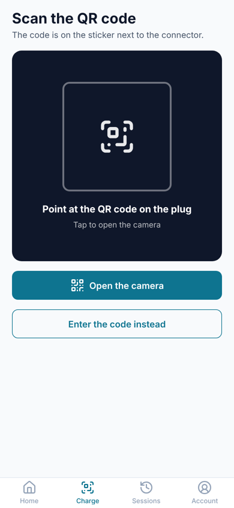            | 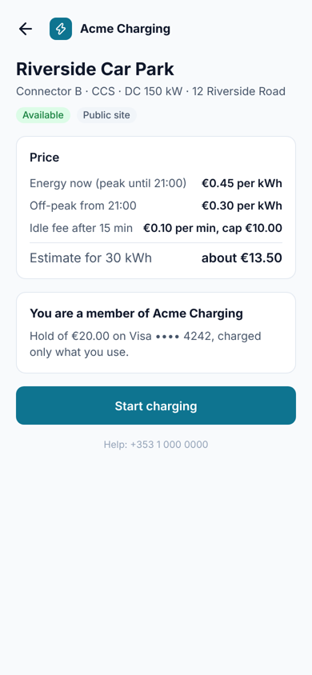             | 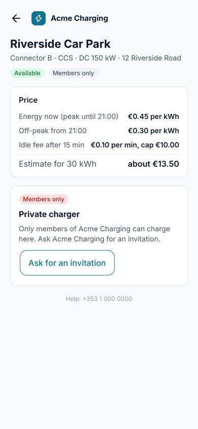 | 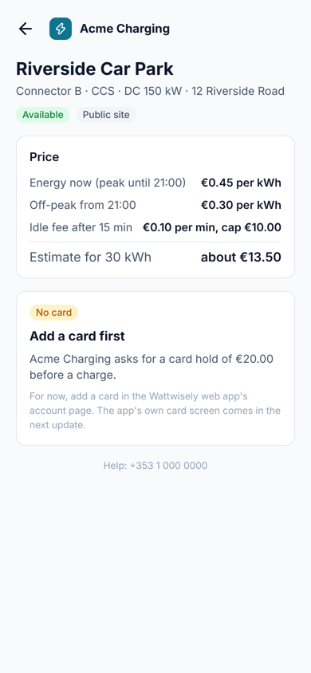       |
| -------------------------------------- | ------------------------------------------- | ------------------------------------------------ | -------------------------------------------- |
| 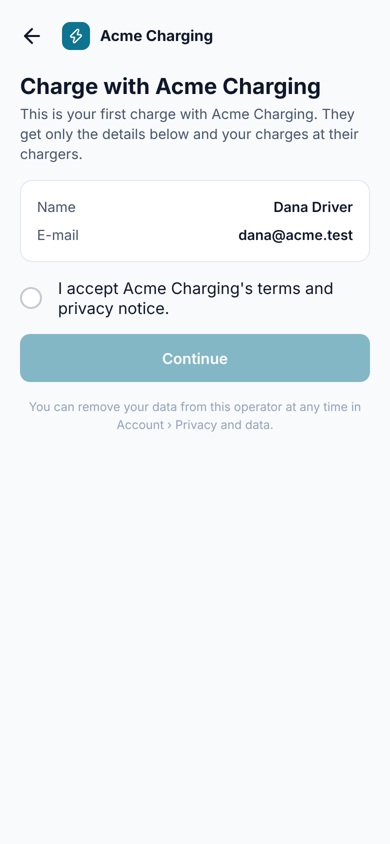 | 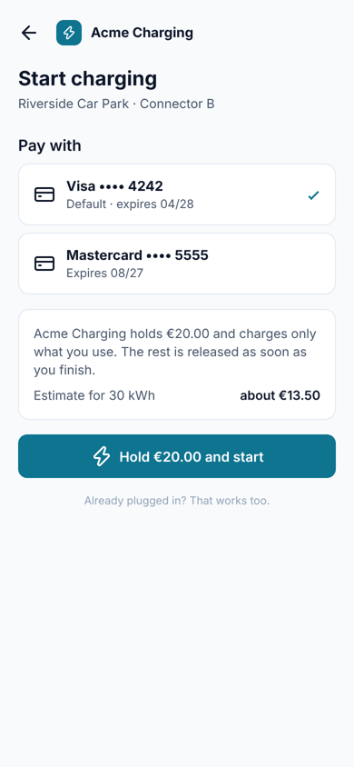             | 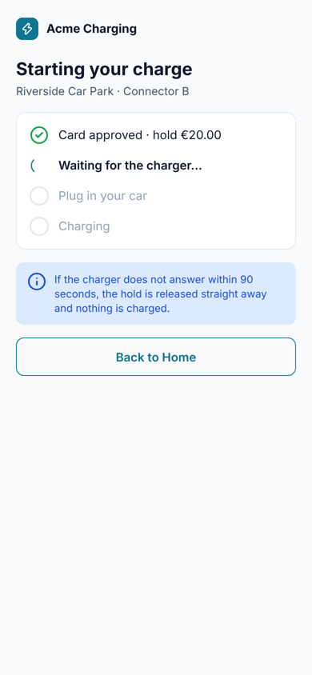              | 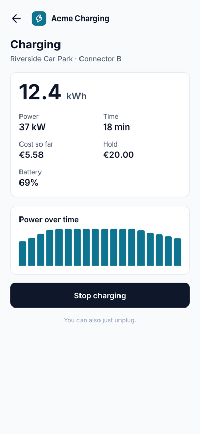                  |
| 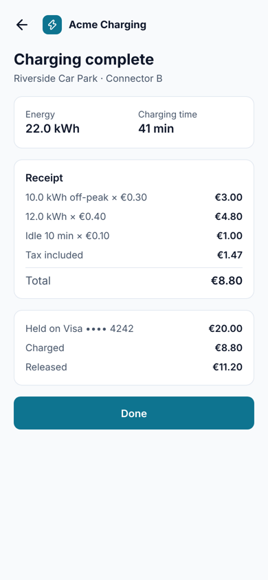    | 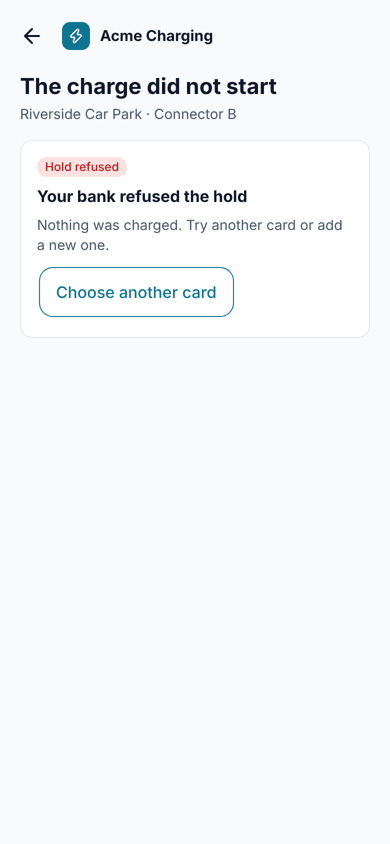 | 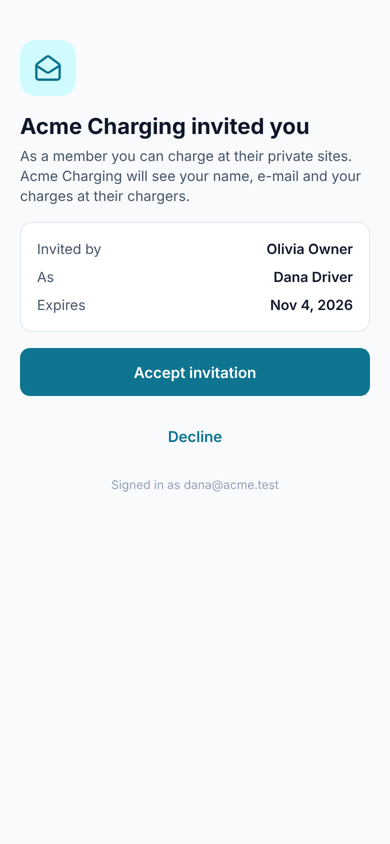          | 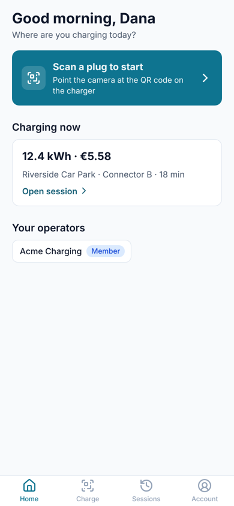 |

## From the QR code to the receipt

```
Charge tab ─ NativeScanner.scan() or the typed code ─ PlugCode.parse()
  └─ /plug/SIM-001/1 ─ GET /v1/driver/places/SIM-001/1 (PlugStore)
       ├─ can_charge false ─ CannotStarts: members only, in use, offline, no card, …
       └─ Start ─ ChargeStarter.next(place)
            ├─ needs_consent ─ /consent ─ the details the operator gets, the checkbox
            ├─ payment pay    ─ /card ─ the saved cards; a card picked becomes the default
            └─ payment free   ─ (straight on)
                 └─ POST /v1/driver/charges ─ navigateRoot('/charges/<id>'), so Back goes Home
                      └─ SessionStore: GET /v1/driver/charges/<id> every 3 s, readings every 9 s while live
                           starting ─ live ─ complete (settled once the hold is taken or released)
```

The API holds the default card, so the card page makes the chosen card the default before it starts. A charge that never started shows why: a refused hold offers "Choose another card", anything else uses the words of `ChargeWords.failure`.

The small classes under `apps/mobile/src/app/core/charging` hold the words, and each has a spec:

| Class           | Writes                                                                                                        |
| --------------- | ------------------------------------------------------------------------------------------------------------- |
| `PlugCode`      | The plug out of `https://charge.example.com/c/WW-7KQ4M2XR9T/1`, or `WW-7KQ4M2XR9T/1` typed by hand            |
| `PlugWords`     | "Connector B · CCS · DC 150 kW · 12 Riverside Road", "You are a member of Acme Charging", the hold's sentence |
| `PriceRows`     | "Energy now (peak until 21:00)", the other bands, the idle fee with its cap, "about 13.50" for 30 kWh         |
| `CannotStarts`  | The chip, title and sentence for each reason the API refuses a plug                                           |
| `StartingSteps` | The hold, the charger, the car, each done, now or still to come                                               |
| `PowerBars`     | Up to 18 bars of average power, as a fraction of the highest; the latest power and battery                    |
| `ReceiptRows`   | "10.0 kWh off-peak × 0.30", "Idle 10 min × 0.10", "Start fee"                                                 |
| `AppLinks`      | The app's page for a link that opened it                                                                      |

### The readings

`GET /v1/driver/charges/{id}/readings` answers only for the driver's own charge (404 otherwise), with the same rows as the staff page's `GET /v1/sessions/{id}/readings`. `SessionReadingPoints`, moved out of `SessionsService` so both endpoints share it, turns them into points: 0 Wh at the start, each meter value less the meter's start, and the stop reading once the session ended.

## Where it differs from the design

- **No "About 25 min to 80%" and no bell on the live screen.** The API does not estimate the time left, and notifications come with module 34.
- **Starting has "Back to Home", not "Cancel".** The API cannot call a charge off before the charger answers; it releases the hold by itself after 90 seconds.
- **No phone field on the first-charge screen.** The API takes no phone number at consent.
- **No "Add a card" yet.** A driver with no saved card is told to add one in the driver web app; module 33 brings the card form to the app.
- **No receipt PDF on the complete screen.** It comes with the sessions screens in module 33.

## App Links and Universal Links

A link opens the app only once the phone has checked that the domain names it. Both checks read files on the driver web app's domain (`DRIVER_HOST`), which its container writes at start-up:

| Phone   | The app declares                                                                                  | The domain serves                                                                              | Set                                                                                                             |
| ------- | ------------------------------------------------------------------------------------------------- | ---------------------------------------------------------------------------------------------- | --------------------------------------------------------------------------------------------------------------- |
| Android | An `autoVerify` intent filter for `https://<host>/c/` and `/invitations/` (`AndroidManifest.xml`) | `/.well-known/assetlinks.json`: the package and the signing key's SHA-256 fingerprint          | `MOBILE_ANDROID_CERT_SHA256` in `deploy/.env`: Google Play's app signing key, from Play Console → App integrity |
| iOS     | `applinks:<host>` in `App.entitlements`                                                           | `/.well-known/apple-app-site-association`: the team and bundle ID, `/c/*` and `/invitations/*` | `MOBILE_IOS_TEAM_ID` in `deploy/.env`                                                                           |

The host is `charge.localhost` in a local build. The release workflow passes the GitHub environment's variable `MOBILE_DRIVER_HOST` (for example `charge.example.com`) to Gradle and to `xcodebuild` as `APP_LINK_HOST`, and stops at its first step without it. **Turn on Associated Domains for the App ID** (Apple Developer → Identifiers → `com.wattwisely.driver`) before the next TestFlight build, or its profile will not match the entitlement. Without the two `.well-known` files a link opens in the browser, as before.

## Trying it

With the local trial running (`deploy/README.md`) and `DRIVER_DEV_URL=http://localhost:4500` in Keycloak's driver client:

```sh
npx nx serve mobile                                                         # http://localhost:4500 at phone width
npm run sim -- --url ws://ocpp.localhost/ocpp --identity WW-7KQ4M2XR9T      # in another terminal
```

Sign in as `dana@acme.test`, open Charge, choose "Enter the code instead" and type `WW-7KQ4M2XR9T/1`. Dana's group makes her charges free, so Start goes straight to the charge; the simulator starts and sends a meter value every 10 seconds, and the chart grows with them. On a phone, scan the plug's QR code from the portal's charger page with the app.
