# Module 33: sessions and account in the mobile app

The mobile app now keeps the driver's history and account. **The Sessions tab lists every charge with the login at every operator, by month with each month's total, filters by operator and shares the list as CSV; a charge opens its receipt, which downloads as a PDF. The Account tab leads to the saved cards and a new card through Stripe's own form, the operators and what each holds about the driver, the name and phone, and privacy and data: a download of everything held, and deleting the account.**

Stories covered: Dana opens Sessions and sees October at €46.30 for 98 kWh over 4 charges. She taps the charge at Riverside Car Park on 21 October, reads the receipt line by line, paid with her Visa, and saves its PDF to Files. Her Amex shows as expired, so she adds a Mastercard as her default. Before changing phones she downloads her data; a year later she deletes her account in the app, and Keycloak's own page deletes her login.

## What changed

| Where                                                | Before                             | Now                                                                                                                                                                         |
| ---------------------------------------------------- | ---------------------------------- | --------------------------------------------------------------------------------------------------------------------------------------------------------------------------- |
| The Sessions tab                                     | "Your charges will be listed here" | Every charge by month, the latest two months' totals, a filter by operator when there is more than one, and the CSV through the share sheet                                 |
| `/sessions/:id`                                      | —                                  | Where and when, energy, time and total, the receipt with how it was paid, the operator's support contact, and the receipt's PDF                                             |
| `GET /v1/driver/charges/{id}/receipt.pdf`            | —                                  | The receipt as an A4 PDF in the operator's name, for the driver's own priced charge only: 409 `receipt_not_ready` before pricing, 404 for anyone else's charge              |
| The Account tab                                      | Name, e-mail and Sign out          | A menu: Payment methods, My operators, Personal details, Privacy and data; Sign out and the version                                                                         |
| `/account/cards` and `/account/cards/new`            | —                                  | The saved cards with Default and Expired, Make default and Remove; Stripe's Payment Element to add one, and whether it becomes the default                                  |
| Plug and card pages                                  | "Add a card in the web app"        | "Add a card" opens the app's own card page and comes back to the plug                                                                                                       |
| `/account/operators`, `/account/operators/:tenantId` | —                                  | The linked operators, and one operator's record of the driver (name, e-mail, phone, reference, groups, charging cards), who pays, and Leave                                 |
| `/account/details`                                   | —                                  | The name and phone, saved with `PATCH /v1/driver/me`; "Change e-mail or password" opens Keycloak's account page                                                             |
| `/account/privacy`                                   | —                                  | The operators with a record, "Download my data", and "Delete my account"                                                                                                    |
| `GET /v1/driver/me/export`                           | —                                  | `my-wattwisely-data.json`: the account, each operator's record linked to it, the saved cards and the charges                                                                |
| `DELETE /v1/driver/me`                               | —                                  | Deletes the account's data (below), 204                                                                                                                                     |
| Charging complete                                    | Receipt and hold                   | Also "Download receipt (PDF)"                                                                                                                                               |
| Keycloak realm                                       | —                                  | The `delete_account` required action enabled, and the `delete-account` role in the realm's default roles                                                                    |
| `packages/driver-core`                               | —                                  | Gains, from the driver web app, `SavedCardsStore`, `ChargeHistory`, `CardFormFactory` and the Stripe forms, `OperatorStore` and `PaymentModeWords`, so both apps share them |
| Capacitor plugins                                    | —                                  | `@capacitor/filesystem`, `@capacitor/file-viewer` and `@capacitor/share`: a receipt opens in the phone's PDF viewer, the CSV and the data go to the share sheet             |

## The screens

| 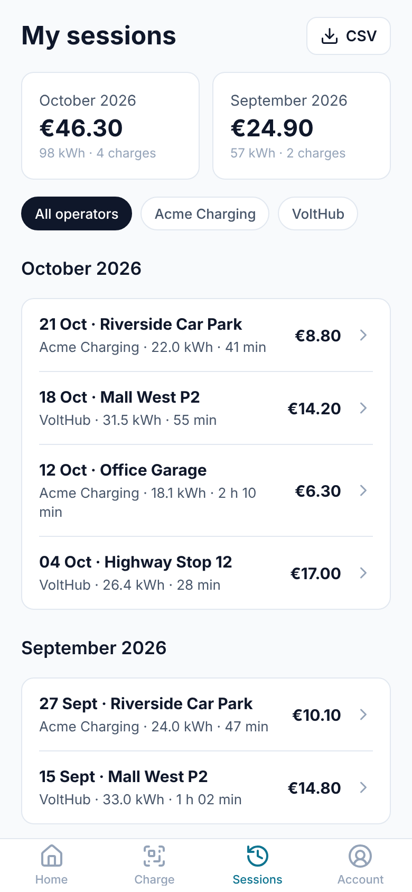     | 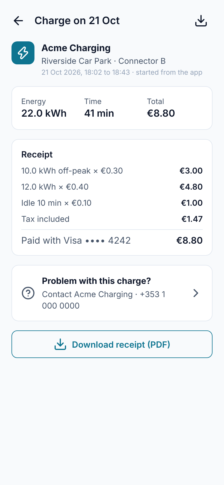     | 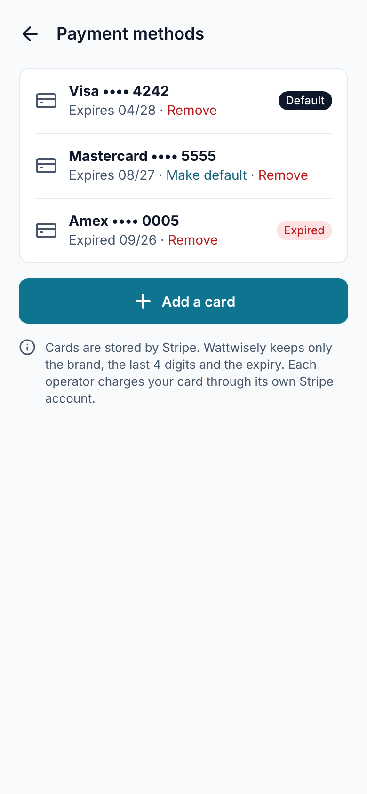 | 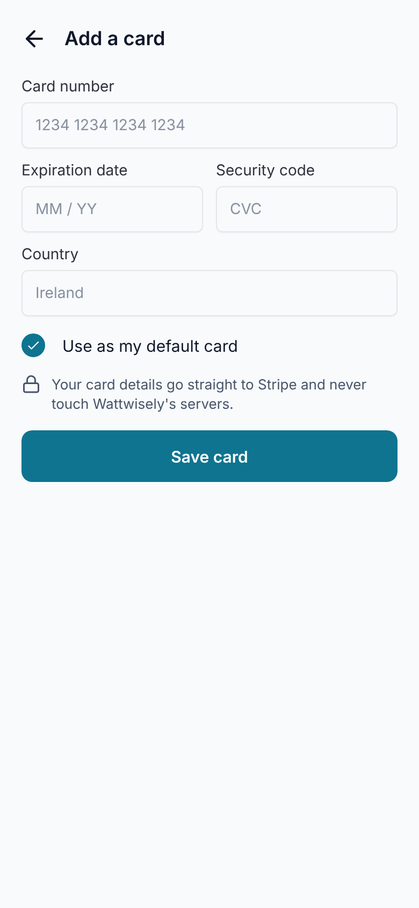  |
| ------------------------------------------ | --------------------------------------------------- | ------------------------------------------------- | -------------------------------------- |
| 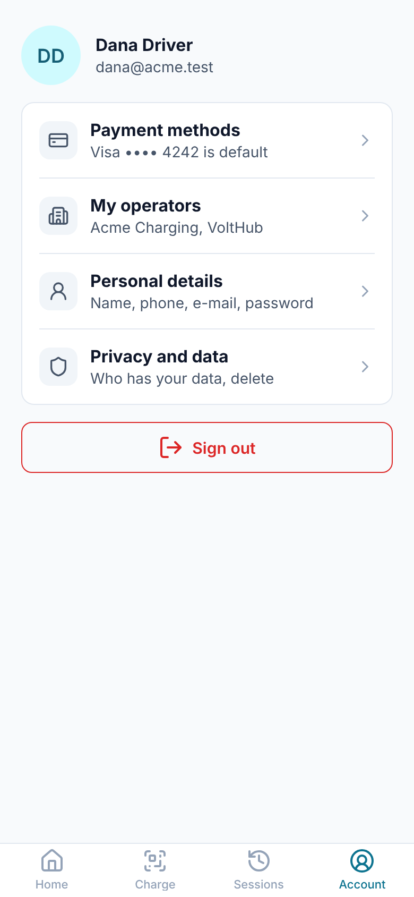          | 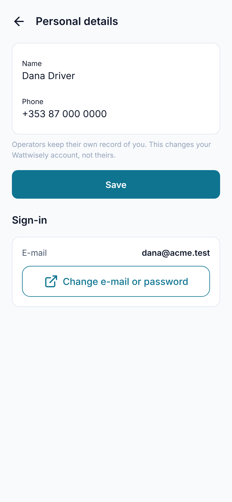 | 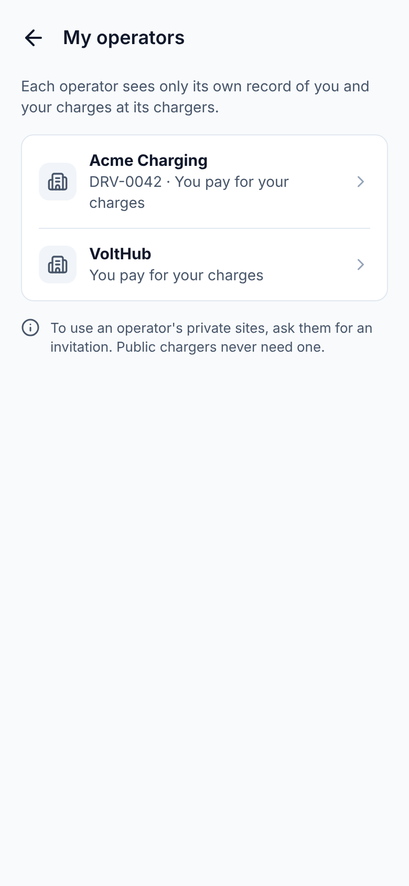       | 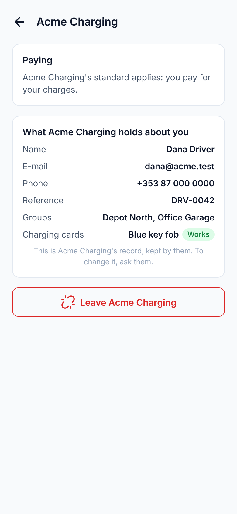 |
| 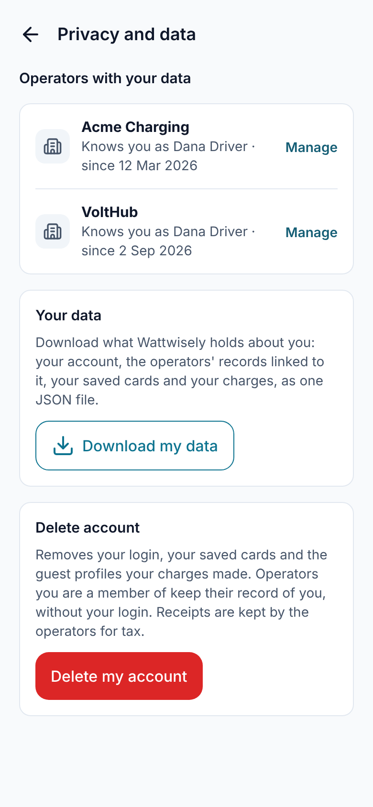 | 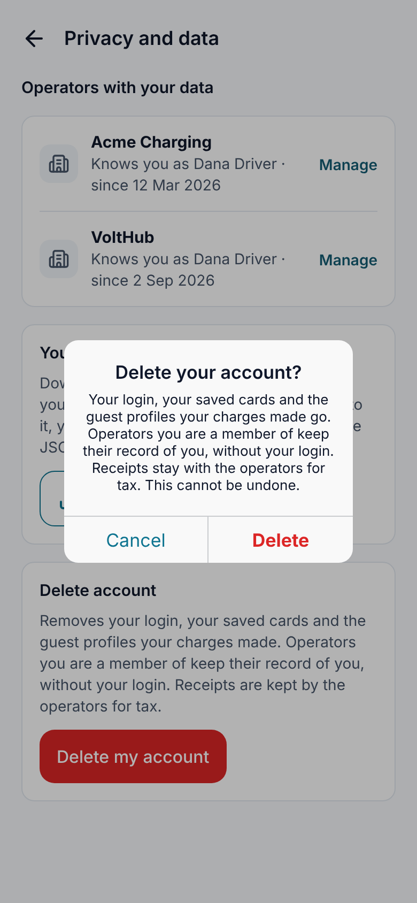     | 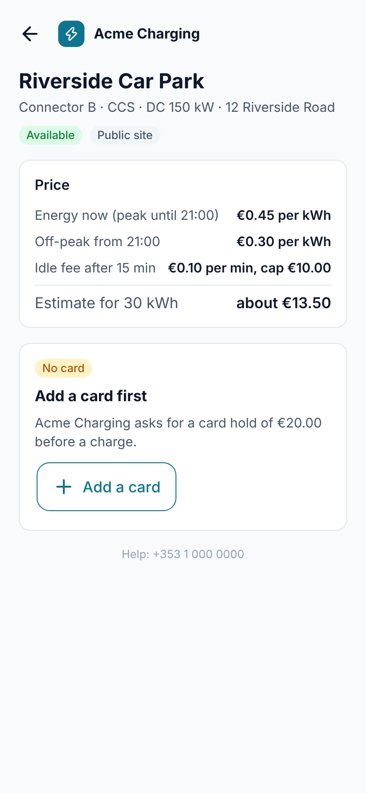  |                                        |

The card form in the screenshot is a stand-in for Stripe's Payment Element, which needs a live key.

## A file from the API

The receipt's PDF, the CSV and the data export need the login, so the app fetches each as a blob with the token, as the web app does, and writes it to the app's cache with `@capacitor/filesystem`. A receipt opens in the phone's PDF viewer through `@capacitor/file-viewer` (`NativeFiles.open()`), where the driver can save, print or send it; a phone with no PDF viewer gets the share sheet. The CSV and the data export go to the share sheet with `@capacitor/share` (`NativeFiles.share()`), from which the driver keeps them in Files or mails them. Android reaches the cache through the app's existing `FileProvider` (`res/xml/file_paths.xml`). In a browser, during `nx serve mobile`, the file downloads instead.

`ReceiptPdf` (`apps/api/src/modules/driver-app/receipts`) draws the receipt with pdfkit from the same `DriverChargeDetailDto` the receipt page shows: the operator's name, the site and connector, the period, the energy, each line, the tax, the total and the card.

## Deleting an account

Of the three choices put to the owner, the one built is: the login, the cards and the profiles the app made go; operators' own records stay.

```
Privacy and data ─ Delete my account ─ the phone's dialog
  └─ DELETE /v1/driver/me ─ DriverAccountEraser
       ├─ SavedCardsEraser: the Stripe customer deleted, every card marked removed
       ├─ for each linked operator, in its tenant:
       │    ├─ a guest record (made by a charge with consent): name "Deleted driver", e-mail and phone removed  · audit drivers.guest_record_erased
       │    └─ a member record (the operator's own): kept, the link to the login removed                       · audit drivers.unlinked
       └─ driver_accounts: Keycloak ID, e-mail, name, phone and Stripe customer removed
  └─ the app forgets its tokens, then opens Keycloak with kc_action=delete_account
       └─ Keycloak's own page: the driver confirms, and Keycloak deletes the login
```

Sessions and payments stay with the operators, who need them for tax; the guest record they point to no longer names anyone. The API has no admin client for Keycloak, so the login is deleted by the driver on Keycloak's page, which `delete_account` and the `delete-account` role allow. Cancelling that page leaves a login with no data behind it: signing in again starts a new, empty account. The realm's default roles apply to every user, so staff could also delete their own login from Keycloak's account page; that ends their sign-in but leaves their tenant's data as it is.

For a realm imported before this module, `deploy/README.md` lists the two settings to turn on by hand.

## Where it differs from the design

- **No Notifications row and no Help row in Account.** Notifications come with module 34. There is no help page or platform contact to point Help at; each receipt has the operator's contact instead.
- **No pending invitations in My operators, and no Member or Guest chip.** The API lists the operators a login is linked to, not the invitations sent to its e-mail: their tokens are stored hashed. An invitation opens from its e-mail. The list does not say whether a record is a member's or a guest's, so the app shows only Blocked.
- **"Download my data" is immediate.** The design says "Ready within 24 hours"; the API answers at once with the JSON file.
- **Personal details has no e-mail or password fields.** Both are Keycloak's, changed on its account page, where a new e-mail is verified.
- **No "Sign out everywhere".** Sign out ends the Keycloak session of this app.
- **The card form is Stripe's.** Its fields are the Payment Element's, with the country it asks for; the app adds only "Use as my default card".

## Trying it

With the local trial running (`deploy/README.md`) and `DRIVER_DEV_URL=http://localhost:4500` in Keycloak's driver client:

```sh
npx nx serve mobile      # http://localhost:4500 at phone width
```

Sign in as `dana@acme.test` and charge once (module 32's steps). Open Sessions: the charge is listed under this month; tap it and choose "Download receipt (PDF)". Open Account → Payment methods → Add a card and use Stripe's test card `4242 4242 4242 4242` with any future date. Open Account → Privacy and data → Download my data to see the JSON file. Delete my account with a throwaway driver, not Dana: the app returns to the welcome page after Keycloak's page.
