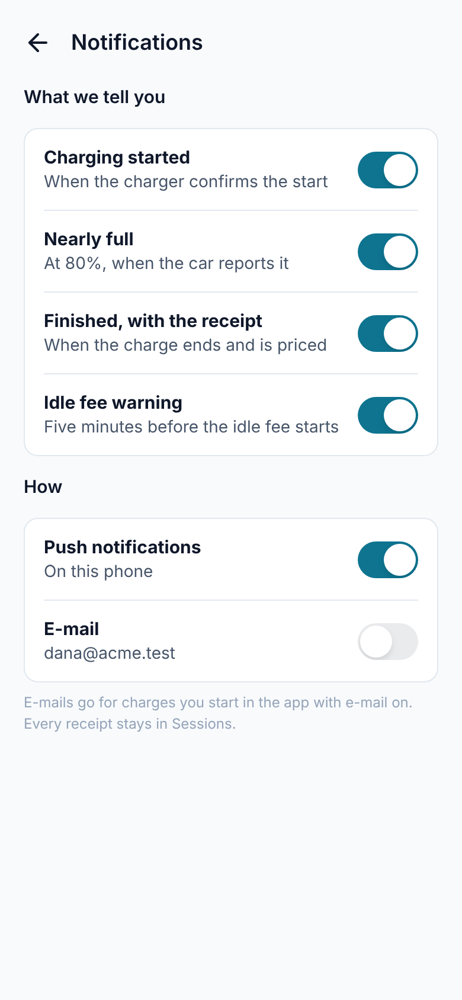
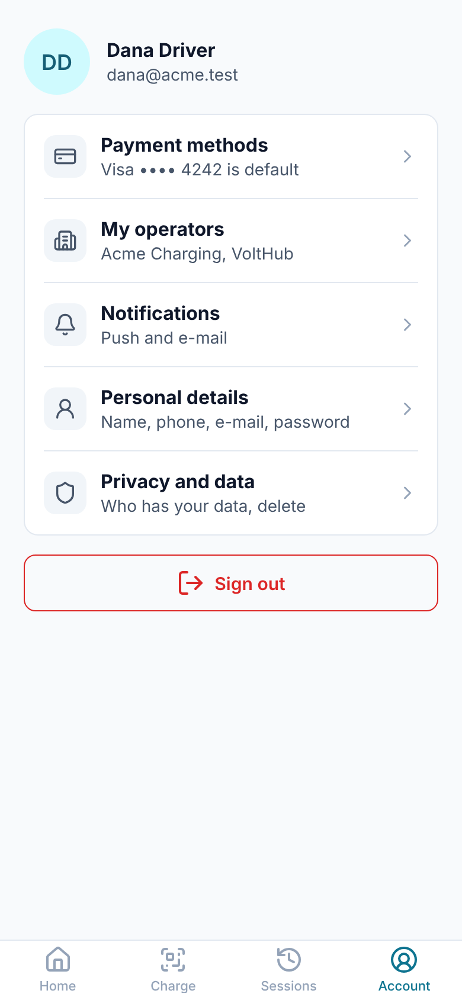

# Module 34: notifications in the mobile app

The mobile app now tells the driver about their charge when the app is closed. **The phone shows a notification when the charge starts, when the battery is nearly full, five minutes before the idle fee starts, and with the receipt; a tap opens the charge or its receipt. Account → Notifications holds the four choices and the two ways: pushes to the phone, and e-mails to the login's address.** Android pushes go through Firebase Cloud Messaging, iOS pushes through Apple's push service, both sent by the worker.

Stories covered: Dana starts a charge at Riverside Car Park, and the phone asks once whether Wattwisely may notify her. She walks to the shops. Twenty minutes later her lock screen says "Nearly full: 82%"; later "Unplug within 5 minutes", and she is back in time. "Charge complete: EUR 8.80" opens the receipt. At home she turns "Charging started" off and e-mail on, so her next receipts also come by mail.

## What changed

| Where                                                    | Before                             | Now                                                                                                                                                                                     |
| -------------------------------------------------------- | ---------------------------------- | --------------------------------------------------------------------------------------------------------------------------------------------------------------------------------------- |
| Account                                                  | Cards, operators, details, privacy | Also Notifications, "Push and e-mail"                                                                                                                                                   |
| `/account/notifications`                                 | —                                  | The four choices and the two ways, each saved as it moves                                                                                                                               |
| The first charge in the app                              | —                                  | The phone asks whether the app may notify; with a yes the phone registers                                                                                                               |
| `GET` and `PUT /v1/driver/me/notifications`              | —                                  | The driver's choices, their e-mail address, and how many phones receive pushes                                                                                                          |
| `PUT /v1/driver/devices`, `DELETE /v1/driver/devices/{}` | —                                  | The phone's push token for the signed-in driver, and taking it off at sign-out. A token another login had moves to this one                                                             |
| A charge started in the app                              | No e-mails                         | With e-mail on, the same e-mails a guest asks for on the charging page (module 11), with the driver's choices                                                                           |
| The worker                                               | E-mails only                       | `PushNotifyJob`, every 15 seconds: the pushes each charge is due, each sent once                                                                                                        |
| Database                                                 | —                                  | `driver_devices` (the phones), `push_deliveries` (each push once per charge), and the choices on `driver_accounts`                                                                      |
| `packages/push`                                          | —                                  | The push sender: Firebase's HTTP v1 API with a service account, Apple's HTTP/2 API with a .p8 key, and a stand-in for the tests                                                         |
| `DELETE /v1/driver/me` and the data export               | Cards, profiles, charges           | Also forget the phones; the export holds the notification choices                                                                                                                       |
| Android and iOS projects                                 | —                                  | `@capacitor/push-notifications`, shown also while the app is open; the notification permission, icon and channel on Android; `aps-environment` and the token hand-over in `AppDelegate` |
| The release workflow                                     | —                                  | Writes `google-services.json` from the secret `MOBILE_GOOGLE_SERVICES_JSON`                                                                                                             |
| The e-mails' footnote                                    | "…asked for on the charging page"  | "…on the charging page or in the app"                                                                                                                                                   |

## The screens

|  |  |
| --------------------------------------------- | --------------------------------- |

The screenshot comes from a browser, which has no pushes; its "Push notifications" line is the one a phone that allows them shows.

## From the charger to the lock screen

```
Phone: the first charge ─ NativePush.token(true) ─ the phone asks ─ yes
  └─ PUT /v1/driver/devices {platform, token} ─ driver_devices
       (again at each start with a sign-in, since tokens change; DELETE at sign-out)

Worker: PushNotifyJob every 15 s, per tenant ─ PushNotifier.run
  1. one transaction: PushWatchRepository.findWatched ─ PushEventRules.due
       └─ PushDeliveriesRepository.claim: a push_deliveries row, unique per charge and kind
  2. no transaction: PlatformPushSender.send to each phone of the account
       ├─ android ─ FcmPushSender ─ POST fcm.googleapis.com/v1/projects/<project>/messages:send
       └─ ios     ─ ApnsPushSender ─ HTTP/2 api.push.apple.com/3/device/<token>
  3. one transaction: sent_at or last_error; a phone the service no longer knows gets invalid_at
```

Network calls happen outside the transactions, since a push service can be slow. A push claimed before a crash and not sent is not sent again: pushes are best-effort, and the receipt stays in Sessions.

### What each push says

| When                                      | Choice                     | Title                     | Body                                                                                       | A tap opens      |
| ----------------------------------------- | -------------------------- | ------------------------- | ------------------------------------------------------------------------------------------ | ---------------- |
| The charger confirms the start            | Charging started           | Charging at Riverside     | Your car is charging on Riverside, connector B.                                            | `/charges/{id}`  |
| The car reports 80%                       | Nearly full                | Nearly full: 82%          | 12.40 kWh so far on Riverside, connector B.                                                | `/charges/{id}`  |
| Five minutes before the idle fee          | Idle fee warning           | Unplug within 5 minutes   | From 21:15 parking on Riverside, connector B costs EUR 0.10 per minute, at most EUR 10.00. | `/charges/{id}`  |
| The charge is priced and the hold settled | Finished, with the receipt | Charge complete: EUR 8.80 | 12.00 kWh at Riverside. Tap for the receipt.                                               | `/sessions/{id}` |

The worker uses the e-mails' rules (`DriverEventRules`, module 11) for when each is due. The e-mails' separate "charging finished" is not pushed: on a phone the receipt follows within a minute or two.

### Which charges get pushes

Any charge of a driver record linked to the login, at any operator, whether it started in the app or with the record's RFID card, as long as:

- "Push notifications" is on for the account, and the account has a phone the service still knows;
- the charge started after the account's first phone registered, so a new phone is not flooded with old receipts;
- the charge closed less than two days ago, as for e-mails.

The choices are read at each round, so turning one off stops it for a charge already under way. E-mail choices are copied onto a charge when it starts, as on the charging page, and apply from the next charge.

## Setting it up

Each platform is sent to only when its key is in `deploy/.env`; without one the app works as before, and e-mails still go.

| Platform | In the app                                                                                                                                                                              | On the server (`deploy/.env`)                                                                                                                                     |
| -------- | --------------------------------------------------------------------------------------------------------------------------------------------------------------------------------------- | ----------------------------------------------------------------------------------------------------------------------------------------------------------------- |
| Android  | A Firebase project with the Android app `com.wattwisely.driver`; its `google-services.json` in the GitHub environment's secret `MOBILE_GOOGLE_SERVICES_JSON`, or in `android/app/`      | `FCM_SERVICE_ACCOUNT_JSON`: Firebase → Project settings → Service accounts → Generate new private key, the whole file on one line, in single quotes               |
| iOS      | **Turn on Push Notifications for the App ID** (Apple Developer → Identifiers → `com.wattwisely.driver`) before the next TestFlight build, or its profile will not match the entitlement | `APNS_PRIVATE_KEY`, `APNS_KEY_ID`, `APNS_TEAM_ID`: Apple Developer → Keys → a key with the Apple Push Notifications service. `APNS_SANDBOX=true` for Xcode builds |

An Android build without `google-services.json` installs and runs but takes no pushes: the app's own `PushSupport` plugin (`PushSupportPlugin.java`) tells the app so before it asks Firebase, which would otherwise stop the app. The release workflow warns when the secret is missing, and stops when the file is for another package.

Apple's sandbox and production services keep separate tokens. A build run from Xcode registers with the sandbox; TestFlight and the App Store with production, which is the default.

## Where it differs from the design

- **No "News from operators" and no WhatsApp row.** Operators have no way to write news yet, and WhatsApp charging (module 17) has its own chat, not a channel for the app's updates.
- **E-mails only for charges started in the app.** A charge started at the charger with a card or an RFID tag gets pushes, but e-mails only if the driver asks on the charging page.
- **No bell on the live screen.** The choices are in Account → Notifications for every charge.

## Trying it

The browser has no pushes, so `nx serve mobile` shows the Notifications screen with "Only in the app on a phone". On a phone:

1. Put a `google-services.json` for `com.wattwisely.driver` in `apps/mobile/android/app/`, and `FCM_SERVICE_ACCOUNT_JSON` for the same Firebase project in `deploy/.env`; restart the worker.
2. `npx nx run mobile:sync`, then run the app from Android Studio on a phone that reaches the local trial (`CAPACITOR_CLEARTEXT=true`, module 30).
3. Sign in as `dana@acme.test`, start a charge on `WW-7KQ4M2XR9T/1` with the simulator (module 32), and allow notifications when asked.
4. Lock the phone: "Charging at" and the site's name arrive within 15 seconds. Stop the charge: "Charge complete: Free" (Dana's group charges free) opens the receipt.
