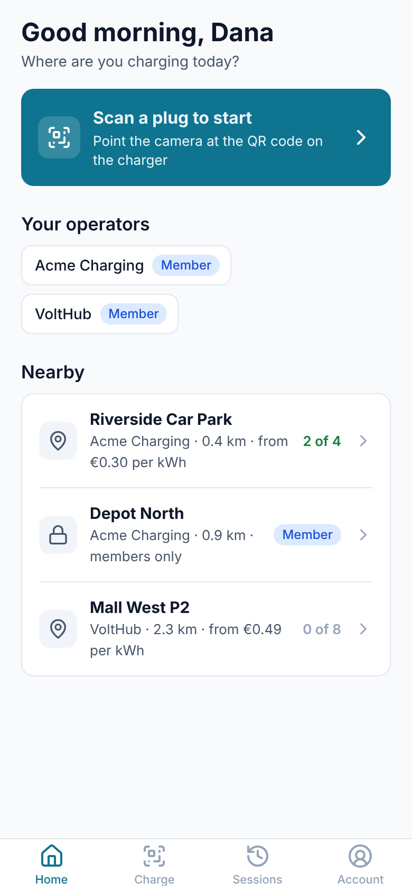
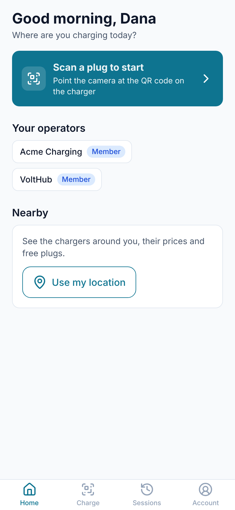

# Module 35: chargers nearby in the mobile app

Home now lists the charging sites around the driver. **"Use my location" asks the phone once for roughly where it is; from then on Home shows up to 20 sites within 15 km, nearest first, at every operator: each one's operator, distance, lowest energy price and free plugs, and the private sites the driver is a member at. A tap opens the plug page of a free plug.**

Stories covered: Dana is in town with 20% left. She opens the app, taps "Use my location" and allows it. Riverside Car Park is 0.4 km away with 2 of 4 plugs free from €0.30 per kWh, and Acme's members-only Depot North is 0.9 km away. She taps Riverside, sees the free plug's prices, and drives there.

## What changed

| Where                          | Before                                  | Now                                                                                                                                                     |
| ------------------------------ | --------------------------------------- | ------------------------------------------------------------------------------------------------------------------------------------------------------- |
| Home                           | Greeting, scan, charging now, operators | Also Nearby: "Use my location", then the sites, or why there are none                                                                                   |
| `GET /v1/driver/places/nearby` | —                                       | `latitude`, `longitude` and `radius_km` (1 to 50, default 15): up to 20 sites, nearest first                                                            |
| `sites`                        | Seen only inside their tenant           | The policy `sites_public_search` shows public sites of every tenant to `DatabaseSession.forSiteSearch()`, and nothing else of theirs (migration `0038`) |
| `TransactionRunner`            | Each setting written out                | The settings as a list, with `app.site_search` added                                                                                                    |
| `packages/driver-core`         | —                                       | `NearbyPlace` and `DriverChargesApiService.nearby()`                                                                                                    |
| Android and iOS projects       | —                                       | `@capacitor/geolocation`; `ACCESS_COARSE_LOCATION` on Android, and the sentence iOS shows when it asks                                                  |

## The screens

|  |  |
| ------------------------------------ | ---------------------------------------------- |

## From the phone to the list

```
Home ─ NearbyStore.load()
  ├─ not asked yet ─ "Use my location" ─ NearbyStore.load(true) ─ the phone asks (coarse location)
  ├─ refused, or the phone's location off ─ a sentence on how to turn it on
  └─ NativeLocation.position() ─ GET /v1/driver/places/nearby?latitude=…&longitude=…
       NearbyPlacesService.near
         1. forSiteSearch: public sites within the circle, of tenants on trial or active
         2. forDriverAccount: the tenants where the login is an active driver
            └─ in each: its private sites one of the driver's access groups opens
         3. in each tenant with a site: operator name, plugs, free plugs, lowest price, the plug to open
         4. nearest first, at most 20
```

The search sees only where public sites are, under its own row-level policy; everything else about a site is read inside its tenant, as the plug page does. Distances are worked out in SQL by the haversine formula (`GeoSql`), after a box around the circle has narrowed the rows with the index on the coordinates.

A plug counts as free as the plug page would call it available: its charger is connected, it reports no fault and no car, and no session holds it. The lowest price is the cheapest energy price among the bands of the site's tariff now in force.

| Line                                        | From                                          |
| ------------------------------------------- | --------------------------------------------- |
| Acme Charging · 0.4 km · from €0.30 per kWh | `NearbyWords.line`: operator, distance, price |
| Acme Charging · 0.9 km · members only       | A private site                                |
| 2 of 4                                      | `NearbyWords.free`: free plugs of all plugs   |
| Member                                      | A private site, instead of the count          |

## Where it differs from the design

- **No "See map".** The app has no map yet; each site's address is in the list's data for a map to come.
- **A site opens a plug, not a site page.** There is no site page in the app; a tap opens the plug page of a free plug, or the first plug when none is free, where the prices and access are.
- **Public chargers on a private site are not listed**, nor private chargers on a public site left out of the count: the list goes by the site's visibility.
- **Approximate location only.** Nothing is tracked in the background, and the position is not stored.

## Trying it

With the local trial running and `DRIVER_DEV_URL=http://localhost:4500` in Keycloak's driver client:

```sh
npx nx serve mobile      # http://localhost:4500 at phone width
```

Make a site public in the portal: Sites → the site → Edit site → Visibility, "Public: shown to everyone". Sign in as `dana@acme.test`; on Home, tap "Use my location" and allow it. In Chrome's DevTools → Sensors, set the location to the site's coordinates: the site is listed at 0.0 km with its free plugs. Move the location 20 km away and pull down to refresh: "No charging sites within 15 km."
