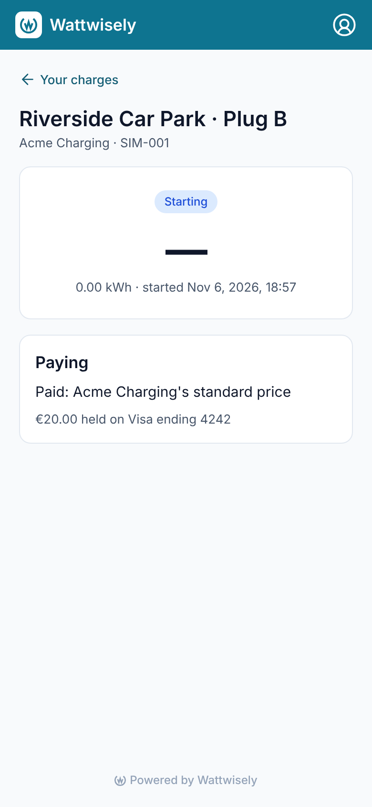
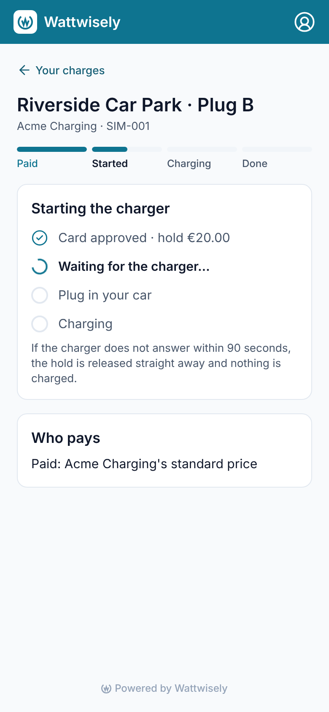
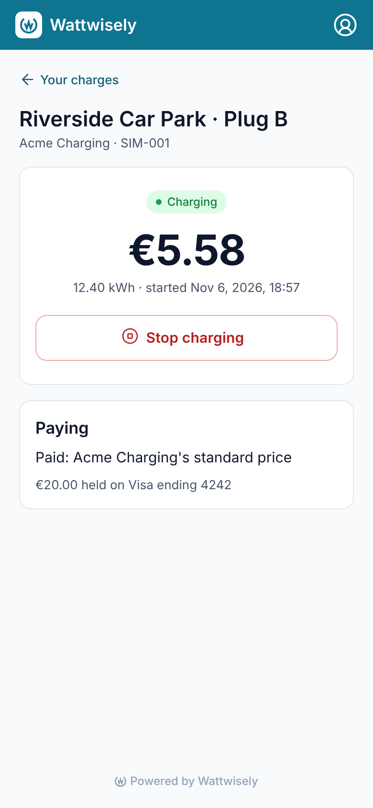
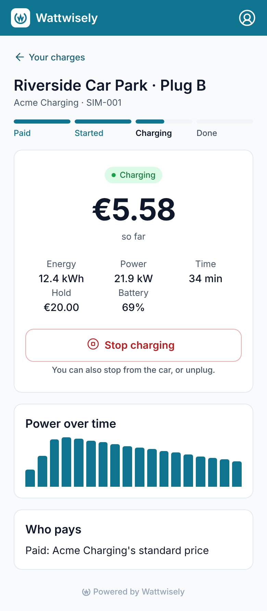
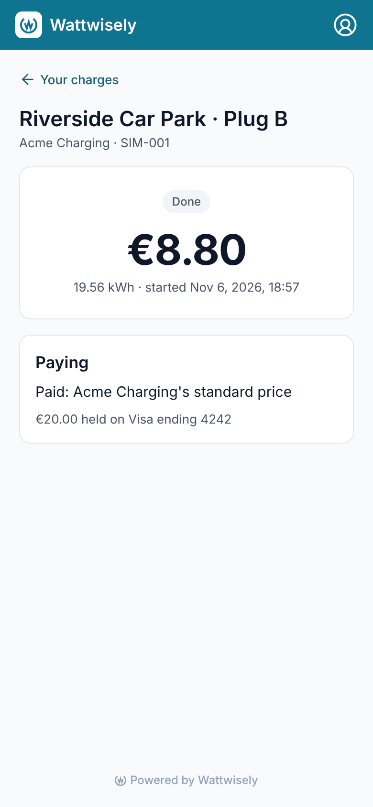
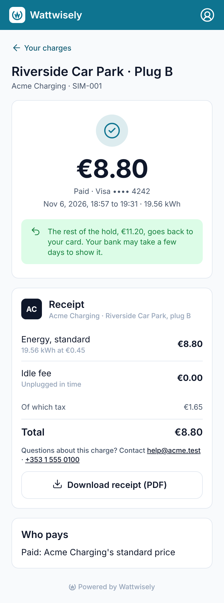
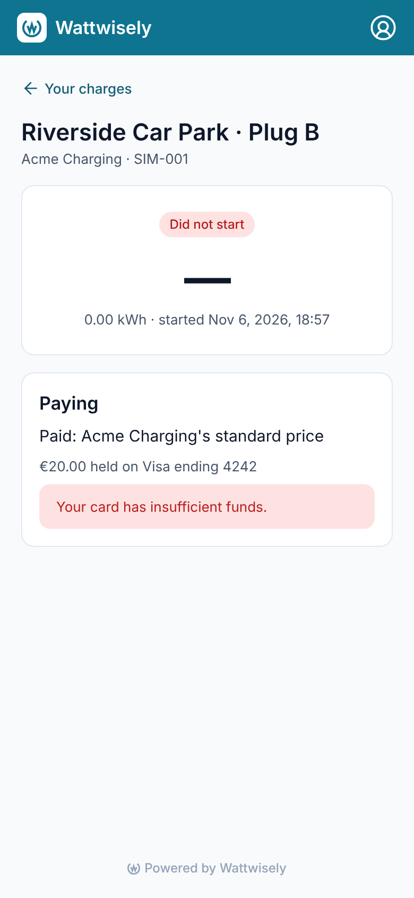
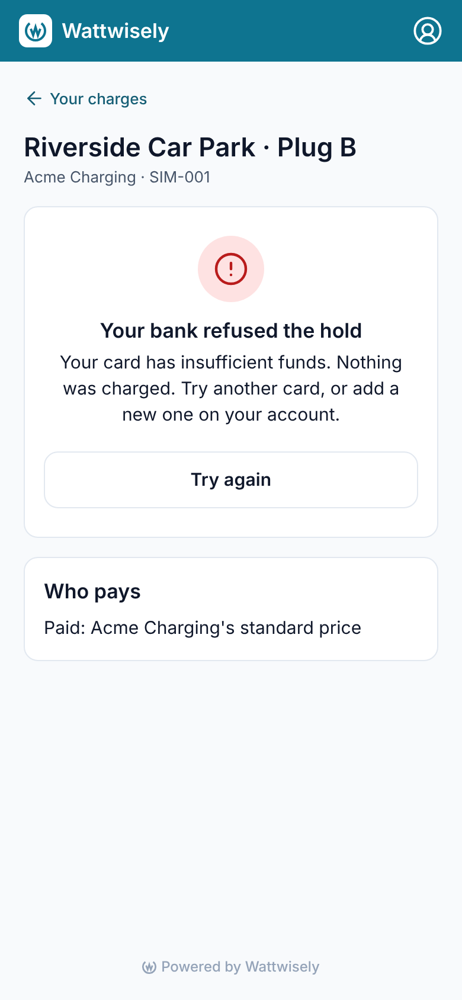

# Module 36: charging with the login on the driver web app

A driver who logged in and pressed "Start charging" on the web used to land on a thinner page than a guest who paid by card: a status chip, the amount, the energy and who pays, with no steps, no power and no receipt. **That page now follows the charge as the mobile app does.** While it starts, the steps over it and the hold, the charger, the car and the charge ticked off one by one. While the car charges, the cost so far in large type, with energy, power, time, the hold and the battery, Stop, and the power over time as bars. When it is done, the price with the card it was paid with, what goes back from the hold, the receipt line by line with its tax and total in the operator's name, how to reach the operator, and **"Download receipt (PDF)"**. A charge that did not start says why, and offers to try again.

This is the first of three modules that bring the driver web app up to the mobile app (modules 36 to 38). **Nothing in the API changed**: the page reads the endpoints the mobile app already uses. The states, steps and power bars of a charge moved from `apps/mobile` into `packages/driver-core`, so both apps show the same words and numbers.

Stories covered: Dana logs in on the web at Riverside Car Park and presses "Start charging". She watches "Card approved · hold €20.00" tick, then "Waiting for the charger…". Half an hour later the page shows €5.58 so far, 12.4 kWh at 21.9 kW and the battery at 69%, with the power falling off as the battery fills. She stops it, reads the €8.80 receipt line by line, sees that €11.20 of the hold goes back to her Visa, and saves the receipt as a PDF. Another day her bank refuses the hold, and the page says so with the bank's reason and "Try again". At the depot her group charges free, so the first step reads "Free" and no hold is taken.

## What changed

| Where                                          | Before                                     | Now                                                                                                                                                                 |
| ---------------------------------------------- | ------------------------------------------ | ------------------------------------------------------------------------------------------------------------------------------------------------------------------- |
| `/account/charges/:id` while starting          | A status chip and "€0.00"                  | The four steps over the charge, and "Starting the charger" with the hold (or the rule that made it free), the charger, the car and the charge, each ticked          |
| `/account/charges/:id` while charging          | Chip, amount, kWh, start time, Stop        | The steps; the cost so far in large type (or "Free" with the rule); energy, power, time, hold and battery; Stop; "Power over time" as up to 18 bars                 |
| `/account/charges/:id` when done               | Chip, amount, kWh, start time              | The price with the card it was paid with and when; what goes back from the hold; the receipt line by line, tax and total; the operator's contact; the receipt's PDF |
| `/account/charges/:id` when it did not start   | Chip and the card's refusal under "Paying" | "Your bank refused the hold" with the bank's reason, or "The charger did not start" with why, and "Try again" back to the plug                                      |
| Who pays                                       | "Paying": the rule and the hold            | "Who pays": the rule, under every state; the hold moved to where it matters (the live figures, the done card)                                                       |
| `packages/driver-core`                         | —                                          | `DriverChargeStates`, `StartingSteps`, `PowerBars` and `ReceiptFileName`, moved from the mobile app or written once for both                                        |
| `ChargeSteps` and `ww-charge-steps`            | The first step was always "Paid"           | It reads "Free" for a charge nobody pays for                                                                                                                        |
| `apps/driver/src/app/core/files/file-saver.ts` | The CSV download made its own link         | `FileSaver` hands any file from the API to the browser: the CSV of charges and the receipt's PDF                                                                    |

## Before and after

At 390 wide, as a phone shows them, with the API stubbed: the same charge, starting, charging, done, and refused by the bank.

| Before                                            | After                                           |
| ------------------------------------------------- | ----------------------------------------------- |
|  |  |
|      |      |
|      |      |
|     |     |

## How the pieces fit

`MyChargeStore` follows the charge every 3 seconds with `GET /v1/driver/charges/{id}` until `DriverChargeStates.isSettled` says the charge ended and its hold was taken or released. While the charge is live it also asks `GET /v1/driver/charges/{id}/readings` every third time, as the mobile app does, so the chart and the battery move without a request every 3 seconds. Once, at the start, it reads the plug's page (`GET /v1/driver/places/{identity}/{connector}`) for the operator's logo and support contact; a charger taken away since has no page, and the receipt then shows no contact.

`DriverChargeStates.view` picks one of four views: `starting` (authorising, starting), `live` (charging, suspended, idle, stopping), `complete`, and `failed` (not started, failed, or a refused hold). `DriverChargeStates.phase` turns the same state into the step the bar is on, so the bar the guest page uses (`ww-charge-steps`) serves this page too.

`MyChargeComponent` shows the header, the steps and one child per view:

- `ChargeStartingComponent`: the four lines of `StartingSteps`, each a tick, a spinner or an empty circle.
- `ChargeLiveComponent`: the figures and Stop. The power reads "—" unless the car is charging, as in the app. `PowerChartComponent` draws `PowerBars` under it.
- `ChargeCompleteComponent`: the guest page's receipt (`ww-charge-receipt`) and its styles, with the operator's logo or initials, `ww-support-contact`, and the PDF button. Before the charge is priced it says the receipt appears once it is.

`MyChargeStore.download` fetches `GET /v1/driver/charges/{id}/receipt.pdf` with the login and saves it as `receipt-<day>-<site>.pdf`, the name the mobile app shares it under. A 409 (`receipt_not_ready`) reads "The receipt is ready once the charge has been priced."

The page stays in the platform's colours, as every account page does; the receipt is in the operator's name and logo.

## Shared with the mobile app

`apps/mobile` now imports `StartingSteps` and `PowerBars` from `@wattwisely/driver-core`. Its `SessionStore.view` and `isSettled` and its `ReceiptFiles.fileName` call `DriverChargeStates` and `ReceiptFileName`, so their specs still hold and the behaviour is unchanged.

## How it was checked

`prettier --check .` and `nx run-many -t lint test build -p driver driver-core mobile` pass, as does `nx test ui` (every icon the driver app names exists). New specs cover `DriverChargeStates` (views, steps, settling, the hold given back), `ReceiptFileName`, the "Free" first step, and `MyChargeStore` (following every 3 seconds with the readings every third time, the PDF's name, and the 409 before pricing). The screenshots above were taken with Playwright against both builds with the API and Keycloak stubbed.

## Read the code in this order

1. `packages/driver-core/src/lib/charging/driver-charge-states.ts` with its spec, then `starting-steps.ts`, `power-bars.ts` and `receipt-file-name.ts`.
2. `apps/driver/src/app/features/my-charges/my-charge.store.ts` with its spec.
3. `my-charge.component.*`, then `charge-starting.component.ts`, `charge-live.component.*`, `power-chart.component.ts` and `charge-complete.component.*`.
4. `apps/mobile/src/app/features/session/session.store.ts` and `core/history/receipt-files.ts`, for what now comes from `driver-core`.
