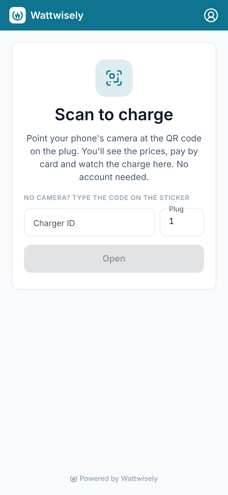
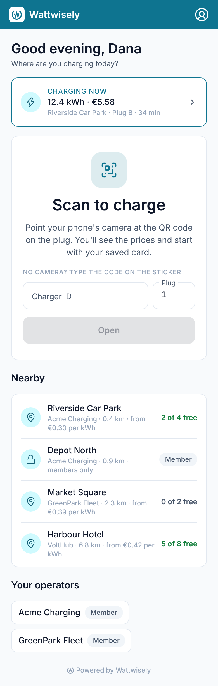
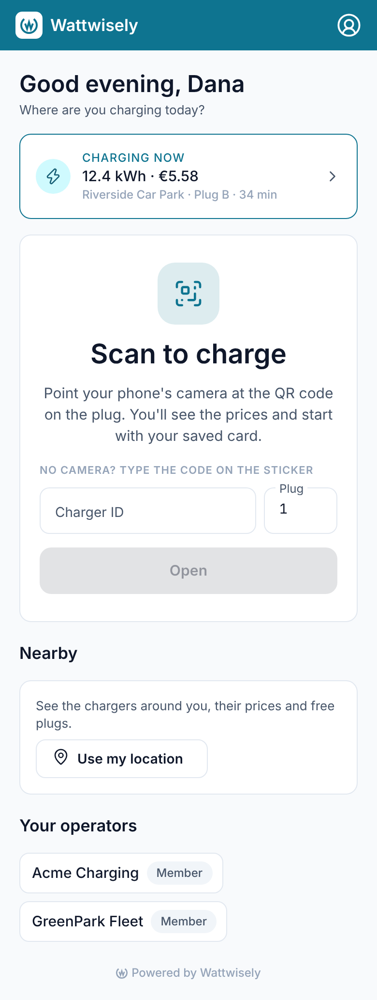

# Module 37: Home and Nearby on the driver web app

The web app's Home was the same for everyone: "Scan to charge", the code fields, and the charges this browser started as a guest. **A logged-in driver now gets what the mobile app's Home has.** It greets them by first name, shows the charge under way at any operator as a "Charging now" card that opens it, lists the sites nearby and the operators the driver belongs to. **Nearby works as in the app**: "Use my location" asks the browser once. From then on Home lists up to 20 sites within 15 km, nearest first, at every operator, each with its operator, distance, lowest energy price and free plugs, and the private sites the driver is a member at. A site opens its free plug's page.

A driver who is not logged in sees Home exactly as before. **Nothing in the API changed**: Home reads `GET /v1/driver/me`, `/operators`, `/charges` and `/places/nearby`, which the mobile app already uses. The Nearby list, the "Charging now" store and the greeting moved from `apps/mobile` into `packages/driver-core`. Each app tells the shared Nearby list where the device is through a `PositionSource`: Capacitor's location on the phone, the browser's on the web.

Stories covered: Dana logs in on her laptop in the evening and reads "Good evening, Dana". The charge she started at Riverside Car Park half an hour ago shows as 12.4 kWh · €5.58, and a click opens it (module 36). She clicks "Use my location" and allows it. Riverside is 0.4 km away with 2 of 4 plugs free from €0.30 per kWh, and Acme's members-only Depot North shows "Member". She clicks Riverside and lands on its free plug's prices. Her operators, Acme Charging and GreenPark Fleet, sit under the list, each opening what that operator holds about her.

## What changed

| Where                               | Before                                         | Now                                                                                                                                                                    |
| ----------------------------------- | ---------------------------------------------- | ---------------------------------------------------------------------------------------------------------------------------------------------------------------------- |
| Home, logged in                     | The same page a guest sees                     | "Good evening, Dana"; "Charging now" with energy, cost, site, plug and time, opening `/account/charges/:id`; Scan to charge; Nearby; Your operators; the guest charges |
| Home, logged out                    | —                                              | Unchanged                                                                                                                                                              |
| Nearby                              | Mobile app only                                | "Use my location", then the sites, or why there are none: none within 15 km, location blocked for the site, a browser without location, or an error                    |
| `packages/driver-core`              | —                                              | `NearbyStore`, `NearbyWords`, `ChargingNowStore` and `Greeting`, moved from the mobile app, and `PositionSource`, the device's position as the Nearby list asks for it |
| `apps/driver/src/app/core/location` | —                                              | `BrowserLocation`: the browser's `PositionSource`, through the Permissions and Geolocation APIs                                                                        |
| `apps/mobile`                       | Its own Nearby store, greeting and charge card | The same classes from `driver-core`; `NativeLocation` is now its `PositionSource`. The words "The phone could not tell where you are" now say "Your device"            |

## Before and after

At 390 wide, logged in, with the API stubbed: Home before, after with the location allowed, and after before the driver chose.

| Before                                    | After                                   | After, before "Use my location"                               |
| ----------------------------------------- | --------------------------------------- | ------------------------------------------------------------- |
|  |  |  |

## How the pieces fit

`HomeComponent` reads `DriverAuthService.isLoggedIn()` once. Logged in, it loads `AccountStore` (the name for the greeting and the operators) and `ChargingNowStore` (the first of the driver's charges that is under way), and shows `NearbyComponent`. Logged out, none of these is asked for, so a guest's Home makes no calls to `/v1/driver`.

`NearbyComponent` calls `NearbyStore.load()` when it appears. The store asks the `PositionSource` for a position without prompting. With the location already allowed, it asks `GET /v1/driver/places/nearby` straight away. Otherwise it shows "Use my location", or why it cannot. The button calls `load(true)`, which lets the browser ask the driver.

`BrowserLocation` reads the permission with `navigator.permissions.query({ name: 'geolocation' })`. A browser without the Permissions API counts as "not asked yet", and the browser asks when the button is pressed. The position is asked for without high accuracy, with a 10-second timeout and a fix up to 5 minutes old, as the app does. A refusal in the browser's own prompt gives no position, and the store then reads the permission again and shows that location is blocked. Browsers give a position only to pages served over HTTPS (or `localhost`), which the deployed driver app is.

A site opens `/c/<charger>/<plug>` for its free plug, the same page a QR code opens. A site with no plug the API could pick is listed but does not open.

## How it was checked

`prettier --check .` and `nx run-many -t lint test build -p driver driver-core mobile ui` pass. The mobile app's specs for the Nearby list, the greeting, Home and sign-out run against the moved classes. The greeting's spec moved with it into `driver-core`. A new spec covers `BrowserLocation`: it does not ask before the button, looks straight away once allowed, never once refused, and reads a refusal in the browser's prompt as no position. The screenshots above were taken with Playwright against the module 36 build and this one, with the API and Keycloak stubbed and the browser's location set to Dublin.

## Read the code in this order

1. `packages/driver-core/src/lib/nearby/position-source.ts`, `nearby.store.ts` and `nearby-words.ts`; `charges/charging-now.store.ts`; `format/greeting.ts`.
2. `apps/driver/src/app/core/location/browser-location.ts` with its spec, and `app.config.ts`, where it becomes the `PositionSource`.
3. `apps/driver/src/app/features/home/home.component.*`, then `nearby.component.*`.
4. `apps/mobile/src/app/core/native/native-location.ts` and `app.config.ts`, for the phone's side.
