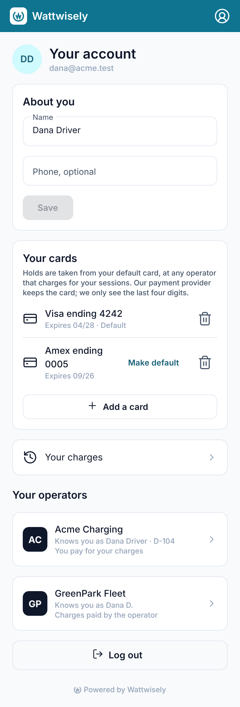
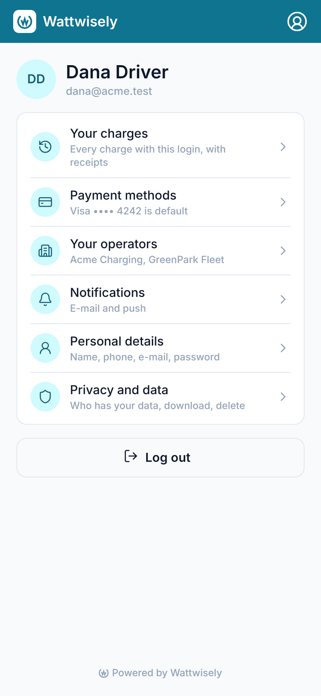
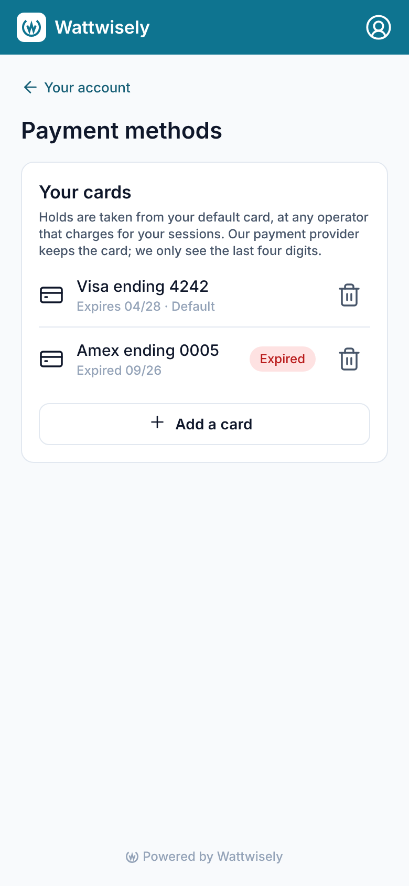
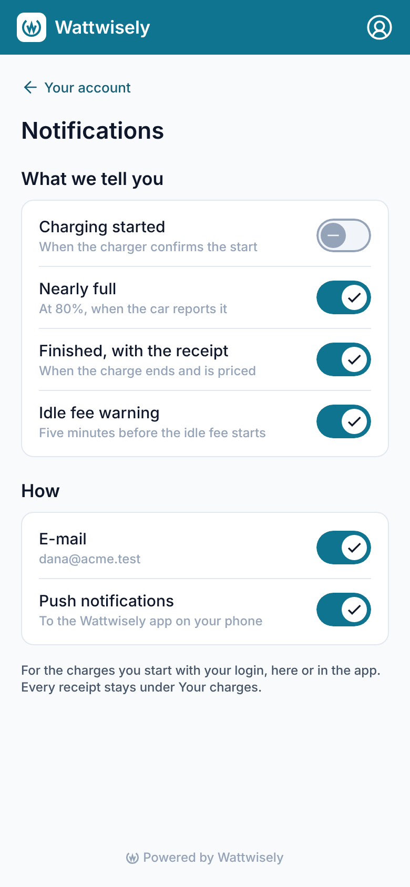
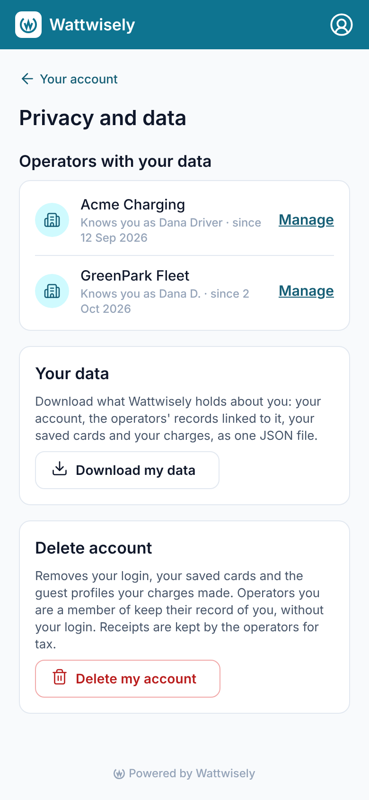
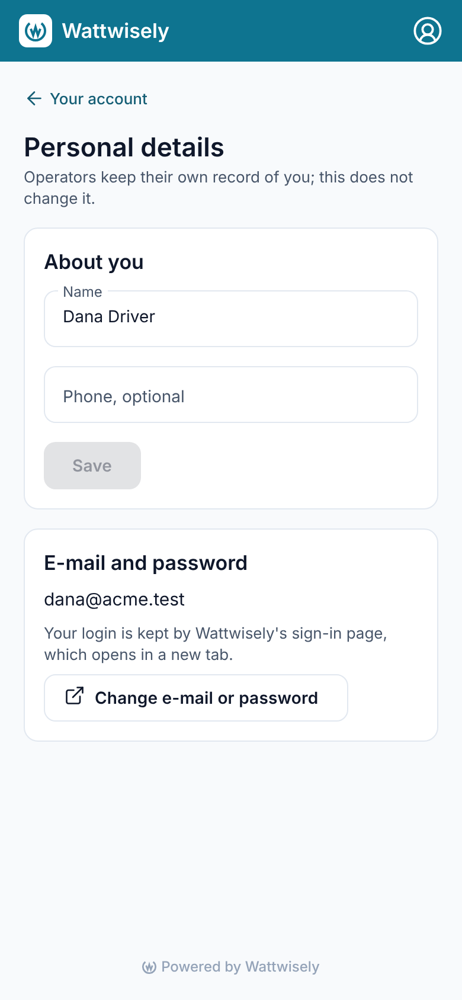
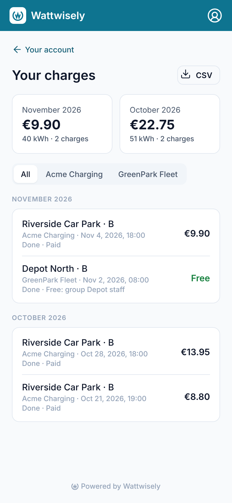

# Module 38: account, privacy and notifications on the driver web app

The web app's account was one long page: the driver's name and phone, their cards, a link to their charges, their operators and Log out. **It is now a menu, as in the mobile app's Account tab**, and each item opens a page of its own. The pages are Your charges, Payment methods, Your operators, Notifications, Personal details, and Privacy and data. **Three of them are new on the web.** Notifications holds the same switches the app has. Personal details opens Keycloak's page to change the e-mail or password. Privacy and data lists the operators that hold the driver's data, downloads everything Wattwisely holds as one JSON file, and deletes the account.

The existing pages gained what the app shows. Your charges now opens with the totals of the last two months. Payment methods marks a card that has expired, and a new card can be made the default as it is added. **Nothing in the API changed**: the pages read and write `GET`/`PATCH /v1/driver/me`, `GET`/`PUT /v1/driver/me/notifications`, `GET /v1/driver/me/export`, `DELETE /v1/driver/me` and the card routes, which the mobile app already uses (modules 33 and 34). The card words and the month totals moved from `apps/mobile` into `packages/driver-core`, so both apps say "Expired 09/26" and add up a month the same way.

Stories covered: Dana logs in on her laptop and opens her account. The menu says her Visa ending 4242 is the default and that Acme Charging and GreenPark Fleet know her. Under Payment methods her old Amex shows "Expired"; she adds a new card and leaves "Use as my default card" ticked. Under Notifications she turns off "Charging started"; the e-mail about her next charge, started on the web, no longer comes. Under Privacy and data she downloads `my-wattwisely-data.json`. When she later deletes her account, the API erases her cards and guest records, and Keycloak's own "Delete account" page removes her login.

## What changed

| Where                    | Before                                                                | Now                                                                                                                                                                              |
| ------------------------ | --------------------------------------------------------------------- | -------------------------------------------------------------------------------------------------------------------------------------------------------------------------------- |
| `/account`               | Name and phone form, cards, a link to the charges, operators, Log out | Who is logged in, then a menu with a line of the driver's own under each item (the default card, the operators' names), then Log out                                             |
| `/account/cards`         | — (the cards sat on the account page)                                 | Payment methods: each card's expiry, an "Expired" chip, and "Use as my default card" while a card is being added                                                                 |
| `/account/operators`     | — (the operators sat on the account page)                             | Your operators: what each calls the driver, who pays there, opening `/account/operators/:id` as before; its back link and leaving now return here                                |
| `/account/notifications` | Mobile app only                                                       | The four events (started, nearly full, finished, idle fee warning) and the two ways (e-mail, push to the app). Each switch saves at once and moves back if the save fails        |
| `/account/details`       | — (the name and phone sat on the account page)                        | Name and phone, and "Change e-mail or password", which opens Keycloak's account page in a new tab                                                                                |
| `/account/privacy`       | Mobile app only                                                       | The operators with the driver's data, each with Manage; Download my data; Delete my account, asked once more before it goes                                                      |
| `/account/charges`       | The charges, by month, with a filter by operator and the CSV          | The same, under the totals of the last two months: money, kWh and the number of charges                                                                                          |
| `packages/driver-core`   | —                                                                     | `CardWords` (name, expiry, expired, the menu's line) and `MonthTotals`, moved from the mobile app; `SavedCardsStore.finish(isDefault)` makes the new card the default when asked |
| `apps/mobile`            | Its own card words and month totals                                   | The same classes from `driver-core`; no change on the phone                                                                                                                      |

## Before and after

At 390 wide, logged in, with the API stubbed. The whole account page before, and the menu after:

| Before                                          | After                                         |
| ----------------------------------------------- | --------------------------------------------- |
|  |  |

The pages behind the menu:

| Payment methods                               | Notifications                                       | Privacy and data                                 |
| --------------------------------------------- | --------------------------------------------------- | ------------------------------------------------ |
|  |  |  |

| Personal details                                 | Your charges, with the month totals          |
| ------------------------------------------------ | -------------------------------------------- |
|  |  |

## How the pieces fit

`AccountComponent` keeps `AccountStore` (who is logged in and their operators) and `SavedCardsStore`, only to write the lines under Payment methods and Your operators. The menu itself is a static list of rows, so adding a page is one row and one route. Every new route sits behind `AccountGuard`, as `/account` does.

`NotificationSettingsStore` reads the switches once and saves the whole set on every change, as the mobile app's store does. It shows the new value at once, and puts the old one back with the API's sentence if the save fails. The switches apply to every charge started with the login, in the app or on the web: the worker's e-mails already read them for both. Pushes only ever go to phones signed in to the app, so the push line says which phones, or that there are none yet.

`AccountDataStore` downloads `GET /v1/driver/me/export` through the `FileSaver` of module 36. Deleting asks once more on the page, then calls `DELETE /v1/driver/me`. The API erases the account, its cards and its guest records, and `DriverAuthService.deleteLogin()` forgets the tokens and opens Keycloak with `kc_action=delete_account`. There the driver deletes the login itself, as in the mobile app. "Change e-mail or password" links to `DriverAuthService.accountUrl()`, the realm's own account console, because the login's e-mail and password belong to Keycloak, not the API.

`SavedCardsStore.finish(isDefault)` saves the card the form confirmed and, when the driver ticked "Use as my default card" and the API did not already make it the default, calls `PATCH /v1/driver/payment-methods/:id` before reading the list again. The box only shows when there is already a card, because the first card is always the default.

## How it was checked

`prettier --check .` and `nx run-many -t lint test build -p driver driver-core mobile ui` pass. New specs cover the Notifications store (a switch saves the whole set, and moves back with the API's sentence when the save fails) and the data store (the download's file name, and that deleting erases the account before it opens Keycloak's page, and not when the API refuses). The saved cards' spec covers making the new card the default. The card words' spec moved with the class into `driver-core`, and the mobile app's account, cards and history specs run against the moved classes. The screenshots above were taken with Playwright against the module 37 build and this one, with the API and Keycloak stubbed.

## Read the code in this order

1. `packages/driver-core/src/lib/cards/card-words.ts` and `saved-cards.store.ts`; `charges/month-totals.ts`.
2. `apps/driver/src/app/app.routes.ts`, then `features/account/account.component.*`, the menu.
3. `features/account/cards/`, `operators.component.ts` and `details.component.*`.
4. `features/notifications/` and `features/privacy/`, each a store with its spec and a page.
5. `core/auth/driver-auth.service.ts`, for `accountUrl()` and `deleteLogin()`.
