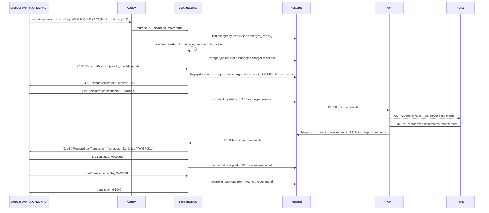

# Module 4: the OCPP 1.6J charger gateway

Module 3 registered chargers and printed the address they should connect to. This module answers at that address. The **OCPP gateway** (`apps/ocpp-gateway`) is the WebSocket service chargers talk to: it checks who is connecting, records what they report (boot, heartbeat, connector status, transactions, meter values), carries commands from the portal to the charger, and tells the portal what happened as it happens.

Stories covered: a charger connects with its identity and password (or is tied to its first boot), its connectors show their live status in the portal, an operator starts, stops, unlocks, resets or takes a charger out of service from the charger page, and a technician can read the raw messages when a charger misbehaves. A charger that drops off is shown offline within a minute; commands sent while it is away wait up to five minutes for it. OCPP 2.0.1 stays in M2.

## What changed since module 3

| Before (module 3)                                              | Now (module 4)                                                                                                                                                   |
| -------------------------------------------------------------- | ---------------------------------------------------------------------------------------------------------------------------------------------------------------- |
| `OCPP_URL` was printed on setup cards and led nowhere          | `ocpp-gateway` answers there; Caddy routes `ocpp.<domain>` (wss) and `ocpp-plain.<domain>` (ws) to it                                                            |
| A charger was offline when `last_seen_at` was too old          | A charger is online exactly while a gateway holds a live lease on its socket (`charger_connections`); the API's `is_online` and the `offline` status read that   |
| Connector statuses were whatever someone typed into the tables | The gateway writes them from StatusNotification, creates connectors the charger reports but nobody added, and marks them unavailable a minute after a disconnect |
| `ChargerPassword` and `ConnectorLabel` lived in the API        | They moved to `packages/ocpp-contracts`, which both the API and the gateway use (commands, events, status words, channel names)                                  |
| The API created its own `DatabaseClient`                       | `packages/db` exports the client and `TransactionRunner`; the gateway reuses them, with the same row-level security                                              |
| `TestData` and `TestDatabase` lived in the API                 | `@wattwisely/db/testing`, shared by the API and gateway tests                                                                                                    |

## The flow at a glance



## Design decisions for M1

The OCPP gateway design describes Valkey streams between the API and gateway instances. M1 runs one gateway instance next to one API, so this module keeps the hand-off in Postgres and leaves Valkey for the day a second gateway instance is needed. The code that would change is small and named below.

| Decision                                                                                                                                                                                                                                    | Why                                                                                                                                                    |
| ------------------------------------------------------------------------------------------------------------------------------------------------------------------------------------------------------------------------------------------- | ------------------------------------------------------------------------------------------------------------------------------------------------------ |
| **Online = a live lease.** `charger_connections` holds one row per connected charger: instance, connection id, `lease_expires_at`. The gateway renews its leases every 30 s (90 s lease) and deletes the row when the socket closes         | The API never guesses from timestamps; a crashed gateway's chargers show offline within 90 s by themselves. Replaces the design's Valkey routing table |
| **Commands over `NOTIFY charger_commands`.** The API writes the `charger_commands` row and notifies inside the same transaction; the gateway instance holding the socket sends it                                                           | Nothing can be delivered before it is committed, and a charger connected to another instance is simply not this instance's business                    |
| **Events over `NOTIFY charger_events`.** The gateway publishes `ChargerEvent` JSON inside the transaction that recorded the change; the API's `ChargerEventHub` listens once per process and fans out to the live streams                   | Portal pages see a change exactly when it is committed, never one that rolled back. Replaces the design's Valkey pub/sub                               |
| **Live stream = server-sent events** at `GET /v1/chargers/{id}/live`, read with `fetch` in the portal                                                                                                                                       | One direction is all the portal needs; a browser's `EventSource` cannot send the bearer token, so the portal parses the stream itself (`SseParser`)    |
| **Who may charge, for now:** Authorize and StartTransaction accept the idTag the platform issued in a RemoteStartTransaction (90 s), or anything when `OCPP_ACCEPT_UNKNOWN_ID_TAGS=true` (bench testing). Everything else answers `Invalid` | RFID cards, app tokens and access groups arrive with the drivers module; this keeps strangers off a charger meanwhile                                  |
| **Sessions are stored minimally:** `charging_sessions` (connector, idTag, transaction id, meter start/stop, energy, reason, the command that started it) and `meter_values` (one row per sample, samples kept as JSON)                      | Module 5 (sessions and pricing) builds on these rows; nothing about them needs to change for it                                                        |
| **Command expiry is lazy:** a queued command past `queued_until` becomes `expired` when the API reads it or the gateway flushes the queue at boot                                                                                           | No scheduler or worker yet; the outcome is the same for whoever looks                                                                                  |
| **A rejected boot gets 10 s, then the socket is closed;** a charger silent for 2.5 heartbeat intervals is closed; connectors turn `unavailable` 60 s after a disconnect unless the charger is back                                          | From the design; the timings are settings so tests run them in milliseconds                                                                            |
| **An accepted charger that reconnects without booting carries on**                                                                                                                                                                          | OCPP 1.6 only requires a BootNotification after a reboot, not after a network drop                                                                     |

## Read the code in this order

### 1. The database: `packages/db`

| Step | File                                      | What it does                                                                                                                                                        |
| ---- | ----------------------------------------- | ------------------------------------------------------------------------------------------------------------------------------------------------------------------- |
| 1    | `src/schema/charger-connections.table.ts` | The lease: one row per connected charger, `instance_id`, `connection_id`, `is_booted`, `lease_expires_at`                                                           |
| 2    | `src/schema/charger-boot-events.table.ts` | Every BootNotification, accepted or not, with what the charger reported and why it was rejected                                                                     |
| 3    | `src/schema/ocpp-messages.table.ts`       | The raw message log: direction, type, message id, action, payload, error code                                                                                       |
| 4    | `src/schema/charger-commands.table.ts`    | A command and its life: `queued → sent → accepted / rejected / timed_out / expired / failed`, with who asked, the charger's answer and `queued_until`               |
| 5    | `src/schema/charging-sessions.table.ts`   | A transaction: `ocpp_transaction_id` from a sequence starting at 1000 (what the charger calls it), meter start and stop, `energy_wh` kept up to date while charging |
| 6    | `src/schema/meter-values.table.ts`        | One row per sampled reading: energy in Wh, power in W, state of charge, and the raw samples                                                                         |
| 7    | `migrations/0005_ocpp_gateway.sql`        | Generated from the schema, with row-level security on every new table                                                                                               |
| 8    | `migrations/0006_ocpp_gateway_grants.sql` | The app role may delete leases, update commands and sessions, and only append boot events, messages and meter values                                                |
| 9    | `src/client/database.client.ts`           | The pool and Drizzle instance, now shared by the API and the gateway; `src/testing/` holds `TestDatabase` and `TestData` for both test suites                       |

### 2. Shared contracts: `packages/ocpp-contracts`

| Step | File                  | What it does                                                                                                                                         |
| ---- | --------------------- | ---------------------------------------------------------------------------------------------------------------------------------------------------- |
| 10   | `command-catalog.ts`  | The five commands, which may wait for an offline charger (a reset never does), the 5 minute queue, the 30 s reply timeout, the OCPP 1.6 action names |
| 11   | `command-payload.ts`  | What `charger_commands.payload` holds per command, in the platform's words (`ocpp_connector_id`, `id_tag`, `ocpp_transaction_id`, …)                 |
| 12   | `notify-channels.ts`  | `charger_commands` and `charger_events`, and the 8 kB NOTIFY limit                                                                                   |
| 13   | `charger-event.ts`    | The live event: `charger.connected / booted / disconnected`, `connector.status`, `session.updated`, `command.result`                                 |
| 14   | `ocpp16-status.ts`    | OCPP 1.6 `ChargePointStatus` → the `connector_status` enum                                                                                           |
| 15   | `remote-start-tag.ts` | The idTag the platform makes up for a remote start (`WW` + 18 characters)                                                                            |

### 3. The gateway: `apps/ocpp-gateway/src`

| Step | File                                                                           | What it does                                                                                                                                                                                                                                                                      |
| ---- | ------------------------------------------------------------------------------ | --------------------------------------------------------------------------------------------------------------------------------------------------------------------------------------------------------------------------------------------------------------------------------- |
| 16   | `gateway.server.ts`, `config/`                                                 | A Fastify server with `@fastify/websocket` on `/ocpp/:identity` and the health checks; every timing and limit is an environment variable, validated at start                                                                                                                      |
| 17   | `connection/upgrade-guard.ts`, `connection/checks/*`                           | The six checks from the design, as a Fastify preHandler so a refused charger gets a plain HTTP answer: 429 `too_many_attempts`, 404 `unknown_charger`, 403 `plain_ws_not_allowed`, 400 `unsupported_protocol`, 401 `bad_credentials`, 409 `already_connected`                     |
| 18   | `connection/charger-connection.ts`, `connection-registry.ts`                   | One object per socket: send, call-and-wait (with a timeout), ping, close; the registry is this instance's sockets by charger id                                                                                                                                                   |
| 19   | `connection/lease-keeper.ts`, `heartbeat-watcher.ts`                           | Takes, renews and releases `charger_connections` leases; closes sockets silent for 2.5 heartbeat intervals                                                                                                                                                                        |
| 20   | `connection/connection-lifecycle.ts`, `disconnect-handler.ts`                  | Open: register, announce, and for an already accepted charger send its waiting commands. Close: fail waiting calls, drop the lease, announce, mark connectors unavailable after the grace period                                                                                  |
| 21   | `transport/ocpp-frame-codec.ts`, `pending-call-tracker.ts`                     | OCPP-J framing (`[2,id,action,payload]`, `[3,id,payload]`, `[4,id,code,description,details]`) and the calls waiting for replies                                                                                                                                                   |
| 22   | `transport/message-pipeline.ts`, `call-processor.ts`, `frame-logger.ts`        | Every frame: decode, log, then either answer the CALL (unknown action → `NotImplemented`, before boot → `SecurityError`, bad payload → `TypeConstraintViolation` / `PropertyConstraintViolation` naming the field, handler failure → `InternalError`) or resolve a waiting call   |
| 23   | `validation/schema-validator.ts`, `schemas/v16/*.json`                         | The OCPP 1.6 JSON schemas (requests the charger sends, responses to the commands we send), compiled once with Ajv                                                                                                                                                                 |
| 24   | `adapters/v16/*.handler.ts`                                                    | One class per message: BootNotification (fingerprint, boot event, lease marked booted, queue flushed, or close after rejection), Heartbeat, StatusNotification, Authorize, StartTransaction (replay-safe), StopTransaction, MeterValues (`v16-meter-reader.ts` picks the numbers) |
| 25   | `adapters/boot-fingerprint.verifier.ts`                                        | Password-less chargers: first boot stores vendor, model and serial; a later boot with another vendor or serial is rejected (`fingerprint_mismatch`); firmware may change                                                                                                          |
| 26   | `commands/command-listener.ts`, `command-dispatcher.ts`, `command-store.ts`    | Hears `charger_commands`, sends one command at a time per charger (`v16-command.builder.ts` maps it to the OCPP call and the reply to an outcome), records the outcome and publishes `command.result`                                                                             |
| 27   | `commands/offline-command-queue.ts`, `issued-tag.registry.ts`, `tag-policy.ts` | Commands waiting for a charger go out when it boots (stale ones expire); the idTag of an accepted remote start is remembered for 90 s so the charger's Authorize and StartTransaction are accepted and the session is linked to the command                                       |
| 28   | `log/message-log.writer.ts`                                                    | Appends frames to `ocpp_messages` in batches (every second or 500 frames), never in the reply path                                                                                                                                                                                |
| 29   | `events/charger-event.publisher.ts`                                            | `pg_notify('charger_events', …)` inside the recording transaction                                                                                                                                                                                                                 |

### 4. The API: `apps/api/src/modules/ocpp`

| Step | File                                                        | What it does                                                                                                                                                       |
| ---- | ----------------------------------------------------------- | ------------------------------------------------------------------------------------------------------------------------------------------------------------------ |
| 30   | `commands/charger-commands.service.ts`, `command-sender.ts` | `chargers:command` at the charger's site, 409 `charger_offline` for a command that cannot wait, the row, the audit entry `chargers.command_sent`, the notification |
| 31   | `commands/command-request.builder.ts`                       | Connector ids become the charger's own numbers (422 `connector_not_found`), a session becomes its OCPP transaction id (422 `session_not_active`)                   |
| 32   | `commands/commands.repository.ts`                           | Newest-first paging; `expireIfDue` turns a stale queued command into `expired` on read                                                                             |
| 33   | `messages/charger-messages.service.ts`                      | `GET /v1/chargers/{id}/messages`: the raw log, newest first, filtered by direction, action or errors only                                                          |
| 34   | `live/charger-event.hub.ts`, `charger-live.service.ts`      | One `LISTEN charger_events` per API process; each stream filters its charger and sends a keep-alive comment every 25 s                                             |
| 35   | `modules/assets/chargers/charger-status.ts`, `connectors/…` | `offline` now means "no live lease"; chargers carry `is_online` and `connected_at`, connectors carry `active_session`                                              |

### 5. Endpoints

| Endpoint                                                                           | Permission         | Notes                                                                                                                |
| ---------------------------------------------------------------------------------- | ------------------ | -------------------------------------------------------------------------------------------------------------------- |
| `POST /v1/chargers/{id}/commands/remote-start` `{connector_id}`                    | `chargers:command` | 202 with the command. The platform makes up the idTag; the session that follows is linked to the command             |
| `POST /v1/chargers/{id}/commands/remote-stop` `{session_id}`                       | `chargers:command` | 422 `session_not_active`                                                                                             |
| `POST /v1/chargers/{id}/commands/reset` `{type: soft \| hard}`                     | `chargers:command` | Never queued: 409 `charger_offline`                                                                                  |
| `POST /v1/chargers/{id}/commands/unlock` `{connector_id}`                          | `chargers:command` |                                                                                                                      |
| `POST /v1/chargers/{id}/commands/change-availability` `{connector_id?, operative}` | `chargers:command` | Without a connector the whole charger changes                                                                        |
| `GET /v1/chargers/{id}/commands`, `GET /v1/commands/{id}`                          | `chargers:read`    | `action`, `status`, `limit`, `cursor`                                                                                |
| `GET /v1/chargers/{id}/messages`                                                   | `chargers:read`    | `direction`, `action`, `errors_only`, `limit`, `cursor`                                                              |
| `GET /v1/chargers/{id}/live`                                                       | `chargers:read`    | `text/event-stream`; each event's type is the `ChargerEvent` type and its data the event as JSON                     |
| `GET /v1/chargers`, `GET /v1/chargers/{id}`                                        | `chargers:read`    | Now also `is_online`, `connected_at`; each connector has `active_session` (`id`, `ocpp_transaction_id`, `energy_wh`) |

### 6. The portal

| Step | File                                                                   | What it does                                                                                                                                                           |
| ---- | ---------------------------------------------------------------------- | ---------------------------------------------------------------------------------------------------------------------------------------------------------------------- |
| 36   | `core/live/sse-parser.ts`, `charger-live.service.ts`                   | Reads the live stream with `fetch` (headers included), parses it, reopens it after a drop                                                                              |
| 37   | `core/api/commands-api.service.ts`                                     | The command, command list and message log calls                                                                                                                        |
| 38   | `features/chargers/charger-activity.store.ts`, `live-event.applier.ts` | Opens the stream for the page: session ticks change the connector in place, status and connection changes reload the charger, command results are shown as they arrive |
| 39   | `features/chargers/connector-card.component.ts`                        | Start charging, Stop charging, Unlock cable, Take out of service; the running session's energy                                                                         |
| 40   | `features/chargers/charger-activity.component.ts`                      | Recent commands with their outcome; the last OCPP frames behind an expander                                                                                            |
| 41   | `features/chargers/charger.component.ts`                               | "Online since …", soft and hard reset, whole-charger availability; commands only show while the charger is online                                                      |

### 7. The simulator: `packages/charger-sim` and `apps/charger-sim`

`SimulatedCharger` connects like a charger (identity, password, subprotocol), sends the usual messages (`ChargerMessages`) and answers the gateway's calls however a test tells it to. The gateway's own flow tests run against it. `npm run sim -- --identity WW-7KQ4M2XR9T --password …` runs a charge point from the command line: it boots, sends heartbeats and connector status, charges when the portal says so (meter values every 10 s), stops, unlocks, resets and reconnects by itself.

## Running it

```sh
cd deploy
./scripts/up.sh --build     # adds OCPP_HOST, OCPP_PLAIN_HOST and OCPP_REQUIRE_TLS to an existing .env, runs the migrations
./scripts/seed-demo.sh
```

Then, from the repository root, connect a simulated charger to one registered in the portal (its setup card shows the address and password):

```sh
npm run sim -- --url ws://ocpp.localhost/ocpp --identity WW-7KQ4M2XR9T --password <from the setup card>
```

The charger page shows it online within a second, its connectors Available, and the "Start charging" button on each connector. During development (`npm start` plus a local Postgres) the gateway runs with `npx nx serve ocpp-gateway` on port 3100 and the simulator with `--url ws://localhost:3100/ocpp`; set `OCPP_REQUIRE_TLS=false` in `apps/ocpp-gateway/.env`.

Settings (all with defaults in `apps/ocpp-gateway/.env.example`): `OCPP_REQUIRE_TLS`, `OCPP_TRUST_PROXY`, `OCPP_ACCEPT_UNKNOWN_ID_TAGS`, `OCPP_HEARTBEAT_INTERVAL_S`, `OCPP_LEASE_SECONDS`, `OCPP_WATCH_INTERVAL_MS`, `OCPP_COMMAND_TIMEOUT_MS`, `OCPP_DISCONNECT_GRACE_MS`, `OCPP_REJECT_CLOSE_DELAY_MS`, `OCPP_MAX_FRAME_BYTES`, `OCPP_RATE_LIMIT_PER_CHARGER`, `OCPP_RATE_LIMIT_PER_IP`.

## Tests

| Test                                                                                                                                                                              | What it proves                                                                                                                                                                                                                                                                                                                                                                            |
| --------------------------------------------------------------------------------------------------------------------------------------------------------------------------------- | ----------------------------------------------------------------------------------------------------------------------------------------------------------------------------------------------------------------------------------------------------------------------------------------------------------------------------------------------------------------------------------------- |
| `apps/ocpp-gateway/src/connection/connection.flow.spec.ts`                                                                                                                        | Against the real server and a simulated charger: 404 for an unknown identity, 400 for the wrong subprotocol, 401 for a wrong password, an accepted boot and its lease, 409 for a second socket, the boot fingerprint (stored, impostor rejected and cut off, firmware may change), a reconnect without a new boot, a silent charger closed, its lease gone and its connectors unavailable |
| `apps/ocpp-gateway/src/transport/messages.flow.spec.ts`                                                                                                                           | `SecurityError` before boot, `NotImplemented`, `TypeConstraintViolation` naming the field, a non-OCPP frame; a StatusNotification creates the connector and pushes `connector.status`; a session from StartTransaction through MeterValues (energy and power live) to StopTransaction; every frame in the message log                                                                     |
| `apps/ocpp-gateway/src/commands/commands.flow.spec.ts`                                                                                                                            | A queued command becomes a RemoteStartTransaction, its idTag authorizes the session that follows and links it to the command; `Rejected`, a CALLERROR and silence become `rejected`, `failed`, `timed_out`; commands wait for a boot and stale ones expire                                                                                                                                |
| `apps/api/src/modules/ocpp/commands/charger-commands.flow.spec.ts`                                                                                                                | 202 with the row and the audit entry, the notification the gateway hears, 409 `charger_offline` for a reset, 422 for a stranger's connector or session, lazy expiry, 404 outside the caller's sites                                                                                                                                                                                       |
| `apps/api/src/modules/assets/connectors/connectors.flow.spec.ts`                                                                                                                  | A charger's status is `offline` without a live lease                                                                                                                                                                                                                                                                                                                                      |
| `ocpp-frame-codec`, `pending-call-tracker`, `schema-validator`, `v16-meter-reader`, `v16-command.builder`, `boot-fingerprint.verifier`, `issued-tag.registry`, `rate-limit.check` | The small pieces on their own                                                                                                                                                                                                                                                                                                                                                             |
| `apps/portal/.../sse-parser.spec.ts`, `live-event.applier.spec.ts`                                                                                                                | The stream parser with chunks cut anywhere; session ticks applied without a reload                                                                                                                                                                                                                                                                                                        |

Not yet checked against real charger hardware or in a browser against the Docker stack (neither was available while building this module): the simulator stands in for both.

## Not in this module

| What                                                                             | Where                                                         |
| -------------------------------------------------------------------------------- | ------------------------------------------------------------- |
| RFID cards, app tokens and access groups (who may charge)                        | Drivers module; the tag policy is the one place to change     |
| Pricing, session history pages, receipts                                         | Module 5 reads `charging_sessions` and `meter_values`         |
| Smart charging, firmware updates, configuration keys, DataTransfer, reservations | Later; the message pipeline answers `NotImplemented`          |
| A second gateway instance and Valkey between instances                           | When needed; `charger_connections` already names the instance |
| OCPP 2.0.1                                                                       | M2, as a second adapter next to `adapters/v16`                |
| `start_failed` for a remote start the charger accepted but never acted on        | Needs the worker module's timers                              |
