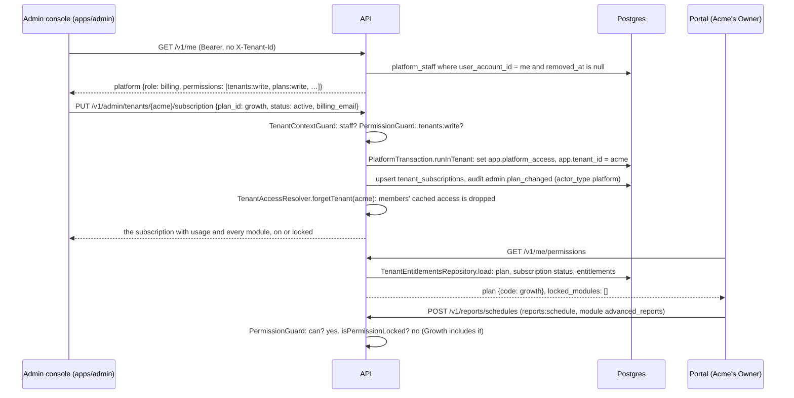

# Module 9: the admin console and plans

Modules 1 to 8 built everything a charge point operator (a tenant) uses. Nothing so far let **Wattwisely itself** run the platform: a tenant was created by SQL, there were no plans, and every tenant had every feature. This module adds the **admin console** at `admin.<domain>`, a separate Angular app for **Wattwisely staff**, and the **plan catalogue** behind it: plans with monthly fees, connector and user limits and the modules they include; add-ons sold on top; per-tenant switches that turn a module on as an add-on, a trial or an exception, or take one away; staff roles for the console; and the tenant lifecycle (create with a first Owner, suspend, reactivate, delete). The portal learns which modules the plan leaves **locked** and gets a read-only **Plan** page under Settings.

Stories covered: a Wattwisely administrator creates "Volt Hotels" on the Starter plan and invites its first Owner, who gets the e-mail from module 2 and lands in a working portal; a billing colleague moves Acme Charging to Growth and adds the Load management add-on; an Owner at Acme sees "Advanced reports: in your plan" on the Plan page and a Technician's call to a locked module is refused with "Advanced reports is not part of your plan. Ask Wattwisely to add it."; Acme's 26th connector is refused on a 25-connector plan with a sentence that says so, while chargers that report an extra connector themselves are never blocked; support suspends a tenant that stopped paying, its team can look but change nothing, and thirty days later an administrator deletes it after typing its short name; an administrator adds a colleague by e-mail before they ever logged in, and cannot remove the last administrator; a tenant's Owner cannot open the console, and a staff member cannot open a tenant's data in the portal unless invited to it; everything staff do is in the audit log, per tenant and platform-wide.

## What changed since module 8

| Before (module 8)                                                      | Now (module 9)                                                                                                                                                                                                                                       |
| ---------------------------------------------------------------------- | ---------------------------------------------------------------------------------------------------------------------------------------------------------------------------------------------------------------------------------------------------- |
| Tenants were inserted by `seed-demo.sh` or by hand                     | `apps/admin`: tenants are created, changed, suspended, reactivated and deleted from the console; `POST /v1/admin/tenants` also invites the first Owner                                                                                               |
| Every tenant had every feature                                         | `plans`, `addons`, `tenant_subscriptions`, `tenant_entitlements`: a tenant has the core modules plus what its plan includes, plus add-ons, trials and overrides set by staff; `PermissionGuard` answers 403 `module_not_in_plan` for a locked module |
| No limits                                                              | `PlanLimits`: a plan's user limit is checked when inviting, its connector limit when adding a connector by hand; 403 `plan_user_limit` / `plan_connector_limit`                                                                                      |
| `is_platform_staff` on `/v1/me` came from a Keycloak realm role        | `platform_staff` in Postgres is the source of truth: `/v1/me` carries `platform: {role, permissions}`; `RouteAccess.platform('tenants:write')` guards admin routes and the tenant header is ignored on them                                          |
| Row-level security knew tenants, users, invitations, chargers, drivers | A sixth session setting, `app.platform_access`, lets staff (through `DatabaseSession.forPlatform` and `forPlatformInTenant`) read every tenant, write the catalogue and act inside one tenant; `tenants` itself is now under row-level security      |
| `GET /v1/me/permissions` listed roles and permissions                  | It also carries `plan` and `locked_modules`; `GET /v1/roles/permissions` marks each permission with its `module` and `is_locked`, so the role editor can grey them out                                                                               |
| Settings had Branding                                                  | Settings also has Plan (`/settings/plan`, `GET /v1/subscription`): the plan, usage against its limits, every module on or locked, add-on prices                                                                                                      |
| Keycloak had the `wattwisely-portal` client                            | Also `wattwisely-admin` for the console (same PKCE flow, no secret); `up.sh` adds it to a realm imported before this module                                                                                                                          |
| The audit log was per tenant                                           | `actor_type` gains `platform`; `tenant_id` may be null for catalogue and staff changes; `GET /v1/admin/audit-log` reads across tenants                                                                                                               |

## The flow at a glance



## Design decisions for M1

| Decision                                                                                                                                                                                                                                                                                                                                                                                                                                                                                                                 |
| ------------------------------------------------------------------------------------------------------------------------------------------------------------------------------------------------------------------------------------------------------------------------------------------------------------------------------------------------------------------------------------------------------------------------------------------------------------------------------------------------------------------------ |
| **Staff live in the database, not in Keycloak.** `platform_staff` says who may use the console and with which role; Keycloak only says who someone is. The console can add a colleague by e-mail before they ever logged in (the account is matched at first login, as module 2 does for invitations), removal takes effect within the 30 seconds of `PlatformAccessResolver`'s cache, and no realm role needs editing by hand                                                                                           |
| **Four staff roles, fixed in code** (`PlatformRoleCatalog`): admin (everything), billing (tenants, plans, read staff and the audit log), support (tenants, read plans), viewer (read only). Nine platform permissions, in `PlatformPermissionCatalog`. Custom staff roles are not worth a table at this size                                                                                                                                                                                                             |
| **A module is a bundle of permissions** (`ModuleCatalog`). Core modules are always on. `advanced_reports`, `custom_roles` and `api_keys` are plan modules; `load_management` and `messaging_charging` are add-ons. `TenantEntitlements` decides per module: an override wins, then a current trial or add-on, then the plan (while the subscription is not cancelled), then "locked". A locked module's permissions stay on the role; the guard refuses with 403 `module_not_in_plan` and the portal greys the pages out |
| **The tenant's cached access carries its entitlements.** `TenantAccess` (module 2) now holds a `TenantEntitlements`; the guard needs no second query. When staff change a plan or a module, `PlatformTransaction.runInTenant` drops that tenant's entries from the cache after the commit, so the change reaches every member on their next request                                                                                                                                                                      |
| **Limits count what people add by hand.** `PlanLimits.ensureUserRoom` runs on an invitation, `ensureConnectorRoom` on `POST /v1/chargers/{id}/connectors`. Connectors a charger reports itself (module 4) are never refused: the charger is already on the wall. The console shows the usage in red when it is over the limit, which is a conversation, not an outage                                                                                                                                                    |
| **Suspension is read-only, not a shutdown.** Module 2's `tenant_suspended` rule already made every writing route refuse; this module gives it a button, a reason in the audit log and `suspended_at`. Charging keeps working: a driver at a plug should not pay for an operator's unpaid invoice                                                                                                                                                                                                                         |
| **Deletion is a state, thirty days after suspension, and keeps the short name.** `POST /v1/admin/tenants/{id}/delete` needs the slug typed back and sets `status: cancelled` and `deleted_at`; nobody can log in to it afterwards. The rows stay for the retention period and the slug stays taken, so QR codes printed with it can never open another operator's page. Purging the data is an operations job in a later module                                                                                          |
| **The plan catalogue is small and editable.** Four launch plans are seeded (Flex, Starter, Growth, Enterprise) with fees in minor units, basis points for the revenue share, nullable limits for "unlimited", and the plan modules as a JSON list validated against `ModuleCatalog`. Prices on a plan or an add-on are what new tenants pay; the invoicing module reads them, this one only stores them                                                                                                                  |
| **The admin console is its own app and its own Keycloak client**, not a section of the portal: a different colour so staff always know where they are, no tenant header, a smaller attack surface for tenant users (the portal never loads admin code), and `admin.<domain>` can be limited to an office network in Caddy. It reuses the portal's plumbing file by file (runtime config, auth, problem details)                                                                                                          |
| **Staff act inside a tenant with that tenant's rules.** `DatabaseSession.forPlatformInTenant` sets both `app.platform_access` and `app.tenant_id`, so inviting an Owner from the console runs module 2's `InvitationSaver` unchanged and lands in that tenant's audit log, with `actor_type: platform`                                                                                                                                                                                                                   |
| **The tenant's own view of its plan is a separate endpoint** (`GET /v1/subscription`, `settings:read`) that leaves out the staff notes. One `SubscriptionDescriber` builds both views                                                                                                                                                                                                                                                                                                                                    |

## Read the code in this order

### 1. The database: `packages/db`

| Step | File                                                                           | What to look at                                                                                                                                                                                                                                            |
| ---- | ------------------------------------------------------------------------------ | ---------------------------------------------------------------------------------------------------------------------------------------------------------------------------------------------------------------------------------------------------------- |
| 1    | `src/schema/plans.table.ts`, `addons.table.ts`                                 | The catalogue: fees, limits, `module_keys`, `is_active`, `version`; visible to everyone logged in, written only with platform access                                                                                                                       |
| 2    | `src/schema/tenant-subscriptions.table.ts`, `tenant-entitlements.table.ts`     | One subscription per tenant; one row per switched module with its `source` (addon, trial, override), `is_enabled` and `ends_at`. A tenant reads its own rows, staff read and write all                                                                     |
| 3    | `src/schema/platform-staff.table.ts`, `row-level-security.ts`                  | Who is staff; `isPlatformAccess()` reads `app.platform_access`; a person sees their own staff row, staff see all                                                                                                                                           |
| 4    | `src/schema/tenants.table.ts`, `audit-log.table.ts`                            | `tenants` under row-level security with `suspended_at`; platform policies on the audit log                                                                                                                                                                 |
| 5    | `src/client/database-session.ts`, `transaction-runner.ts`                      | `forPlatform(userAccountId)` and `forPlatformInTenant(tenantId, userAccountId)`; the sixth `set_config`                                                                                                                                                    |
| 6    | `migrations/0013_admin_portal_plans.sql`, `0014_admin_portal_plans_grants.sql` | The tables and policies; grants for `wattwisely_app`; the `platform_tenant_overview` view (members, invited, sites, chargers, AC and DC connectors, last session per tenant); the four plans, two add-ons and the module permissions each system role gets |
| 7    | `src/testing/test-platform.ts`                                                 | `TestPlatform`: staff, subscriptions and entitlements for tests, and the seeded plan ids                                                                                                                                                                   |

### 2. The API, shared parts: `apps/api/src/common`

| Step | File                                                                                                  | What to look at                                                                                                                                                                                     |
| ---- | ----------------------------------------------------------------------------------------------------- | --------------------------------------------------------------------------------------------------------------------------------------------------------------------------------------------------- |
| 8    | `permissions/module-catalog.ts`, `module-permissions.ts`, `permission-catalog.ts`                     | Every module with its kind and permissions; the six module permissions join the catalogue; `ModuleCatalog.moduleOf(permissionKey)`                                                                  |
| 9    | `entitlements/tenant-entitlements.ts`, `tenant-entitlements.repository.ts`, `plan-limits.ts`          | The rules: `isModuleEnabled`, `isPermissionLocked`, `sourceOf`, `lockedModuleKeys`; loading plan, status and entitlements in one go; the two limit checks                                           |
| 10   | `platform/platform-permission-catalog.ts`, `platform-role-catalog.ts`, `platform-access.ts`           | Nine platform permissions, four roles, and `PlatformAccess.can`                                                                                                                                     |
| 11   | `platform/platform-access.resolver.ts`, `platform-transaction.ts`                                     | Staff lookup with a 30-second cache (also of "not staff"); `run` and `runInTenant`, which drops the tenant's cached access after the commit                                                         |
| 12   | `auth/route-access.decorator.ts`, `tenant/tenant-context.guard.ts`, `permissions/permission.guard.ts` | `RouteAccess.platform(permission)`: the context guard resolves staff instead of a tenant; the permission guard checks the platform permission, or the tenant one plus the plan lock plus suspension |
| 13   | `tenant/tenant-access.ts`, `tenant-access.resolver.ts`, `cache/expiring-cache.ts`                     | `TenantAccess` carries `entitlements`; `forgetTenant`; `deleteBySuffix`                                                                                                                             |
| 14   | `audit/audit.recorder.ts`                                                                             | `actor_type: platform` when staff act; an explicit `tenantId` (null for catalogue and staff changes)                                                                                                |

### 3. The API, the modules: `apps/api/src/modules`

| Step | File                                                                                                                                                       | What to look at                                                                                                                                                                                |
| ---- | ---------------------------------------------------------------------------------------------------------------------------------------------------------- | ---------------------------------------------------------------------------------------------------------------------------------------------------------------------------------------------- |
| 15   | `plans/plans.service.ts`, `plan-columns.ts`, `addons.service.ts`, `admin-plans.controller.ts`, `admin-addons.controller.ts`, `admin-modules.controller.ts` | The catalogue endpoints; a plan's module list validated against the gated modules and kept in catalogue order; `plans.plan_created`, `plan_changed`, `addon_changed` in the platform audit log |
| 16   | `subscription/subscription.describer.ts`, `tenant-overview.repository.ts`, `subscriptions.repository.ts`, `subscription.controller.ts`                     | One description of a tenant's plan for both the tenant (`GET /v1/subscription`) and staff; usage from the view; `TenantModuleDto.listFor` marks every module                                   |
| 17   | `admin/tenants/tenant-creation.service.ts`, `tenant-creator.ts`, `owner-inviter.ts`, `tenant-slug.ts`                                                      | Create: the slug from the name unless given, the subscription, the first Owner invited through module 2's saver and mailer, as "Wattwisely"                                                    |
| 18   | `admin/tenants/admin-tenants.service.ts`, `tenant-lifecycle.service.ts`, `tenant-deletion.policy.ts`                                                       | List with search, status and plan filters; edit with `If-Match`; suspend, reactivate and delete with their rules and audit actions                                                             |
| 19   | `admin/tenants/admin-tenant-plan.service.ts`, `tenant-plan.writer.ts`, `tenant-entitlements.writer.ts`, `admin-owners.service.ts`                          | Set the subscription; switch a module on or off with a source; reset it to the plan; list and invite Owners                                                                                    |
| 20   | `admin/staff/admin-staff.service.ts`, `staff.writer.ts`, `platform-staff.repository.ts`                                                                    | Add by e-mail (creating the account if needed, restoring a removed row), change role, remove; never the last admin; the resolver's cache is dropped                                            |
| 21   | `admin/overview/admin-overview.repository.ts`, `admin/audit/admin-audit-log.service.ts`                                                                    | Counts for the first page; the platform-wide audit log with an optional `tenant_id` filter                                                                                                     |
| 22   | `me/me.service.ts`, `me/dto/me-response.dto.ts`, `me/dto/my-permissions.dto.ts`, `roles/dto/permission.dto.ts`                                             | `platform` on `/v1/me`; `plan` and `locked_modules` on `/v1/me/permissions`; `module` and `is_locked` on each permission                                                                       |
| 23   | `team/invitation.saver.ts`, `assets/connectors/connectors.service.ts`                                                                                      | Where the two limits are checked                                                                                                                                                               |

### 4. The admin console: `apps/admin/src/app`

| Step | File                                                                                                                   | What to look at                                                                                                                                      |
| ---- | ---------------------------------------------------------------------------------------------------------------------- | ---------------------------------------------------------------------------------------------------------------------------------------------------- |
| 24   | `app.config.ts`, `app.routes.ts`, `core/auth/api-auth.interceptor.ts`                                                  | The portal's start-up without the tenant parts; `AuthGuard` then `StaffGuard`; a Bearer token and never `X-Tenant-Id`                                |
| 25   | `core/staff/staff-context.service.ts`, `staff.guard.ts`                                                                | `/v1/me` once; `isStaff`, `can(permission)`; non-staff land on `/not-staff`, a page named in `data.permission` needs that permission                 |
| 26   | `core/api/*.service.ts`, `core/api/models/*`                                                                           | One service per area of the API; the models mirror the DTOs                                                                                          |
| 27   | `layout/shell.component.*`, `features/overview/*`                                                                      | The frame in violet, the role in the bar; the first page's tiles and plan uptake                                                                     |
| 28   | `features/tenants/tenants.component.*`, `new-tenant-dialog.component.*`                                                | Search and filters, the list, the creation dialog (plan, trial, first Owner, billing contact)                                                        |
| 29   | `features/tenants/tenant.component.*`, `tenant.store.ts`, `tenant-plan.component.*`, `subscription-dialog.component.*` | One tenant: the facts, the Actions menu (edit, suspend, reactivate, delete with the slug typed back), the Plan & billing card and its dialog         |
| 30   | `features/tenants/tenant-modules.component.*`, `module-dialog.component.ts`, `tenant-owners.component.ts`              | Every module with why it is on or locked; switch one on as add-on, trial or override, off as override, or back to the plan; Owners and an invitation |
| 31   | `features/plans/plans.component.*`, `plan-dialog.component.*`, `plan-form.ts`, `addon-dialog.component.ts`             | The catalogue, a plan's fees as people write them (`Money`), limits where empty means unlimited, the plan modules as checkboxes; add-on prices       |
| 32   | `features/staff/*`, `features/audit-log/*`, `features/not-staff/*`                                                     | Colleagues and their roles; the platform-wide log with a tenant filter; the page everyone else sees                                                  |

### 5. The portal: `apps/portal/src/app`

| Step | File                                                                           | What to look at                                                                                          |
| ---- | ------------------------------------------------------------------------------ | -------------------------------------------------------------------------------------------------------- |
| 33   | `core/permissions/permissions.service.ts`, `core/api/models/my-permissions.ts` | `plan`, `lockedModules`, `isModuleLocked(key)` for later modules' pages to grey themselves out           |
| 34   | `features/settings/plan.component.*`, `core/api/subscription-api.service.ts`   | Settings, Plan: the plan, two usage meters, the module list with add-on prices                           |
| 35   | `layout/shell.component.*`, `core/config/runtime-config.ts`                    | "Plan" in the navigation; "Admin console" in the user menu for staff when `adminUrl` is in `config.json` |

### 6. Deployment: `deploy`

| Step | File                                                                               | What to look at                                                                                                           |
| ---- | ---------------------------------------------------------------------------------- | ------------------------------------------------------------------------------------------------------------------------- |
| 36   | `docker-compose.yml`, `caddy/Caddyfile`, `.env.example`                            | The `admin` service at `ADMIN_HOST`; the API's CORS and the portal's `PORTAL_ADMIN_URL`; `ADMIN_URL` for the realm import |
| 37   | `keycloak/realm/wattwisely-realm.json`, `scripts/lib/keycloak.sh`, `scripts/up.sh` | The `wattwisely-admin` client; `ensure_admin_client` adds it to a realm that was imported before this module              |
| 38   | `scripts/add-platform-admin.sh`, `scripts/seed-demo.sh`                            | The first administrator on a server; two demo staff and a plan for each demo tenant                                       |

### 7. Endpoints

All `/v1/admin/…` routes need a Wattwisely staff role (403 `not_platform_staff` otherwise) and ignore `X-Tenant-Id`. Writes with `If-Match` answer 428 without it and 409 `version_conflict` when someone else saved first.

| Endpoint                                                    | Permission             | Notes                                                                                                                                                                                                                   |
| ----------------------------------------------------------- | ---------------------- | ----------------------------------------------------------------------------------------------------------------------------------------------------------------------------------------------------------------------- |
| `GET /v1/admin/overview`                                    | `tenants:read`         | Tenants by status, connectors (AC and DC), sites, chargers, tenants per plan, staff count                                                                                                                               |
| `GET /v1/admin/tenants`                                     | `tenants:read`         | `q` (name or slug), `status`, `plan` (code), `cursor`, `limit`; each row with its plan, subscription status and usage                                                                                                   |
| `POST /v1/admin/tenants`                                    | `tenants:write`        | `name`, `plan_id`; optional `slug`, `region`, `payment_mode`, `subscription_status` (active or trialing), `trial_ends_at`, `owner_email`, `billing_email`, `billing_name`. 409 `tenant_slug_taken`, 409 `plan_inactive` |
| `GET /v1/admin/tenants/{id}`                                | `tenants:read`         | The tenant with `subscription` (usage, modules, staff notes), `owners`, `can_delete_from`, `version`                                                                                                                    |
| `PATCH /v1/admin/tenants/{id}`                              | `tenants:write`        | `name`, `region`, `payment_mode`; `If-Match`                                                                                                                                                                            |
| `POST /v1/admin/tenants/{id}/suspend`                       | `tenants:suspend`      | `{reason}`; `If-Match`; 409 `tenant_status_conflict` when not active                                                                                                                                                    |
| `POST /v1/admin/tenants/{id}/reactivate`                    | `tenants:suspend`      | `{reason}`; `If-Match`; 409 `tenant_status_conflict` when not suspended                                                                                                                                                 |
| `POST /v1/admin/tenants/{id}/delete`                        | `tenants:delete`       | `{confirm_slug, reason}`; `If-Match`; 400 `confirmation_mismatch`, 409 `tenant_deletion_too_early` before 30 days of suspension; afterwards every change answers 409 `tenant_deleted`                                   |
| `PUT /v1/admin/tenants/{id}/subscription`                   | `tenants:write`        | `plan_id`, `status`, `trial_ends_at`, `billing_email`, `billing_name`, `billing_reference`, `notes`; 409 `plan_inactive` for a plan no longer sold; audit `admin.plan_changed` in the tenant                            |
| `PUT /v1/admin/tenants/{id}/modules/{key}`                  | `tenants:write`        | `source` (addon, trial, override), `is_enabled` (false only with override), `ends_at`, `note`; only plan modules and add-ons; audit `admin.module_changed`                                                              |
| `DELETE /v1/admin/tenants/{id}/modules/{key}`               | `tenants:write`        | The module follows the plan again; audit `admin.module_reset`                                                                                                                                                           |
| `GET /v1/admin/tenants/{id}/owners`                         | `tenants:read`         | Active and invited Owners                                                                                                                                                                                               |
| `POST /v1/admin/tenants/{id}/owners/invites`                | `tenants:write`        | `{email}`; module 2's invitation, sent as "Wattwisely"; `is_email_sent`; 409 `already_member`                                                                                                                           |
| `GET /v1/admin/plans`, `GET /v1/admin/plans/{id}`           | `plans:read`           | Every plan with `tenant_count`                                                                                                                                                                                          |
| `POST /v1/admin/plans`, `PATCH /v1/admin/plans/{id}`        | `plans:write`          | `code` (create only), `name`, `description`, `currency`, the three fees, `revenue_share_bps`, `connector_limit`, `user_limit` (null = unlimited), `module_keys`, `is_active`, `sort_order`; 409 `plan_code_taken`       |
| `GET /v1/admin/addons`, `PATCH /v1/admin/addons/{key}`      | `plans:read` / `write` | Price, `pricing_unit` (per_connector, per_site, per_tenant), `is_active`; `If-Match`                                                                                                                                    |
| `GET /v1/admin/modules`                                     | `plans:read`           | The module catalogue with each module's permissions                                                                                                                                                                     |
| `GET /v1/admin/staff`, `GET /v1/admin/staff/roles`          | `staff:read`           | Colleagues with their roles; the four roles and their permissions                                                                                                                                                       |
| `POST /v1/admin/staff`                                      | `staff:manage`         | `{email, role}`; 409 `already_staff`                                                                                                                                                                                    |
| `PATCH /v1/admin/staff/{id}`, `DELETE /v1/admin/staff/{id}` | `staff:manage`         | `{role}`; `If-Match`; 409 `last_admin`                                                                                                                                                                                  |
| `GET /v1/admin/audit-log`                                   | `platform_audit:read`  | Module 2's filters plus `tenant_id`; entries carry `tenant_id` (null for platform actions)                                                                                                                              |
| `GET /v1/subscription`                                      | `settings:read`        | The tenant's own view: plan, status, billing contact, usage, modules (no staff notes)                                                                                                                                   |
| `GET /v1/me`, `GET /v1/me/permissions`                      | any login / member     | `platform` (role and permissions, or null); `plan` and `locked_modules`                                                                                                                                                 |

A tenant route whose permission belongs to a locked module answers 403 `module_not_in_plan`. Inviting past the user limit answers 403 `plan_user_limit`; adding a connector past the connector limit 403 `plan_connector_limit`.

## Running it

```sh
cd deploy
./scripts/up.sh --build         # adds ADMIN_HOST to an older .env and the wattwisely-admin client to Keycloak
./scripts/seed-demo.sh          # admin@wattwisely.test and support@wattwisely.test; Acme on Growth + Load management, Volt on Starter
```

Open <http://admin.localhost> as `admin@wattwisely.test` (password `Wattwisely-demo-1`, authenticator app at first login): the overview, then Tenants, Acme Charging. Change its plan to Starter and open <http://portal.localhost> as `owner@acme.test`, Settings, Plan: Advanced reports is now locked and the connector meter is red (Acme has five connectors on a plan with no limit, so try Flex, which allows ten, then Starter's 25). Back in the console, switch Advanced reports on as a trial until next month and the portal shows it "On trial". Suspend Acme with a reason and the portal's banner says the account is read-only; reactivate it. Create a tenant with an Owner e-mail and find the invitation in Mailpit at <http://localhost:8025>. Log in as `owner@acme.test` at <http://admin.localhost> and see the "not staff" page; as `support@wattwisely.test` the Plans page is read-only and there is no Staff page.

On a real server the first administrator is added from the shell, `./scripts/add-platform-admin.sh ada@wattwisely.com "Ada Admin"`; everyone after that from the console's Staff page. With `npm start` the console runs at <http://localhost:4400> and reads `apps/admin/public/config.json`; the API's `CORS_ORIGINS` in `apps/api/.env.example` already allows it.

## Tests

| Test                                                                                                                           | What it proves                                                                                                                                                                                                                                    |
| ------------------------------------------------------------------------------------------------------------------------------ | ------------------------------------------------------------------------------------------------------------------------------------------------------------------------------------------------------------------------------------------------- |
| `apps/api/src/common/entitlements/tenant-entitlements.spec.ts`, `common/permissions/module-catalog.spec.ts`                    | Core always on; plan modules follow the plan while the subscription lives; add-ons, trials with an end date and overrides in their order of precedence; a permission's module                                                                     |
| `apps/api/src/common/permissions/permission.guard.spec.ts`                                                                     | Platform routes need staff and the right platform permission; a locked module's permission is refused with `module_not_in_plan`; suspension still only blocks writes                                                                              |
| `apps/api/src/common/permissions/permission.flow.spec.ts`                                                                      | Every route still declares its access (now also `RouteAccess.platform`); `plan` and `locked_modules` on `/v1/me/permissions`; a module locked until staff switch it on                                                                            |
| `apps/api/src/common/database/row-level-security.spec.ts`                                                                      | A tenant cannot change the `tenants` row; platform access can, but still sees no tenant data without `app.tenant_id`; a tenant sees only its own subscription, a staff member their own row                                                       |
| `apps/api/src/modules/plans/plans.flow.spec.ts`                                                                                | The four seeded plans with tenant counts, the add-ons and the module catalogue; create and change a plan with `If-Match`; a taken code and an unknown module refused; add-on prices; every catalogue change as a platform action in the audit log |
| `apps/api/src/modules/admin/admin-tenants.flow.spec.ts`                                                                        | Staff list tenants, nobody else does; a tenant created with a first Owner who accepts the e-mail and logs in; refusals (taken slug, inactive plan, unknown module); plan and module changes seen by the tenant at once                            |
| `apps/api/src/modules/admin/admin-tenant-lifecycle.flow.spec.ts`                                                               | User and connector limits in use; suspend (read-only for members), delete after 30 days with the slug typed back, reactivate, and the wrong transitions refused                                                                                   |
| `apps/api/src/modules/admin/admin-staff.flow.spec.ts`                                                                          | `/v1/me` tells the console the role; a colleague added by e-mail before logging in; role changes with `If-Match`; the last admin stays; access ends on removal; the platform-wide audit log filtered by tenant                                    |
| `apps/api/src/modules/admin/tenants/tenant-slug.spec.ts`, `tenant-deletion.policy.spec.ts`                                     | Slugs from names; the thirty-day rule                                                                                                                                                                                                             |
| `apps/admin/src/app/core/staff/staff-context.service.spec.ts`, `features/plans/plan-form.spec.ts`, `shared/limit.pipe.spec.ts` | The console knows a role and its permissions, and that everyone else is not staff; fees and percentages shown the way people write them, an empty limit as unlimited; "7 / 25"                                                                    |
| `apps/portal/src/app/core/permissions/permissions.service.spec.ts`                                                             | The portal knows the plan and which modules are locked                                                                                                                                                                                            |

## Not in this module

| What                                                                                                     | Where                                                                                              |
| -------------------------------------------------------------------------------------------------------- | -------------------------------------------------------------------------------------------------- |
| Invoices, payment of the platform fees, Stripe Billing, dunning                                          | The invoicing module: it reads the plan and add-on prices stored here and the usage view           |
| The pages behind `advanced_reports`, `custom_roles`, `api_keys`, `load_management`, `messaging_charging` | Their own modules; the lock, the permissions and the Plan page are ready for them                  |
| Purging a deleted tenant's data, exports before deletion                                                 | An operations job once the retention policy is agreed                                              |
| Self-service plan changes and sign-up from the portal                                                    | Later; today a plan is a conversation with Wattwisely, which is what the M1 customers expect       |
| Limiting the console to an office network or a VPN                                                       | A `not remote_ip` rule on the `ADMIN_HOST` block in the Caddyfile, when there is a network to name |
| Impersonating a tenant user from the console                                                             | The support tooling module, with the tenant's consent recorded                                     |
